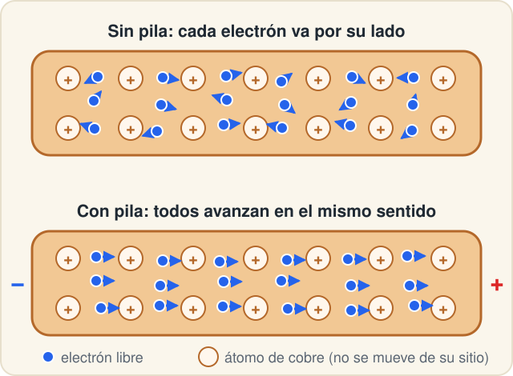

Vicente le hizo a Marina una pregunta que parece de niños: *¿qué viaja por un cable?* Y Marina, que lleva treinta y un años usando enchufes, no supo qué contestar. Esta lección la contesta.

Al terminar sabrás tres cosas: de qué está hecho un cable por dentro, qué es exactamente lo que se mueve cuando decimos que «pasa la corriente» y por qué una bombilla necesita dos cables y no uno. Hoy no hay ni una fórmula. Hay una imagen, y conviene que te quede muy clara, porque todo lo demás del curso se apoya en ella.

## Lo más pequeño: el átomo

Todo lo que puedes tocar —el cobre de un cable, el plástico que lo recubre, tu mano— está hecho de piezas diminutas llamadas **átomos**. Para lo que nos interesa, un átomo tiene dos partes:

- Un **núcleo** en el centro, pesado y quieto. Dentro del núcleo están los **protones**.
- Alrededor del núcleo, unas partículas muchísimo más ligeras y movedizas: los **electrones**.

Protones y electrones tienen una propiedad que se llama **carga eléctrica**. No hace falta saber qué es «en el fondo» (nadie lo sabe: es una propiedad básica de la materia, igual que el peso). Basta con saber cómo se comporta, y se comporta de una manera muy simple:

- Hay dos tipos de carga. A la de los protones la llamamos **positiva (+)** y a la de los electrones, **negativa (−)**. Son solo nombres: podrían haberse llamado «roja» y «azul».
- **Cargas de distinto tipo se atraen. Cargas del mismo tipo se repelen.**

De esa segunda regla sale toda la electricidad. Tradúcela así: *a un electrón le atrae lo positivo y le espanta lo negativo*. Si le dejas, se irá hacia donde haya carga positiva y huirá de donde haya otros electrones amontonados.

En condiciones normales un átomo tiene tantos protones como electrones. Sus cargas se compensan y el átomo, visto desde fuera, es **neutro**: ni atrae ni repele. Por eso no notas nada eléctrico al tocar una mesa, aunque esté hecha de una cantidad inimaginable de cargas.

## El secreto de los metales: electrones sueltos

En la mayoría de los materiales, cada electrón está bien sujeto a su átomo y no se va a ninguna parte. Los metales son distintos. En un metal como el cobre, el electrón más exterior de cada átomo está tan flojo que se suelta y vaga por todo el trozo de metal sin pertenecer a ningún átomo en concreto. A esos electrones se les llama **electrones libres**.

Así que un cable de cobre, por dentro, es esto: una estructura fija de átomos, que no se mueven de su sitio, y entre ellos una multitud de electrones libres que sí pueden moverse.

Y son una multitud difícil de imaginar. En un solo centímetro de cable de casa hay más de **mil trillones** de electrones libres (un 1 seguido de 21 ceros).

De aquí sale la primera idea importante del curso, y es justo la que casi nadie tiene:

> **Un cable no es un tubo vacío que se llena de electricidad cuando lo conectas. Es un tubo que ya está lleno de electrones, siempre, también cuando está guardado en un cajón.**

La pila no va a fabricar electrones ni a meterlos en el cable. Los electrones ya están ahí. Lo que hará la pila es otra cosa, que veremos enseguida.

Según lo sueltos que tengan los electrones, los materiales se reparten en tres grupos, y el examen los pregunta:

- **Conductores:** tienen cargas que pueden moverse y dejan pasar la corriente. Los mejores son los metales: cobre, plata, aluminio, oro, hierro. También conducen, aunque peor, el agua con sales disueltas y el cuerpo humano, que es sobre todo agua salada. Por eso la electricidad puede ser peligrosa.
- **Aislantes:** no tienen electrones libres; todos están sujetos. No dejan pasar la corriente: plástico, goma, vidrio, cerámica, madera seca, aire seco.
- **Semiconductores:** un caso intermedio y muy especial, como el silicio. Conducen poco, pero se puede controlar cuánto. Con ellos se fabrican los diodos y los transistores, que conocerás en la sección 4.

Con esto ya entiendes dos objetos de la mesa de Vicente. El cable es cobre por dentro (para que los electrones puedan moverse) y plástico por fuera (para que el cobre no toque otros metales ni tu mano: si los tocara, los electrones tendrían un camino por donde no deben ir). Y el destornillador tiene el mango de plástico por la misma razón.

## Agitarse no es avanzar

Los electrones libres de un cable guardado en un cajón no están quietos. Se mueven sin parar, pero cada uno hacia un lado, al azar, chocando y rebotando. Como unos van hacia la izquierda y otros hacia la derecha, en conjunto no hay ningún desplazamiento: el resultado neto es cero. Es el patio del colegio antes de que suene la palmada del maestro, como decía Vicente.

Hay **corriente eléctrica** cuando algo consigue que todos esos electrones, además de agitarse, avancen poco a poco **en la misma dirección**.

Quédate con la definición, que es una de las preguntas del examen de esta sección:

> **Corriente eléctrica:** movimiento ordenado de cargas eléctricas (en un cable, de electrones libres) a lo largo de un conductor.

## Por qué hacen falta dos cables

Aquí viene el experimento que Vicente hizo con la pila y la bombilla. Primero unió con un solo cable un extremo de la pila con la bombilla. No pasó nada.

—Pero si la pila ya está tocando la bombilla —protestó Marina—. ¿No debería llegarle algo?

—¿Y adónde van los electrones después de llegar a la bombilla? —contestó Vicente.

Esa es la clave. Los electrones no pueden amontonarse en la bombilla: se repelen entre sí, y en cuanto se apretaran un poco, empujarían hacia atrás a los que vienen detrás y todo se detendría al instante. Para que haya un movimiento continuo, los electrones que llegan a la bombilla necesitan una salida, y esa salida tiene que llevarlos de vuelta a la pila. Hace falta un camino cerrado, de ida y vuelta, sin interrupciones. Ese camino cerrado se llama **circuito** (la palabra viene de «círculo», y no por casualidad).

Vicente añadió el segundo cable, de la bombilla al otro extremo de la pila, y la bombilla se encendió.

### La imagen que vamos a usar toda la sección: el circuito de agua

Para imaginar un circuito eléctrico vamos a usar una comparación que nos acompañará durante toda la sección: un circuito cerrado de agua.

Imagina una tubería que forma un anillo cerrado y está llena de agua, como la de una calefacción. En un punto del anillo hay una **bomba** que empuja el agua. En otro punto hay una **rueda de paletas**, como la de un molino: el agua, al pasar, la hace girar, y con ese giro se puede hacer un trabajo, por ejemplo moler grano. Después de la rueda, el agua vuelve a la bomba por el otro tramo de tubería. Fíjate en tres detalles:

1. Las tuberías están **siempre llenas** de agua, funcione o no la bomba.
2. La bomba **no fabrica agua**: solo hace circular la que ya hay.
3. El agua **no se gasta** en la rueda. Sale toda la que entra. Lo que se queda en la rueda es el empuje que el agua traía: llega con presión y sale casi sin ella.

Un circuito eléctrico funciona igual:

| En el circuito de agua | En el circuito eléctrico |
|---|---|
| El agua que llena las tuberías | Los electrones libres que llenan los cables |
| La bomba, que la hace circular | La pila o la batería |
| Las tuberías | Los cables |
| La rueda de paletas, que el agua hace girar | La bombilla (o la emisora, o cualquier aparato) |
| Una llave que corta el paso | El interruptor |

¿Y qué pasa en la bombilla? Dentro tiene un hilo metálico finísimo, el filamento. Los electrones lo atraviesan con dificultad, chocando con sus átomos, y esos choques lo calientan tanto que se pone a brillar. Los electrones salen por el otro lado, todos, y siguen su camino hacia la pila. **La bombilla no consume electrones. Se queda con el empuje que la pila les había dado**, igual que la rueda se queda con el empuje del agua. Dedicaremos a esto la lección 3, porque es la confusión más extendida de toda la electricidad.

Toda comparación cojea en algún punto, y es honrado avisar de dónde cojea esta: si cortas una tubería, el agua se derrama por el suelo. Si cortas un cable, los electrones **no** se derraman: el aire es aislante y no pueden salir. Simplemente se detienen todos, en todo el circuito, a la vez. (Solo con un empuje eléctrico enorme el aire acaba cediendo y salta una chispa: es lo que ocurre en un rayo. Todo aislante tiene un límite.)

## Circuito abierto y circuito cerrado

Dos expresiones que vas a oír continuamente:

- **Circuito cerrado:** el camino está completo. Los electrones pueden dar la vuelta, hay corriente y la bombilla luce.
- **Circuito abierto:** el camino está interrumpido en algún punto (un interruptor, un cable suelto, un filamento roto). No hay corriente en **ninguna** parte del circuito.

Un **interruptor** es exactamente eso: una pieza que abre o cierra el camino a voluntad.

## Donde la gente se lía

- **«La pila está llena de electricidad y se va vaciando.»** No exactamente. La pila no es un depósito de electrones: es una bomba. Lo que guarda es energía química, que usa para empujar. Cuando decimos que una pila «se ha gastado», lo que ha perdido es la capacidad de empujar, no los electrones.
- **«La corriente sale de la pila, llega a la bombilla y allí se acaba.»** No. La corriente da la vuelta entera. Por el cable de vuelta pasan tantos electrones como por el de ida.
- **«Cerrado significa que no pasa.»** Cuidado, porque aquí el idioma juega en contra. Un grifo *cerrado* no deja pasar el agua, pero un circuito *cerrado* sí deja pasar la corriente, porque lo que está cerrado es el círculo. Y un circuito *abierto* es el que está cortado. Si lo piensas como «el círculo está completo» o «el círculo está roto», no te equivocarás.

## Compruébalo tú

Piensa cada respuesta antes de leer la solución. No hay cuentas: son para comprobar que tienes la imagen.

1. Tienes un trozo de cable de cobre suelto encima de la mesa, sin conectar a nada. ¿Tiene electrones libres dentro? ¿Hay corriente en él?
2. Aflojas un poco la tapa de una linterna y se apaga, aunque las pilas son nuevas. ¿Por qué?
3. El filamento de una bombilla se rompe. ¿Sigue pasando corriente por los cables que llegan hasta ella?
4. ¿Por qué los alicates de electricista tienen los mangos recubiertos de goma?

**Soluciones**

1. Sí, tiene electrones libres: los tiene siempre, porque son parte del cobre. Pero no hay corriente: se mueven al azar y nada los hace avanzar en una misma dirección.
2. Al aflojar la tapa se separa un contacto y el circuito queda abierto. Sin camino cerrado no hay corriente, por nuevas que sean las pilas.
3. No. Un circuito abierto en un punto está abierto entero: los electrones se detienen en todos los cables a la vez.
4. Porque la goma es un aislante: no tiene electrones libres y no deja que la corriente pase del metal de la herramienta a la mano.

## En una frase

Los cables están siempre llenos de electrones libres; hay corriente cuando una pila los hace circular todos en el mismo sentido, y solo pueden circular si el camino es un círculo completo: un circuito cerrado.

Falta lo más interesante: ¿qué hace exactamente la pila para ponerlos en marcha? Eso es la tensión, y es la lección siguiente.
