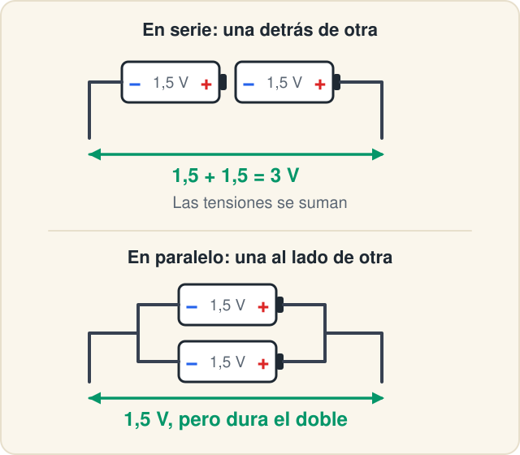
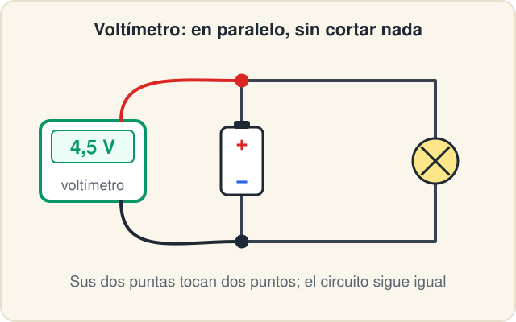

En la lección anterior quedó una pregunta en el aire. Los cables están llenos de electrones libres, pero esos electrones no van a ninguna parte por sí solos. ¿Qué hace la pila para ponerlos a circular?

La respuesta es la primera de las tres magnitudes de la electricidad: la **tensión**, que se mide en **voltios**. Al terminar esta lección sabrás qué significa de verdad que una batería sea «de 12 voltios», por qué la tensión siempre se mide entre dos puntos y por qué un pájaro puede posarse en un cable de alta tensión sin que le pase nada.

## Qué hay dentro de una pila

Una pila tiene dos extremos metálicos, que se llaman **bornes** o **polos**: uno marcado con **+** (positivo) y otro con **−** (negativo). Dentro hay unas sustancias químicas cuya reacción hace una sola cosa: **arranca electrones de un borne y los amontona en el otro**.

El resultado es un desequilibrio:

- En el borne **negativo** sobran electrones. Están apretados, y como se repelen entre sí, están deseando marcharse.
- En el borne **positivo** faltan electrones. Ese hueco los atrae.

Mientras la pila está sola, guardada en un cajón, los electrones del borne negativo no tienen por dónde ir al positivo y no pasa nada. Pero el desequilibrio está ahí, esperando.

En cuanto unes los dos bornes con un camino conductor —un cable, una bombilla, otro cable—, los electrones del lado negativo empujan a los electrones libres del cable, estos empujan a los siguientes, y toda la fila se pone en marcha hacia el borne positivo. La pila, por dentro, sigue reponiendo el desequilibrio: recoge los electrones que llegan al positivo y los devuelve al negativo. Por eso la corriente no se detiene a los pocos instantes: la pila es una bomba que no para de bombear.

Ese desequilibrio que empuja tiene nombre.

> **Tensión:** el empuje que una fuente da a los electrones para que circulen de un punto a otro. Se mide en **voltios (V)**.

(Llamamos **fuente** a cualquier cosa capaz de empujar: una pila, una batería, un enchufe, un panel solar.)

Encontrarás la tensión con tres nombres distintos, y los tres significan exactamente lo mismo: **tensión**, **voltaje** y **diferencia de potencial**. En las fórmulas se escribe con la letra **U** (en algunos libros, **V**).

## La tensión en el circuito de agua

Vuelve al circuito de agua de la lección anterior. La bomba consigue que el agua circule porque crea una **diferencia de presión**: a su salida el agua está más apretada que a su entrada, y por eso se mueve de un lado al otro a través de las tuberías y de la rueda.

- Una bomba floja crea poca diferencia de presión, y el agua circula con desgana.
- Una bomba potente crea mucha diferencia de presión, y empuja el agua con fuerza.

La tensión es eso mismo para los electrones: la **diferencia de presión eléctrica** entre los dos bornes de la pila. Una pila de 1,5 V empuja poco. Una batería de coche de 12 V empuja ocho veces más fuerte. Un enchufe de 230 V, más de ciento cincuenta veces más.

Algunos valores que conviene tener en la cabeza:

| Fuente | Tensión |
|---|---|
| Pila normal (AA, AAA) | 1,5 V |
| Batería de un móvil | unos 3,7 V |
| Pila de petaca, como la de Vicente (son tres pilas de 1,5 V en serie dentro de una funda) | 4,5 V |
| Batería de coche | 12 V (entre 12,6 y 12,8 V recién cargada) |
| Fuente de alimentación de una emisora (la caja que convierte la electricidad del enchufe en la que necesita el equipo) | 13,8 V |
| Enchufe de casa en Europa | 230 V |
| Líneas eléctricas de transporte | de 20.000 a 400.000 V |

Un detalle que te será útil: las emisoras de radioaficionado se alimentan a 13,8 V porque esa es la tensión que hay en la batería de un coche con el motor en marcha, mientras se está cargando. Así un mismo equipo sirve en casa y en el coche.

## La idea que más cuesta: la tensión es siempre entre dos puntos

Esta es la parte que hay que leer despacio.

La tensión no es algo que «tenga» un punto. Es una **diferencia** entre dos puntos. Cuando decimos que una batería es de 12 voltios, lo que estamos diciendo es que **entre** su borne positivo **y** su borne negativo hay una diferencia de 12 voltios.

Ocurre igual que con la altura. Si te digo que una montaña «mide 800 metros», la frase está incompleta: ¿800 metros desde dónde? Desde el nivel del mar, desde el pueblo que hay en su falda, desde el fondo del valle… Una altura es siempre una diferencia entre dos sitios. Y el agua de un río no baja porque esté «alta», sino porque hay **desnivel** entre un punto y el siguiente. Sin desnivel, el agua se queda quieta, esté a la altura que esté. (Desnivel y diferencia de presión son la misma idea vista de dos maneras: algo que es distinto en un punto y en otro, y que por eso pone las cosas en movimiento.)

Con los electrones pasa lo mismo: **solo se mueven entre dos puntos si entre esos dos puntos hay diferencia de tensión.** Si no hay diferencia entre ellos, no se mueven, por mucha tensión que tengan los dos respecto a un tercer punto.

Ahora ya puedes resolver el misterio del pájaro. El pájaro se posa en un cable que está a 20.000 voltios **respecto al suelo**. Pero el pájaro no toca el suelo: toca dos puntos del mismo cable, separados tres centímetros. Entre esos dos puntos tan cercanos de un mismo cable no hay prácticamente ninguna diferencia (en la lección 5 verás por qué), así que entre una pata y la otra la tensión es casi cero. Sin diferencia no hay empuje, y no circula corriente por el pájaro. Otra cosa sería que tocara a la vez ese cable y otro distinto, o el cable y la torre: entonces sí tendría miles de voltios de diferencia entre un extremo del cuerpo y el otro.

Por esa misma razón, para hablar cómodamente, en los aparatos se elige un punto de referencia y se le llama **cero voltios**. Ese punto se conoce como **masa** (en los coches y en muchas radios es el borne negativo de la batería, unido al chasis metálico). Cuando alguien dice «en este punto hay 5 voltios», siempre quiere decir «5 voltios respecto a masa». Es como decir «800 metros sobre el nivel del mar». (La masa no es exactamente lo mismo que la *toma de tierra* de los enchufes, aunque a menudo estén unidas; la toma de tierra es un asunto de seguridad y la veremos en la sección 10.)

## Puede haber tensión sin que haya corriente

Otra consecuencia que sorprende al principio: **la tensión existe aunque no circule nada.**

Piensa en la bomba del circuito de agua funcionando con la llave de paso cerrada. El agua no se mueve, pero la presión está ahí, empujando contra la llave. En cuanto la abras, el agua correrá.

Una pila guardada en un cajón tiene sus 1,5 V entre los bornes aunque no esté conectada a nada. Un enchufe tiene 230 V entre sus dos agujeros aunque no haya nada enchufado. La tensión es el empujón *disponible*. La corriente solo aparece cuando, además, hay un camino cerrado por el que circular.

Dicho en una línea, que te conviene memorizar:

> **En los circuitos de esta sección, la tensión es la causa y la corriente es el efecto.** Puede haber tensión sin corriente (una pila sin conectar), pero no corriente sin una tensión que la empuje.

## Juntar pilas: en serie y en paralelo

El mando de la tele lleva dos pilas de 1,5 V colocadas una a continuación de la otra, el + de una tocando el − de la siguiente. A esa forma de conectar, una detrás de otra en fila, se le llama **en serie**. Dos bombas en fila empujan el doble:

- **Pilas en serie: las tensiones se suman.** Dos pilas de 1,5 V dan 3 V. Cuatro dan 6 V.

Y aquí va un dato que casi nadie sabe: una batería de coche «de 12 voltios» son en realidad **seis** baterías pequeñas (se llaman *celdas* o *vasos*) de unos 2,1 V cada una, conectadas en serie dentro de la misma caja (6 × 2,1 = 12,6 V). La propia palabra *batería* viene de ahí: es un conjunto de elementos iguales puestos en fila, como una batería de cañones.

La otra forma de conectar es **en paralelo**: una al lado de la otra, uniendo todos los + por un lado y todos los − por otro. Dos bombas una al lado de la otra no empujan más fuerte, pero se reparten el trabajo:

- **Pilas en paralelo: la tensión es la misma que la de una sola, pero duran más.** Dos pilas en paralelo duran el doble, porque cada una solo tiene que aportar la mitad de la corriente. (En paralelo solo deben ponerse pilas iguales e igual de cargadas; si no, la más cargada se descarga sobre la otra.)

Las palabras «en serie» y «en paralelo» van a aparecer durante todo el curso. De momento quédate con la imagen: **en serie, en fila, una tras otra; en paralelo, lado a lado.**

## Cómo se mide: el voltímetro

La tensión se mide con un **voltímetro**. El polímetro de Vicente es, entre otras cosas, un voltímetro: basta girar su selector hasta la posición de voltios de corriente continua, que suele estar marcada con **V⎓** o con **DCV** (enseguida verás qué significa «continua»).

Como la tensión es una diferencia entre dos puntos, el voltímetro tiene dos puntas, una roja y una negra, y se usa tocando con cada una uno de los dos puntos. No hay que cortar ni desmontar nada: el circuito sigue como estaba y el voltímetro se coloca *al lado*, como un observador. Por eso se dice que **el voltímetro se conecta en paralelo** con aquello cuya tensión se quiere medir: a su lado, de un extremo al otro.

Si un día tienes un polímetro a mano, mide una pila nueva y una gastada. La nueva dará algo más de 1,5 V; la gastada, bastante menos. Estás viendo, con números, cuánto empuja cada una.

## Continua y alterna, en dos líneas

Una pila empuja siempre en el mismo sentido: el + es siempre + y el − es siempre −. La corriente que produce va siempre hacia el mismo lado y se llama **corriente continua (CC)**. Es la de pilas, baterías y paneles solares. En los aparatos la verás escrita en inglés: **DC**.

En el enchufe de casa ocurre otra cosa: los dos polos se intercambian el papel cien veces por segundo (cincuenta idas y cincuenta vueltas), y los electrones van y vienen en vez de avanzar. Eso es la **corriente alterna (CA)**, en inglés **AC**. De momento basta con saber que existe; la sección 3 entera está dedicada a ella, porque una señal de radio es precisamente corriente alterna rapidísima.

## Donde la gente se lía

- **«La tensión circula por el cable.»** No. Lo que circula es la corriente. La tensión no circula: *está* entre dos puntos, igual que el desnivel no baja por el río. Un truco de lenguaje que usan los técnicos: la tensión está **entre** dos puntos; la corriente pasa **por** un punto.
- **«Muchos voltios significan mucha corriente.»** No necesariamente. Los voltios dicen con cuánta fuerza se empuja, no cuánto llega a circular. La chispa que te da el coche al bajar en un día seco tiene miles de voltios y es inofensiva, porque la cantidad de carga que se mueve es minúscula. Que esto no te confunda en sentido contrario: los 230 V de un enchufe **sí** son peligrosos, porque detrás de ellos hay toda la corriente que haga falta. En la lección 4 lo verás con números.
- **«En este cable hay 12 voltios.»** Frase incompleta. ¿Respecto a qué? Siempre hay un segundo punto, aunque no se nombre (normalmente, la masa).

## Compruébalo tú

1. Una linterna lleva tres pilas de 1,5 V en serie. ¿A qué tensión funciona su bombilla?
2. Un experimento solo mental (**jamás** se toca un enchufe con un cable): unes con un cable los dos agujeros de un enchufe que, por una avería, no tiene tensión entre ellos. ¿Circula corriente por el cable?
3. Tocas con las dos puntas del voltímetro el **mismo** borne de una batería de coche. ¿Qué marcará: 12 V, 6 V o 0 V?
4. Una batería de 12 V está sobre la mesa, sin conectar a nada. ¿Tiene tensión? ¿Hay corriente?
5. Quieres alimentar una radio de 12 V con pilas de 1,5 V. ¿Cuántas necesitas y cómo las conectas?

**Soluciones**

1. A 4,5 V: en serie las tensiones se suman (1,5 + 1,5 + 1,5).
2. No. Sin diferencia de tensión entre los dos extremos del cable, nada empuja a los electrones.
3. Marcará 0 V. Las dos puntas están en el mismo punto, y entre un punto y él mismo no hay diferencia. Es el pájaro en el cable.
4. Tiene tensión: 12 V entre sus bornes, esperando. No hay corriente, porque no hay circuito cerrado.
5. Ocho pilas en serie: 8 × 1,5 = 12 V.

## En una frase

La tensión es el empujón que una fuente da a los electrones; se mide en voltios, existe siempre **entre dos puntos** y puede estar ahí aunque nada circule.

Ya tenemos el empujón. En la lección siguiente medimos lo que ese empujón consigue: la corriente.
