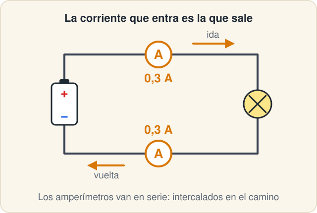

Ya tienes dos piezas: los cables están llenos de electrones libres, y la tensión de la pila los empuja. Ahora toca medir el resultado de ese empujón: cuánta carga circula. Eso es la **corriente**, y se mide en **amperios**.

En esta lección vas a deshacer la confusión más común de toda la electricidad —la idea de que la corriente «se gasta» en los aparatos— y vas a descubrir algo que sorprende incluso a gente con años de oficio: los electrones avanzan por el cable más despacio que un caracol.

## Contar lo que pasa

En el circuito de agua, para saber cuánta agua circula no te fijas en lo rápido que va cada gota. Te pones en un punto de la tubería y cuentas **cuántos litros pasan por ahí cada segundo**. Eso es el caudal.

La corriente eléctrica es el caudal de electrones: **cuánta carga pasa por un punto del cable cada segundo**.

Contar electrones de uno en uno sería absurdo, porque son demasiados. Así que se cuentan por paquetes enormes, igual que el agua se cuenta por litros y no por gotas. El paquete se llama **culombio (C)**, y contiene unos 6,24 trillones de electrones (6.240.000.000.000.000.000). No hace falta que recuerdes la cifra; recuerda solo que el culombio es a la carga lo que el litro es al agua: una cantidad.

Y ahora la unidad importante:

> **Un amperio (A)** es la corriente que hay cuando por un punto del cable pasa **un culombio cada segundo**.

En las fórmulas, la corriente se escribe con la letra **I** (de *intensidad*, que es su otro nombre: «intensidad de corriente»). La definición anterior, escrita en forma de fórmula, es:

**I = Q / t**

Corriente (en amperios) igual a carga que ha pasado (Q, de *quantity*, cantidad, en culombios) dividida entre el tiempo que ha tardado (t, en segundos). En todo el curso, la barra «/» significa «dividido entre». Es la misma cuenta que «litros entre segundos». Si por un cable pasan 20 culombios en 10 segundos, la corriente es 20 / 10 = 2 amperios.

Para que los amperios dejen de ser un número abstracto, aquí tienes una escala:

| Aparato | Corriente que circula por él, aproximadamente |
|---|---|
| Un LED pequeño | 0,02 A |
| Un móvil cargándose | 1 a 2 A |
| La emisora de Vicente, escuchando | menos de 1 A |
| La emisora de Vicente, transmitiendo | unos 10 A |
| Un horno eléctrico | unos 10 A |
| El motor de arranque de un coche | más de 200 A, durante un instante |

Como muchas corrientes son pequeñas, se usa a menudo el **miliamperio (mA)**, que es la milésima parte de un amperio. Mil miliamperios hacen un amperio. Por el LED de la tabla pasan 0,02 A, que es lo mismo que 20 mA. A las conversiones de unidades les dedicaremos una lección entera más adelante, porque son la fuente de errores número uno en el examen.

## La corriente no se gasta

Vamos con la confusión grande. Casi todo el mundo imagina que la corriente sale de la pila, llega a la bombilla, la bombilla «se la come» y por el cable de vuelta regresa menos, o no regresa nada.

Es falso, y el circuito de agua lo deja claro. La rueda de paletas no se bebe el agua: por la tubería de vuelta sale exactamente la misma cantidad de agua por segundo que entró por la de ida. Si no fuera así, el agua se iría acumulando en la rueda hasta reventar la tubería. Lo que el agua deja en la rueda es su empuje, no agua.

En el circuito de la pila y la bombilla pasa igual:

> **En un circuito de un solo camino, la corriente es la misma en todos sus puntos.** Antes de la bombilla, dentro de la bombilla y después de la bombilla pasan los mismos amperios.

(«De un solo camino» quiere decir sin bifurcaciones. Los circuitos donde la corriente puede repartirse entre varios caminos llegarán en la sección 5.)

—Entonces, ¿qué gasta la bombilla? —preguntó Marina—. Porque la pila se acaba agotando. Algo se consume.

—Se consume el empuje —dijo Vicente—. Salen los mismos electrones y al mismo ritmo; lo que han perdido es presión. Mide con el voltímetro: antes de la bombilla hay cuatro voltios y medio respecto al borne negativo; después de ella, casi cero. Esa presión perdida es la energía que se ha quedado dentro, convertida en luz y en calor. Y la pila se agota de tanto volver a dársela.

Esa es la imagen correcta: **lo que se gasta es energía, no electrones ni corriente.** El agua sale de la rueda de paletas en la misma cantidad y al mismo ritmo que entró, pero sin presión; la presión se ha quedado en la rueda, haciéndola girar.

> **Un aviso sobre la forma de hablar.** Oirás a todo el mundo decir —y este curso también lo dirá, porque es lo habitual— que un aparato «consume 10 amperios». Es una manera abreviada de decir que *por él circulan* 10 amperios. Los amperios no se quedan dentro del aparato; lo que se queda es la energía.

## Más lentos que un caracol

Ahora, la sorpresa. Cuando pulsas el interruptor, la luz se enciende al instante. Es natural pensar que los electrones salen disparados por el cable a una velocidad tremenda. Pues no.

En el cable de una linterna, los electrones avanzan a unas centésimas de milímetro por segundo. Si el cable midiera un metro, un electrón tardaría horas en recorrerlo.

¿Cómo se enciende entonces al instante? Porque el cable está lleno. Piensa en una manguera que ya está llena de agua: en cuanto abres el grifo, sale agua por la otra punta **en ese mismo momento**, aunque el agua que acaba de entrar por el grifo esté todavía a metros de distancia. No ha salido *esa* agua: ha salido la que ya estaba al final de la manguera.

En el cable ocurre lo mismo. Al cerrar el interruptor, el empujón de la pila se transmite de electrón a electrón a lo largo de todo el cable casi a la velocidad de la luz, y todos los electrones del circuito, incluidos los que ya estaban dentro del filamento de la bombilla, echan a andar a la vez. La bombilla se enciende con electrones que ya tenía dentro.

Así que hay que distinguir dos velocidades:

- La velocidad a la que **avanza cada electrón**: lentísima, centésimas de milímetro por segundo.
- La velocidad a la que **se propaga el empujón**: rapidísima, cercana a la de la luz.

Lo que viaja rápido por un cable es el empujón; los electrones solo se van desplazando poco a poco. Ese empujón que se propaga tiene un nombre, *campo eléctrico*, que volverá a aparecer más adelante. Esto parece una curiosidad y en realidad es una de las claves de la radio. Cuando lleguemos a las antenas verás que lo que sale volando hacia el espacio tampoco son electrones, sino ese mismo empujón.

## El sentido de la corriente: una convención con historia

Los electrones tienen carga negativa, así que huyen del borne negativo de la pila y van hacia el positivo. Por el circuito, por tanto, **los electrones circulan del − al +**.

Sin embargo, en todos los esquemas, libros y exámenes verás la corriente dibujada **del + al −**. No es un error: es una costumbre anterior al descubrimiento del electrón. En el siglo XVIII, Benjamin Franklin tuvo que decidir a ciegas qué carga llamar positiva y supuso que lo que circulaba salía del polo positivo. Acertó en casi todo y falló en eso. Cuando en 1897 se descubrió el electrón y se vio que iba al revés, ya había un siglo de libros escritos, y se decidió dejarlo como estaba.

A ese sentido de + a − se le llama **sentido convencional** de la corriente. La buena noticia es que no afecta a ningún cálculo: todas las fórmulas dan el mismo resultado se mire como se mire.

> **Para el examen y para los esquemas, la corriente va del + al −.** Los electrones, por dentro, van al revés, y no pasa nada.

## Cómo se mide: el amperímetro

La corriente se mide con un **amperímetro** (el polímetro de Vicente también lo es, girando el selector a la posición de amperios y, en casi todos los modelos, cambiando además la punta roja al agujero marcado con una **A**).

Aquí hay una diferencia importante con el voltímetro. Para contar el caudal de una tubería hay que cortar la tubería e intercalar el contador, de modo que toda el agua pase por dentro de él. Con la corriente ocurre igual: **hay que abrir el circuito e intercalar el amperímetro, para que toda la corriente lo atraviese.** El amperímetro queda en fila con los demás elementos, uno detrás de otro. Por eso se dice que **el amperímetro se conecta en serie**.

Compara los dos instrumentos, porque el examen lo pregunta siempre:

| | Qué mide | Cómo se conecta | Qué hay que hacer |
|---|---|---|---|
| **Voltímetro** | Tensión (voltios) | **En paralelo** | Tocar dos puntos, sin cortar nada |
| **Amperímetro** | Corriente (amperios) | **En serie** | Abrir el circuito e intercalarlo |

Un truco para recordarlo: la tensión está *entre* dos puntos, así que se mide tocando dos puntos. La corriente pasa *por* un punto, así que hay que ponerse en su camino.

Los dos instrumentos están construidos al revés uno del otro. El voltímetro, por dentro, apenas deja pasar corriente, para no alterar el circuito al que se asoma. El amperímetro, por dentro, es casi un simple cable, para no estorbar a la corriente que mide.

De ahí sale una advertencia práctica. Si conectas un amperímetro por error como si fuera un voltímetro, tocando directamente los dos bornes de una batería, estás uniendo esos bornes con un cable. En la lección 5 verás por qué eso es una mala idea y cómo se llama.

## Donde la gente se lía

- **«La bombilla gasta corriente.»** Gasta energía. La corriente que entra es la que sale.
- **«Por el cable de vuelta no pasa nada.»** Pasa exactamente lo mismo que por el de ida. Por eso los dos cables de un aparato son igual de gruesos.
- **«Los electrones van a la velocidad de la luz.»** Lo que va casi a la velocidad de la luz es el empujón. Los electrones, a paso de caracol.
- **«Tensión y corriente son más o menos lo mismo.»** Son cosas distintas: la tensión es cuánto se empuja (la presión de la bomba) y la corriente es cuánto circula (el caudal). Con el mismo empujón puede circular mucho o poco, según lo que haya en el camino. De eso va precisamente la lección siguiente.

## Compruébalo tú

1. Por un cable pasan 30 culombios en 6 segundos. ¿Qué corriente circula?
2. Una corriente de 2 A circula durante 1 minuto. ¿Cuánta carga ha pasado?
3. En un circuito de una pila y una bombilla, el amperímetro colocado antes de la bombilla marca 0,3 A. ¿Qué marcará si lo cambias al cable de después de la bombilla?
4. Un cargador entrega 500 mA. ¿Cuántos amperios son?
5. Quieres medir la corriente que circula por una emisora. ¿Tocas con las puntas del polímetro los dos bornes de la batería, o desconectas uno de los cables y pones el polímetro en medio?

**Soluciones**

1. I = Q / t = 30 / 6 = **5 A**.
2. Dos amperios son 2 culombios cada segundo. Un minuto son 60 segundos, así que en total han pasado 2 × 60 = **120 culombios**. (Con letras: Q = I × t. Y fíjate en que había que pasar los minutos a segundos antes de multiplicar.)
3. Lo mismo, **0,3 A**. En un circuito de un solo camino, la corriente es igual en todos los puntos.
4. Mil miliamperios son un amperio, así que 500 mA = **0,5 A**.
5. Lo segundo: se abre el circuito y se intercala el amperímetro **en serie**. Tocar los dos bornes de la batería con el polímetro en modo amperímetro provocaría una corriente enorme a través de él.

## En una frase

La corriente es la cantidad de carga que pasa por un punto cada segundo; se mide en amperios, es la misma en todo un circuito de un solo camino y no se gasta: lo que se gasta es la energía que transporta.

Ya tenemos el empujón (voltios) y el caudal (amperios). Falta lo que decide cuánto caudal consigue cada empujón. Esa tercera pieza es la resistencia, y con ella llega la ley de Ohm.
