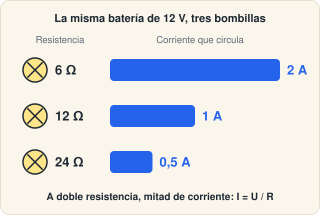
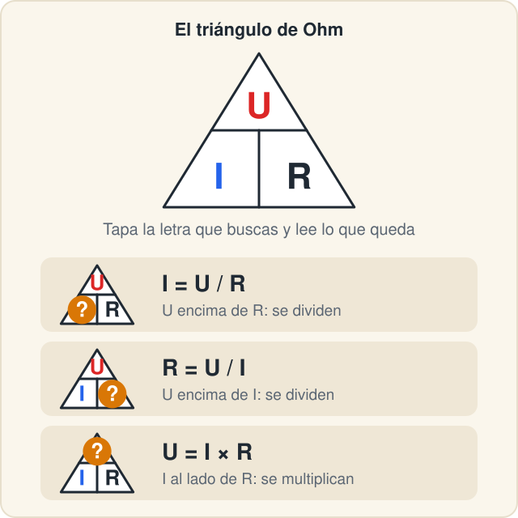

Esta es la lección central de la sección, y probablemente la más rentable del curso entero: la ley de Ohm cae en el examen con toda seguridad. Vamos a llegar a ella sin prisa. Cuando aparezca la fórmula ya sabrás lo que dice, porque la habrás deducido tú con sentido común.

Recuerda dónde estamos. La tensión es el empujón (voltios). La corriente es lo que circula (amperios). Queda una pregunta: con un mismo empujón, **¿de qué depende que circule mucho o poco?**

## La tercera pieza: la resistencia

Vuelve al circuito de agua. Con la misma bomba, por una tubería ancha y corta circula muchísima agua, y por una tubería estrecha, larga y llena de codos circula poca. La tubería estorba al paso del agua, y unas tuberías estorban más que otras.

Con los electrones ocurre igual. Al avanzar por un material van chocando con sus átomos, y cada choque los frena. Hay materiales y piezas que los frenan muy poco, y otros que los frenan muchísimo.

> **Resistencia:** la oposición que un material o un aparato presenta al paso de la corriente. Se mide en **ohmios**, que se escriben con la letra griega omega: **Ω**. En las fórmulas es la letra **R**.

Mucha resistencia significa que cuesta mucho que la corriente pase. Poca resistencia, que pasa con facilidad.

¿Y cuánto es un ohmio? Se define con las dos unidades que ya conoces:

> **Un ohmio** es la resistencia de algo que, empujado con 1 voltio, deja pasar 1 amperio.

Si hacen falta 10 voltios para conseguir ese mismo amperio, es que estorba diez veces más: tiene 10 Ω.

Todo lo que existe tiene alguna resistencia. Para hacerte una idea:

| Objeto | Resistencia aproximada |
|---|---|
| Un metro de cable de cobre grueso | 0,01 Ω (casi nada) |
| El filamento de una bombilla de linterna | unos 15 Ω |
| El filamento de una bombilla de coche | unos 6 Ω |
| El cuerpo humano, de mano a mano, con la piel seca | decenas de miles de ohmios |
| Un trozo de plástico | billones de ohmios (prácticamente infinita) |

Un conductor es simplemente algo con muy poca resistencia, y un aislante, algo con una resistencia gigantesca.

### Una palabra, dos significados

Cuidado con la palabra, porque «resistencia» se usa para dos cosas distintas:

- Es la **propiedad**: lo que estorba cualquier objeto. «Este cable tiene poca resistencia.»
- Y es también una **pieza** que se fabrica a propósito para estorbar una cantidad exacta: un cilindro diminuto con dos patas de alambre y unas franjas de colores que indican su valor. «Pon aquí una resistencia de 100 ohmios.»

¿Para qué querría alguien estorbar a propósito? Para **limitar la corriente**. Un LED conectado directamente a una batería de 12 V se quema al instante, porque deja pasar muchísima más corriente de la que aguanta. Con la resistencia adecuada delante, pasa solo la que necesita. Las resistencias son la pieza más abundante de cualquier aparato electrónico, y las conocerás a fondo en la sección 4.

## El experimento: quién decide la corriente

Vicente puso sobre la mesa una batería de 12 V y tres bombillas de coche distintas, cuya resistencia (encendidas) conocía: 6, 12 y 24 Ω. Conectó la primera, midió la corriente con el polímetro, y repitió con las otras dos. La batería era siempre la misma.

| Lo que conecta a la batería de 12 V | Corriente que mide |
|---|---|
| Bombilla A (resistencia de 6 Ω) | 2 A |
| Bombilla B (resistencia de 12 Ω) | 1 A |
| Bombilla C (resistencia de 24 Ω) | 0,5 A |

—Espera —dijo Marina—. ¿La batería no da siempre la misma corriente? Yo pensaba que una batería era «de tantos amperios».

—Esa es la idea que hay que quitarse de la cabeza —contestó Vicente—. La batería no decide la corriente. La batería pone el empujón: doce voltios, conectes lo que conectes. Cuánta corriente sale lo decide lo que tú le conectes. Si le pones algo que estorba poco, sale mucha. Si le pones algo que estorba mucho, sale poca.

Este es el punto que más conviene entender de toda la sección:

> **La fuente fija la tensión. El aparato fija la resistencia. La corriente es el resultado de las dos.**

Un enchufe da 230 V tanto si conectas un cargador de móvil como si conectas un horno. Lo que cambia es la corriente: el cargador deja pasar muy poca y el horno deja pasar mucha.

Y con esto se explica algo de la historia de Vicente que quizá te chocó. Su emisora, conectada a la misma batería de 12 V, consumía menos de 1 A escuchando y 10 A transmitiendo. La batería no cambió. Lo que cambió fue la emisora: al transmitir pone en marcha sus circuitos de potencia y deja pasar mucha más corriente, exactamente como si hubiera bajado su resistencia.

## La ley, deducida con sentido común

Mira otra vez la tabla del experimento y busca la regla.

- Con 6 Ω salen 2 A. Con 12 Ω, que es el doble, sale 1 A, que es la mitad. Con 24 Ω, el doble otra vez, sale la mitad otra vez. **A doble resistencia, mitad de corriente.**
- Y ahora divide en cada fila la tensión entre la resistencia: 12 / 6 = 2. 12 / 12 = 1. 12 / 24 = 0,5. **Sale justo la corriente.**

Vicente repitió entonces el experimento con dos baterías en serie, es decir, con 24 V, y la bombilla C:

| Tensión | Bombilla C (24 Ω) | Corriente que mide |
|---|---|---|
| 12 V | la misma | 0,5 A |
| 24 V | la misma | 1 A |

**A doble tensión, doble corriente.** Y la división sigue cumpliéndose: 24 / 24 = 1.

Las dos cosas son de puro sentido común: cuanto más fuerte empujas, más circula; cuanto más estorba el camino, menos circula. Escrito con letras, eso es la **ley de Ohm**, que publicó el profesor alemán Georg Simon Ohm en 1827:

**I = U / R**

*La corriente (en amperios) es igual a la tensión (en voltios) dividida entre la resistencia (en ohmios).*

Lee la fórmula como una frase y no como un jeroglífico: se divide lo que empuja entre lo que estorba. Si aumenta lo que empuja, la corriente sube. Si aumenta lo que estorba, la corriente baja.

Un aviso para el examen: en muchos libros y en algunas preguntas la tensión se escribe con la letra **V** en lugar de **U**, y la ley aparece como I = V / R. Es exactamente lo mismo.

## Las tres formas de la misma ley

La ley de Ohm relaciona tres cantidades. Si conoces dos cualesquiera, puedes calcular la tercera. Según cuál te falte, la misma ley se escribe de tres maneras:

| Quiero saber… | Fórmula | Se lee así |
|---|---|---|
| la **corriente** | **I = U / R** | El empujón entre lo que estorba |
| la **tensión** | **U = I × R** | El empujón necesario para hacer pasar esa corriente por esa resistencia |
| la **resistencia** | **R = U / I** | Cuántos voltios han hecho falta por cada amperio |

No son tres leyes: es una sola, despejada de tres maneras. Si no te llevas bien con despejar fórmulas, existe un truco gráfico que usan generaciones de estudiantes: el **triángulo de Ohm**. Se dibuja un triángulo con la U arriba y la I y la R abajo. Tapas con el dedo la letra que quieres calcular y lo que queda a la vista es la fórmula: si las dos letras que quedan están una encima de otra, se dividen; si están una al lado de otra, se multiplican.

## Cómo resolver un problema, paso a paso

Los problemas de ley de Ohm del examen se resuelven todos igual. Coge la costumbre de seguir siempre estos cuatro pasos:

1. **Apunta lo que te dan y lo que te piden**, con sus letras: U, I o R.
2. **Pasa todo a unidades básicas**: voltios, amperios y ohmios. Si te dan miliamperios (milésimas de amperio) o kilohmios (miles de ohmios: «kilo» significa mil, como en *kilómetro*), conviértelos *antes* de calcular. La lección 8 está dedicada entera a estas conversiones.
3. **Elige la forma de la ley** que tiene sola, a la izquierda, la letra que te piden.
4. **Calcula y comprueba que el resultado tiene sentido.**

**Ejemplo 1.** *Una resistencia de 100 Ω se conecta a una batería de 12 V. ¿Qué corriente circula?*

- Me dan U = 12 V y R = 100 Ω. Me piden I.
- Las unidades ya son básicas.
- La forma que tiene la I sola es I = U / R.
- I = 12 / 100 = **0,12 A** (o, lo que es lo mismo, 120 mA).
- ¿Tiene sentido? Cien ohmios empujados con solo 12 voltios: es lógico que pase poco más de una décima de amperio.

**Ejemplo 2.** *Por una resistencia circulan 2 A cuando se le aplican 24 V. ¿Cuánto vale la resistencia?*

- Me dan I = 2 A y U = 24 V. Me piden R.
- R = U / I = 24 / 2 = **12 Ω**.

**Ejemplo 3.** *¿Qué tensión hay entre los extremos de una resistencia de 50 Ω por la que circulan 200 mA?*

- Me dan R = 50 Ω e I = 200 mA. Me piden U.
- Atención al paso 2: 200 mA no son 200 amperios. Son 200 milésimas de amperio: 200 / 1.000 = 0,2 A.
- U = I × R = 0,2 × 50 = **10 V**.
- Quien se salta el paso 2 calcula 200 × 50 = 10.000 V, y entre las cuatro opciones del examen suele estar esa cifra esperándole. Es la trampa más repetida.

## Con la ley de Ohm se entiende el peligro

Ahora puedes poner números a una advertencia que dejamos pendiente. El cuerpo humano conduce, y su resistencia depende mucho de la piel: seca, decenas de miles de ohmios; húmeda, puede bajar a unos 2.000 Ω.

- Con los 230 V de un enchufe y la piel húmeda: I = 230 / 2.000 ≈ 0,1 A. Parece poco, pero bastan unos 0,03 A (30 mA) atravesando el pecho para que sea mortal.
- Con los 12 V de una batería y la piel seca (pongamos 50.000 Ω): I = 12 / 50.000 = 0,00024 A. No llega a una milésima de amperio; ni se nota.

Que esa segunda cuenta no te lleve a engaño con el enchufe: la piel seca protege frente a tensiones bajas, pero con la de la red deja de hacerlo en un instante, y la corriente es peligrosa también con las manos secas.

Lo que hace daño es la corriente que atraviesa el cuerpo, y esa corriente la decide la ley de Ohm: la tensión que tocas dividida entre la resistencia que tú ofreces. Por eso el enchufe se respeta siempre y la batería de 12 V se puede manejar con las manos (otra cosa es lo que una batería puede hacerle a una llave inglesa, como verás en la lección siguiente).

## Donde la gente se lía

- **«Una batería de 12 V da X amperios.»** La batería da voltios. Los amperios los decide lo que conectas.
- **«A más resistencia, más corriente.»** Al revés. La resistencia estorba: a más resistencia, menos corriente.
- **«La ley de Ohm son tres fórmulas que hay que memorizar.»** Es una sola idea: corriente igual a empujón entre estorbo. Las otras dos formas son la misma, mirada desde otro lado.
- **Olvidar convertir unidades.** Los miliamperios se pasan a amperios y los kilohmios a ohmios antes de tocar la fórmula. Siempre.

## Compruébalo tú

Usa los cuatro pasos. Las soluciones, razonadas, están justo debajo.

1. Una resistencia de 40 Ω se conecta a una batería de 12 V. ¿Qué corriente circula?
2. Por una resistencia de 3 kΩ circulan 4 mA. ¿Qué tensión hay entre sus extremos?
3. Al conectar una bombilla a una pila de 4,5 V circulan 0,3 A. ¿Qué resistencia tiene la bombilla?
4. A una resistencia le aplicas 10 V y circula 1 A. Si le aplicas 30 V, ¿qué corriente circulará? Resuélvelo sin calcular la resistencia.
5. Un LED necesita que por él pasen 0,02 A. La resistencia que se le pone delante va a tener 10 V entre sus extremos (el porqué lo verás en la sección 4). ¿De cuántos ohmios tiene que ser?
6. Con la piel mojada, la resistencia de una persona entre mano y mano puede bajar a 1.000 Ω. ¿Qué corriente la atravesaría al tocar 230 V? ¿Es peligrosa?

**Soluciones**

1. I = U / R = 12 / 40 = **0,3 A** (300 mA).
2. Primero las unidades: 3 kΩ = 3.000 Ω y 4 mA = 0,004 A. Después, U = I × R = 0,004 × 3.000 = **12 V**.
3. R = U / I = 4,5 / 0,3 = **15 Ω**.
4. La resistencia no cambia y la tensión se ha multiplicado por tres. A triple empujón, triple corriente: **3 A**. (Si calculas la resistencia sale lo mismo: R = 10 / 1 = 10 Ω, y luego I = 30 / 10 = 3 A.)
5. R = U / I = 10 / 0,02 = **500 Ω**.
6. I = U / R = 230 / 1.000 = **0,23 A**. Es casi ocho veces la corriente que puede matar (0,03 A): **muy peligrosa**. Agua y electricidad, nunca juntas.

## En una frase

La fuente pone la tensión, el aparato pone la resistencia y de las dos sale la corriente: **I = U / R**. Más empujón, más corriente; más estorbo, menos corriente.

En la lección siguiente usamos la ley de Ohm para entender tres cosas muy prácticas: por qué importan el largo y el grueso de un cable, por qué una batería no da siempre exactamente sus doce voltios y qué es un cortocircuito.
