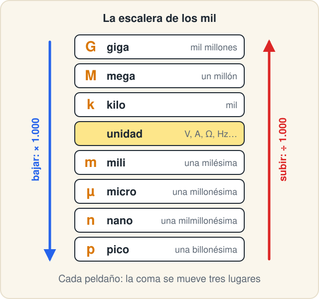

Esta lección no tiene nada de física. Tiene algo más prosaico: la manera de no equivocarse con los ceros. Merece lección propia por una razón muy concreta. La mayoría de los fallos en las preguntas de cálculo del examen no se deben a no saber la fórmula, sino a meter en ella miliamperios donde iban amperios, o kilohmios donde iban ohmios.

## Por qué existen los prefijos

En radio se manejan cantidades muy grandes y muy pequeñas. La frecuencia de una emisora puede ser de 145.000.000 hercios; la corriente de un circuito, de 0,00002 amperios. Escribir y leer tantos ceros es incómodo y, sobre todo, es una invitación al error.

La solución es la misma que usas a diario sin pensarlo. No dices que tu pueblo está a 12.000 metros: dices que está a 12 **kilo**metros. No dices que una pastilla tiene 0,5 gramos: dices 500 **mili**gramos. «Kilo» y «mili» son **prefijos**: palabras que se ponen delante de una unidad y significan «multiplicado por mil» o «dividido entre mil».

En electricidad y radio se usan siete. Esta tabla **cae en el examen** y la vas a usar todos los días. (En los ejemplos aparecen hercios, Hz, y faradios, F, dos unidades que aún no conoces. No importa: los prefijos funcionan igual con cualquier unidad.)

| Prefijo | Símbolo | Significa | Ejemplo |
|---|---|---|---|
| **giga** | G | × 1.000.000.000 (mil millones) | 1,2 GHz |
| **mega** | M | × 1.000.000 (un millón) | 7 MHz, 1 MΩ |
| **kilo** | k | × 1.000 (mil) | 4,7 kΩ, 145.500 kHz |
| *(ninguno)* | | la unidad tal cual | 12 V, 2 A, 50 Ω |
| **mili** | m | ÷ 1.000 (una milésima) | 500 mA, 12 mV |
| **micro** | µ | ÷ 1.000.000 (una millonésima) | 100 µA, 22 µF |
| **nano** | n | ÷ 1.000.000.000 (una milmillonésima) | 10 nF |
| **pico** | p | ÷ 1.000.000.000.000 (una billonésima) | 47 pF |

Tres detalles para no tropezar:

- La **m** minúscula es *mili* y la **M** mayúscula es *mega*. Entre 1 mΩ y 1 MΩ hay una diferencia de mil millones de veces. La mayúscula importa.
- El símbolo de *micro* es la letra griega **µ** («mu»). Cuando no se puede escribir, se sustituye por una **u**: 22 uF es lo mismo que 22 µF.
- *Kilo* se escribe con **k** minúscula.

## La escalera de los mil

Lo que hace manejable la tabla es que **cada prefijo es mil veces mayor que el siguiente**. Colócalos como los peldaños de una escalera:

**G → M → k → (unidad) → m → µ → n → p**

Cada peldaño que bajas, el número se multiplica por 1.000. Cada peldaño que subes, se divide entre 1.000.

Y multiplicar o dividir por 1.000 no requiere calculadora: es **mover la coma tres lugares**.

- **Bajar un peldaño** (hacia un prefijo más pequeño): la coma se mueve tres lugares a la **derecha** y el número se hace mayor.
- **Subir un peldaño** (hacia un prefijo más grande): la coma se mueve tres lugares a la **izquierda** y el número se hace menor.

Puede parecer que esto contradice la tabla, donde «mili» significaba *dividido entre mil*. No hay contradicción: un miliamperio es mil veces más pequeño que un amperio, y precisamente por eso hacen falta mil veces más miliamperios para decir lo mismo. **Unidad más pequeña, número más grande.** Igual que 2 euros son 200 céntimos, o que un kilómetro son mil metros: la cantidad no ha cambiado, pero el número sí.

Dos detalles prácticos para mover la coma. Si un número no lleva coma, la coma está al final: 500 es lo mismo que 500,0. Y si al moverla faltan cifras, los huecos se rellenan con ceros: de 3,5 a 3.500, o de 500 a 0,500.

Una advertencia sobre la escritura: en este curso, como es norma en España, el punto separa los miles (1.200) y la coma los decimales (0,5). Las calculadoras lo hacen al revés y muestran 0.5.

**Ejemplos, uno a uno:**

- **500 mA a amperios.** De *mili* a la unidad se sube un peldaño: coma tres lugares a la izquierda. 500 → 0,500. Son **0,5 A**.
- **3,5 kΩ a ohmios.** De *kilo* a la unidad se baja un peldaño: coma tres lugares a la derecha. 3,5 → 3.500. Son **3.500 Ω**.
- **7 MHz a hercios.** De *mega* a la unidad se bajan dos peldaños: seis lugares a la derecha. Son **7.000.000 Hz**.
- **7 MHz a kilohercios.** De *mega* a *kilo* se baja un peldaño: **7.000 kHz**.
- **0,02 A a miliamperios.** Se baja un peldaño: tres lugares a la derecha. 0,02 → 20. Son **20 mA**.
- **1.500 µA a miliamperios.** De *micro* a *mili* se sube un peldaño: **1,5 mA**.
- **0,1 µF a nanofaradios.** De *micro* a *nano* se baja un peldaño: **100 nF**.

Si dudas de hacia dónde va la coma, usa la comprobación del sentido común: al pasar a una unidad más pequeña, el número tiene que salir más grande, y al revés. Si 500 mA te salen 500.000 A, la coma ha ido hacia el lado equivocado: medio amperio no puede ser medio millón de amperios.

## La regla de oro antes de usar una fórmula

Las fórmulas de esta sección —la ley de Ohm, las de la potencia— solo dan el resultado correcto si metes en ellas **voltios, amperios, ohmios y vatios**, sin prefijos. De modo que la rutina es siempre la misma:

1. Convierte todos los datos a la unidad básica.
2. Aplica la fórmula.
3. Si quieres, pasa el resultado al prefijo que resulte más cómodo de leer.

**Ejemplo completo.** *Por una resistencia de 4,7 kΩ circulan 2 mA. ¿Qué tensión hay entre sus extremos?*

1. Convertir: 4,7 kΩ = 4.700 Ω. 2 mA = 0,002 A.
2. Fórmula: U = I × R = 0,002 × 4.700 = 9,4.
3. Resultado: **9,4 V**.

### Un atajo de veteranos

Cuando los datos vienen en **miliamperios** y **kilohmios**, el «mili» (÷ 1.000) y el «kilo» (× 1.000) se anulan entre sí. Puedes multiplicar los números tal cual y el resultado sale directamente en voltios:

**mA × kΩ = V**

En el ejemplo anterior: 2 × 4,7 = 9,4 V. Es un atajo cómodo porque en electrónica esa pareja aparece constantemente. Pero úsalo solo cuando lo entiendas; mientras tanto, la rutina de convertir todo a unidades básicas no falla nunca.

## Todas las magnitudes de la sección, juntas

Ya han salido todas las letras y todas las unidades de la electricidad básica. Aquí las tienes reunidas. Es muy fácil cruzarlas al principio (¿la I era la tensión?), así que vuelve a esta tabla cuantas veces haga falta.

| Magnitud | Letra | Unidad | Símbolo | Qué es, en el circuito de agua |
|---|---|---|---|---|
| Carga | Q | culombio | C | Una cantidad de agua |
| **Tensión** | **U** | **voltio** | **V** | La presión con que empuja la bomba |
| **Corriente** | **I** | **amperio** | **A** | El caudal: agua que pasa por segundo |
| **Resistencia** | **R** | **ohmio** | **Ω** | Lo que estorba la tubería |
| Conductancia | G | siemens | S | Lo fácil que deja pasar (lo contrario de estorbar) |
| **Potencia** | **P** | **vatio** | **W** | El trabajo que hace la rueda cada segundo |
| Energía | E | julio o vatio-hora | J, Wh | El trabajo total que ha hecho la rueda |
| Capacidad de una batería | — | amperio-hora | Ah | El agua total que la bomba puede mover antes de agotarse |

Y las fórmulas que las unen, que son solo estas:

| Para qué | Fórmulas |
|---|---|
| Corriente | I = Q / t |
| Ley de Ohm | I = U / R, o bien U = I × R, o bien R = U / I |
| Resistencia de un cable | R = ρ × L / S |
| Conductancia | G = 1 / R |
| Tensión en bornes de una batería | f.e.m. − I × resistencia interna |
| Potencia | P = U × I, o bien P = I² × R, o bien P = U² / R |
| Energía | E = P × t |
| Autonomía de una batería | horas = amperios-hora / amperios |
| Energía de una batería | Wh = Ah × V |
| Rendimiento | potencia útil / potencia consumida |

Con esta tabla, y recordando que en serie se suman las tensiones y en paralelo las capacidades, se resuelven las preguntas de cálculo de electricidad básica del examen.

## Donde la gente se lía

- **Mover la coma hacia el lado contrario.** Comprobación rápida: al pasar a una unidad más pequeña, el número tiene que hacerse más grande. Medio amperio son 500 mA, nunca 0,0005 mA.
- **Confundir la m con la M.** Minúscula, *mili* (una milésima); mayúscula, *mega* (un millón).
- **Meter en la fórmula los números tal como vienen.** Las fórmulas solo funcionan con voltios, amperios y ohmios. Primero convertir, después calcular.

## Compruébalo tú

Convierte sin calculadora:

1. 250 mA a amperios.
2. 2,2 kΩ a ohmios.
3. 0,015 A a miliamperios.
4. 14.200 kHz a megahercios.
5. 470 nF a microfaradios.
6. 1,5 MΩ a kilohmios.

Y dos problemas con trampa de unidades:

7. Por una resistencia de 10 kΩ circulan 0,5 mA. ¿Qué tensión hay entre sus extremos?
8. A una resistencia de 2 kΩ se le aplican 10 V. ¿Qué corriente circula, en miliamperios?

**Soluciones**

1. Subir un peldaño, coma tres a la izquierda: **0,25 A**.
2. Bajar un peldaño, coma tres a la derecha: **2.200 Ω**.
3. Bajar un peldaño: **15 mA**.
4. Subir un peldaño: **14,2 MHz**.
5. De nano a micro se sube un peldaño: **0,47 µF**.
6. De mega a kilo se baja un peldaño: **1.500 kΩ**.
7. 10 kΩ = 10.000 Ω y 0,5 mA = 0,0005 A. U = I × R = 0,0005 × 10.000 = **5 V**. (Con el atajo: 0,5 × 10 = 5 V.)
8. 2 kΩ = 2.000 Ω. I = U / R = 10 / 2.000 = 0,005 A, que son **5 mA**.

## En una frase

Cada prefijo vale mil veces el siguiente, así que cambiar de prefijo es mover la coma de tres en tres; y antes de usar cualquier fórmula, todo a voltios, amperios y ohmios.

Con esto terminas la electricidad básica. El material siguiente es un resumen de toda la sección en formato de chuleta, pensado para repasar antes del examen.
