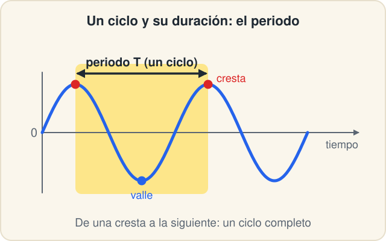

En la pantalla del transceptor de Vicente brillaba un número ámbar: **7.088.0** (el primer punto separa los miles y el segundo, las décimas: son 7.088,0 kilohercios; enseguida verás qué es un hercio). «Todo lo que hace esta máquina se resume en ese número», dijo. Marina sabía cómo se llamaba —la frecuencia—, pero no supo decir qué *era*. Lucía lo dijo a su manera: «ondas por segundo».

Lucía tenía razón, y esta lección convierte su intuición en algo con lo que puedas hacer cuentas. Al terminar sabrás qué son el periodo y la frecuencia, cómo se pasa de uno a otra, qué es un hercio y qué significa exactamente el número del dial.

## Dos maneras de medir el ritmo

En la lección anterior viste que la corriente alterna repite el mismo ciclo una y otra vez. Algunas lo repiten con calma y otras a una velocidad de vértigo. Ese ritmo se puede medir de dos maneras, igual que el de un corazón:

- Puedes decir **cuánto dura cada latido**: «un latido cada segundo».
- O puedes decir **cuántos latidos hay en un tiempo dado**: «sesenta latidos por minuto».

Las dos frases cuentan lo mismo desde dos lados. Con la corriente alterna se hace igual, y cada manera tiene su nombre.

## El periodo: cuánto dura un ciclo

> **Periodo:** el tiempo que tarda en completarse un ciclo. Se escribe con la letra **T** y se mide en **segundos (s)**.

En el gráfico de la senoide, el periodo es una *anchura*: la distancia horizontal entre un punto de la onda y el punto equivalente del ciclo siguiente. Por ejemplo, de una cresta a la cresta siguiente. (Recuerda que en ese gráfico la dirección horizontal es el tiempo.)

Los ciclos de la corriente alterna suelen durar muy poco, mucho menos de un segundo, así que el periodo casi siempre se expresa con los prefijos de la sección 2:

- en **milisegundos (ms)**: milésimas de segundo;
- en **microsegundos (µs)**: millonésimas de segundo.

El ciclo de la tensión del enchufe, por ejemplo, dura 20 ms: dos centésimas de segundo.

## La frecuencia: cuántos ciclos caben en un segundo

> **Frecuencia:** el número de ciclos que se completan cada segundo. Se escribe con la letra **f** y se mide en **hercios (Hz)**.
>
> **Un hercio** es un ciclo por segundo.

Si una tensión completa 50 ciclos cada segundo, su frecuencia es de 50 Hz. Si completa siete millones, 7.000.000 Hz. La unidad lleva el nombre de Heinrich Hertz, el físico alemán que en 1887 produjo y detectó por primera vez ondas de radio en un laboratorio.

Mira la figura. En el mismo segundo, arriba caben 2 ciclos y abajo caben 6. Para que quepan más ciclos en el mismo tiempo, cada uno tiene que durar menos. De ahí sale la regla que une las dos medidas:

> **A más frecuencia, menos periodo. A menos frecuencia, más periodo.** Cuando una sube, la otra baja.

## De una a otra: la fórmula

La relación exacta se deduce con una cuenta de sentido común.

Si cada ciclo dura medio segundo, ¿cuántos caben en un segundo? Dos. Has dividido 1 segundo entre lo que dura cada ciclo: 1 / 0,5 = 2.

Si cada ciclo dura una décima de segundo, caben diez: 1 / 0,1 = 10.

Siempre es la misma operación: **un segundo dividido entre lo que dura un ciclo**.

**f = 1 / T**

*La frecuencia (en hercios) es igual a 1 dividido entre el periodo (en segundos).*

Y al revés, si sabes cuántos ciclos caben en un segundo, cada uno dura esa fracción de segundo:

**T = 1 / f**

*El periodo (en segundos) es igual a 1 dividido entre la frecuencia (en hercios).*

**Ejemplo 1.** *La tensión del enchufe tiene una frecuencia de 50 Hz. ¿Cuánto dura un ciclo?*

T = 1 / f = 1 / 50 = 0,02 s. Son dos centésimas de segundo, es decir, **20 ms**.

**Ejemplo 2.** *Un ciclo de una señal dura 0,001 s. ¿Cuál es su frecuencia?*

f = 1 / T = 1 / 0,001 = **1.000 Hz**. Tiene lógica: si cada ciclo dura una milésima de segundo, en un segundo caben mil.

## La trampa de siempre: las unidades

La fórmula solo funciona con el periodo en **segundos** y la frecuencia en **hercios**. Pero el examen te dará el periodo en milisegundos o en microsegundos, y si metes ese número tal cual en la fórmula, el resultado sale mil veces (o un millón de veces) más pequeño de lo debido.

Se puede convertir primero a segundos, como en la sección 2, pero eso obliga a dividir entre números como 0,002. Hay una manera más natural de hacer la misma cuenta, con otra pregunta: **¿cuántos ciclos caben en un segundo?**

- Un segundo tiene **1.000 milisegundos**. Si cada ciclo dura 2 ms, caben 1.000 / 2 = 500 ciclos: 500 Hz.
- Un segundo tiene **1.000.000 de microsegundos**. Si cada ciclo dura 4 µs, caben 1.000.000 / 4 = 250.000 ciclos: 250.000 Hz.

**Ejemplo 3.** *Una señal tiene un periodo de 2 ms. ¿Cuál es su frecuencia?*

En un segundo hay 1.000 ms, y cada ciclo ocupa 2: caben 1.000 / 2 = **500 Hz**.

Quien divide sin más, 1 / 2, obtiene 0,5, y entre las cuatro respuestas del examen suele estar ese «0,5 Hz» esperándole.

**Ejemplo 4.** *Una señal tiene un periodo de 4 µs. ¿Cuál es su frecuencia?*

En un segundo hay 1.000.000 µs, y cada ciclo ocupa 4: caben 1.000.000 / 4 = 250.000 Hz, que se escribe mejor como **250 kHz**.

De esta manera de contar sale una regla cómoda: los prefijos del periodo y los de la frecuencia van **en espejo**. Si el ciclo es mil veces más corto (*mili*), caben mil veces más (*kilo*). Si es un millón de veces más corto (*micro*), caben un millón de veces más (*mega*).

| Si el periodo está en… | …1 dividido entre él da la frecuencia en… |
|---|---|
| segundos (s) | hercios (Hz) |
| milisegundos (ms) | kilohercios (kHz) |
| microsegundos (µs) | megahercios (MHz) |

Con el ejemplo 3: 1 / 2 = 0,5, y como el periodo estaba en milisegundos, son 0,5 kHz, es decir, 500 Hz. Con el ejemplo 4: 1 / 4 = 0,25 MHz, que son los mismos 250 kHz.

## Hercios, kilohercios, megahercios

Las frecuencias de radio son números enormes, así que se escriben casi siempre con prefijos. Son los mismos de la sección 2:

| Unidad | Símbolo | Equivale a | Dónde la encuentras |
|---|---|---|---|
| hercio | Hz | 1 ciclo por segundo | La red eléctrica: 50 Hz |
| kilohercio | kHz | 1.000 Hz | El sonido; la onda media |
| megahercio | MHz | 1.000.000 Hz | La onda corta, la FM, las bandas de radioaficionado |
| gigahercio | GHz | 1.000.000.000 Hz | El wifi, los satélites |

Cambiar de una a otra es mover la coma de tres en tres lugares, como siempre: 7 MHz = 7.000 kHz = 7.000.000 Hz. Y 145.500 kHz = 145,5 MHz.

## El número del dial, por fin

Ya puedes leer la pantalla de Vicente. **7.088.0** son 7.088,0 kilohercios, es decir, 7,088 MHz, es decir, 7.088.000 hercios.

Lo que significa es esto: la corriente alterna que el transceptor envía a la antena completa **siete millones ochenta y ocho mil ciclos cada segundo**. Cada ciclo dura unas 0,14 millonésimas de segundo.

Y el mando grande, el dial, no hace nada misterioso: cambia ese ritmo. Al girarlo hasta 7.100, la corriente pasa a oscilar a 7.100.000 ciclos por segundo. Cada emisora del mundo transmite a un ritmo distinto, y **sintonizar es elegir qué ritmo quieres escuchar**. Dos emisoras pueden estar en el aire a la vez sin estorbarse precisamente porque cada una oscila a su frecuencia y el receptor es capaz de quedarse solo con la que tú le indicas. (Cómo consigue separar un ritmo de todos los demás es materia de las secciones 5 y 7; de momento, acéptalo como se acepta que el oído distingue una flauta de un tambor que suenan a la vez.)

## Frecuencias que se oyen y frecuencias que vuelan

Para terminar, un primer mapa a grandes rasgos. Según lo rápido que oscile, una corriente alterna sirve para cosas muy distintas:

- **50 Hz:** la red eléctrica. Sirve para transportar energía.
- **De unos 20 Hz a unos 20.000 Hz (20 kHz):** las **audiofrecuencias**, abreviado **AF** (a veces **BF**, de «baja frecuencia»). Si conectas una corriente alterna de estas frecuencias a un altavoz, su membrana vibra a ese ritmo y **se oye**. A 440 Hz suena la nota *la* con la que se afinan las orquestas. Cuanto mayor la frecuencia, más agudo el sonido. La voz humana, para entenderse bien por radio, necesita solo el tramo de unos 300 a 3.000 Hz.
- **De unos 3 kHz hacia arriba:** las **radiofrecuencias**, abreviado **RF**. Son las corrientes alternas tan rápidas que parte de su energía puede salir de una antena y viajar por el espacio. Aquí viven todas las emisoras. (El tramo más bajo se solapa con lo que el oído alcanza; a efectos prácticos, la radio empieza en las decenas de kilohercios.)

Un aviso para no mezclar dos cosas: un sonido de 1.000 Hz y una corriente eléctrica de 1.000 Hz no son lo mismo. El sonido es aire que vibra; la corriente, electrones que oscilan en un cable. Lo que tienen en común es el ritmo. Un micrófono convierte lo primero en lo segundo, y un altavoz, lo segundo en lo primero.

En la lección 6 completaremos este mapa con todos sus tramos y sus nombres oficiales.

## Donde la gente se lía

- **«Más frecuencia es una onda más alta.»** No. La frecuencia no tiene nada que ver con la altura de la onda en el gráfico, sino con lo *apretados* que están los ciclos. La altura es otra magnitud, que veremos en la lección siguiente.
- **Confundir kHz y MHz.** 7 MHz son 7.000 kHz, no 700 ni 70. Tres lugares de coma por cada peldaño.
- **«Una frecuencia alta viaja más rápido.»** No: como verás en la lección 5, todas las ondas de radio viajan a la misma velocidad. Una frecuencia alta oscila más deprisa, que es otra cosa.

## Compruébalo tú

1. Una señal completa 200 ciclos cada segundo. ¿Cuál es su frecuencia? ¿Y su periodo, en milisegundos?
2. Un ciclo de una señal dura 0,5 s. ¿Cuál es su frecuencia?
3. Una señal tiene un periodo de 5 ms. ¿Cuál es su frecuencia?
4. Una señal tiene un periodo de 1 µs. ¿Cuál es su frecuencia?
5. En algunos países la red eléctrica es de 60 Hz. ¿Dura allí cada ciclo más o menos que en España? Calcula cuánto.
6. Expresa 3.650 kHz en megahercios y 0,5 MHz en kilohercios.
7. El dial de un equipo marca 14.250.0 (en kilohercios). ¿Cuántos ciclos por segundo completa esa señal?
8. Dos señales: una de 100 Hz y otra de 1 kHz. ¿Cuál tiene el periodo más largo? ¿Cuál sonaría más aguda en un altavoz?

**Soluciones**

1. Doscientos ciclos por segundo son, por definición, **200 Hz**. El periodo: T = 1 / f = 1 / 200 = 0,005 s = **5 ms**.
2. f = 1 / T = 1 / 0,5 = **2 Hz**. (Si cada ciclo dura medio segundo, caben dos en un segundo.)
3. En un segundo hay 1.000 ms y cada ciclo ocupa 5: caben 1.000 / 5 = **200 Hz**. (Con el espejo: 1 / 5 = 0,2 kHz = 200 Hz.)
4. En un segundo hay 1.000.000 µs y cada ciclo ocupa 1: caben 1.000.000 ciclos, **1 MHz**. (Con el espejo: 1 / 1 = 1 MHz.)
5. Más frecuencia, menos periodo: dura **menos**. T = 1 / 60 ≈ 0,0167 s, unos **16,7 ms** frente a los 20 ms de España.
6. 3.650 kHz = **3,65 MHz** (se sube un peldaño: coma tres lugares a la izquierda). 0,5 MHz = **500 kHz** (se baja un peldaño: coma tres lugares a la derecha).
7. 14.250,0 kHz = 14.250.000 Hz: **catorce millones doscientos cincuenta mil ciclos por segundo**.
8. La de **100 Hz** tiene el periodo más largo (10 ms frente a 1 ms): menos frecuencia, más periodo. La de **1 kHz** sonaría más aguda.

## En una frase

El periodo es lo que dura un ciclo y la frecuencia es cuántos ciclos caben en un segundo; se calculan una a partir de la otra con **f = 1 / T**, la frecuencia se mide en hercios, y el número del dial de una radio no es más que eso: los ciclos por segundo de la señal.

Ya sabemos medir lo *deprisa* que oscila una onda. En la lección siguiente medimos lo *grande* que es, y descubrimos por qué los 230 voltios del enchufe son, en realidad, 325.
