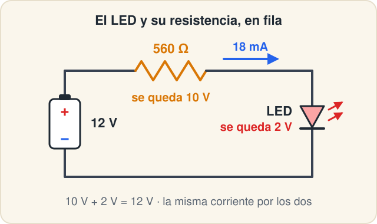

En el rastro, Vicente cogió de una bandeja un cilindrito con franjas de colores, lo miró medio segundo y dijo: «marrón, negro, rojo: mil ohmios». A Marina le pareció un truco de feria. No lo es: es un alfabeto de diez colores que se aprende en una tarde, y aquella misma tarde, con el receptor gris abierto sobre la mesa y la lata de Amparo al lado, Vicente se lo enseñó.

Esta es la primera de las «cuatro familias y media» de componentes de las que hablaba Vicente: resistencias, condensadores, bobinas (con sus transformadores), semiconductores y, la media que falta, las válvulas. Al terminar la lección sabrás reconocer una resistencia, leer su valor en los colores, elegir una del tamaño adecuado para que no se queme y calcular la que necesita un LED para no morir en el intento.

## Qué es y qué aspecto tiene

En la sección 2 vimos que la palabra «resistencia» significa dos cosas: la propiedad de estorbar a la corriente (que tiene cualquier objeto) y una pieza fabricada a propósito para estorbar una cantidad exacta. Aquí hablamos de la pieza.

> **Resistencia** (el componente; también se llama *resistor*): pieza de dos patas fabricada para tener un valor concreto y conocido de resistencia, medido en ohmios (Ω).

La más común es un cilindro del tamaño de un grano de arroz, de color beis o azul claro, con un alambre saliendo por cada extremo y tres, cuatro o cinco franjas de colores pintadas alrededor. No tiene polaridad: da igual en qué sentido la conectes, porque estorba lo mismo en los dos.

¿Para qué sirve una pieza cuyo único talento es estorbar? Para tres cosas, y entre las tres explican por qué es el componente más abundante de cualquier aparato:

- **Limitar la corriente.** Recuerda la ley de Ohm: I = U / R. Si un componente delicado aguanta poca corriente, se le pone delante una resistencia que la frene. Lo haremos con un LED al final de la lección.
- **Repartir la tensión.** Dos resistencias en fila se reparten la tensión de la fuente, como el cable y la emisora de Marina en la sección 2. Eso permite fabricar la tensión que haga falta en cada punto de un circuito. Lo verás con cuentas en la sección 5.
- **Convertir electricidad en calor**, a propósito. Una estufa es una resistencia grande.

## El código de colores

Las resistencias son demasiado pequeñas para llevar el valor escrito con números, así que lo llevan pintado en franjas. Cada color es una cifra:

| Color | Cifra |
|---|---|
| Negro | 0 |
| Marrón | 1 |
| Rojo | 2 |
| Naranja | 3 |
| Amarillo | 4 |
| Verde | 5 |
| Azul | 6 |
| Violeta | 7 |
| Gris | 8 |
| Blanco | 9 |

Para memorizarlo, fíjate en que del rojo al violeta son los colores del arcoíris en su orden. Delante van los dos oscuros (negro y marrón) y detrás los dos claros (gris y blanco).

En la resistencia normal, de **cuatro franjas**, se lee así:

1. **Primera franja:** primera cifra.
2. **Segunda franja:** segunda cifra.
3. **Tercera franja:** el **multiplicador**. Dice cuántos ceros hay que añadir detrás de las dos cifras.
4. **Cuarta franja**, algo separada de las otras: la **tolerancia**, de la que hablamos enseguida. Casi siempre es dorada.

¿Por qué lado se empieza? Por el extremo donde las franjas están más juntas; la de tolerancia queda algo separada de las demás, al final. Si hay una franja dorada o plateada, esa es siempre la última.

**Ejemplo, paso a paso.** Una resistencia con las franjas amarillo, violeta, rojo y dorado.

- Amarillo: 4.
- Violeta: 7. Llevamos «47».
- Rojo como multiplicador: el rojo es el 2, así que se añaden dos ceros. «4700».
- Son **4.700 Ω**, es decir, 4,7 kΩ.

Más ejemplos, para coger soltura:

- **Marrón, negro, rojo:** 1, 0 y dos ceros → 1.000 Ω = 1 kΩ. Es la que leyó Vicente en el rastro.
- **Amarillo, violeta, naranja:** 4, 7 y tres ceros → 47.000 Ω = 47 kΩ.
- **Rojo, rojo, negro:** 2, 2 y *ningún* cero (el negro es el 0) → 22 Ω. Ojo con este caso: el negro en tercera posición no significa «un cero», significa «cero ceros».
- **Marrón, negro, verde:** 1, 0 y cinco ceros → 1.000.000 Ω = 1 MΩ.

Para valores menores de 10 Ω, la tercera franja puede ser **dorada**, que en esa posición significa «dividir entre 10» (rojo, rojo, dorado son 22 / 10 = 2,2 Ω), o **plateada**, que significa «dividir entre 100».

Existen también resistencias de precisión con **cinco franjas**. Se leen igual, pero con tres cifras en lugar de dos antes del multiplicador.

### La tolerancia: cuánto puede equivocarse

Ninguna fábrica consigue que todas las piezas salgan exactas. La **tolerancia** es el margen de error que el fabricante garantiza, en tanto por ciento:

| Cuarta franja | Tolerancia |
|---|---|
| Marrón | ± 1 % |
| Rojo | ± 2 % |
| **Dorado** | **± 5 %** (la más habitual) |
| Plateado | ± 10 % |
| Sin cuarta franja | ± 20 % (resistencias antiguas) |

Una resistencia de 1.000 Ω con franja dorada (5 %) puede medir en realidad cualquier valor entre 950 y 1.050 Ω: el 5 % de 1.000 es 50, y se resta y se suma. Para la inmensa mayoría de los circuitos, ese margen da exactamente igual.

—Una cosa rara —dijo Lucía, revolviendo en una de las cajitas de Amparo—. Hay de 4.700 y de 5.600, pero no hay ninguna de 5.000. ¿Se le acabaron?

—No se fabrican —contestó Vicente—. Cuando se inventó la lista de valores, lo normal era una tolerancia del diez por ciento. Piénsalo: si una de 4.700 puede valer hasta un diez por ciento más, y una de 5.600 hasta un diez por ciento menos, entre las dos ya cubren todo el hueco. Fabricar una de 5.000 sería fabricar lo mismo dos veces. Por eso los valores van a saltos: 10, 12, 15, 18, 22, 27, 33, 39, 47, 56, 68, 82, y luego lo mismo con más ceros.

Esa lista de saltos se llama *serie normalizada*, y explica por qué en electrónica aparecen una y otra vez números tan poco redondos como 47 o 330.

## El otro dato vital: la potencia

Una resistencia convierte en calor toda la energía que frena. En la sección 2 calculamos cuánta: **P = I² × R** (o P = U × I, o P = U² / R; son la misma cuenta). Cada resistencia aguanta una potencia máxima; si la superas, se quema.

La potencia que aguanta no depende de su valor en ohmios, sino de su **tamaño**: cuanto mayor es la pieza, más superficie tiene para soltar calor.

| Tamaño | Potencia máxima |
|---|---|
| Como un grano de arroz | 0,25 W (un cuarto de vatio; la normal) |
| Algo mayor | 0,5 W y 1 W |
| Bloque cerámico blanco, del tamaño de una goma de borrar | 5 a 10 W |
| Con cuerpo metálico y aletas | decenas o cientos de vatios |

De modo que al elegir una resistencia hay que mirar siempre dos cosas: **cuántos ohmios** y **cuántos vatios**. Y conviene ir con margen. Una regla práctica: que la resistencia no trabaje a más de la mitad de lo que aguanta. Si el cálculo dice que va a disipar 0,2 W, se pone una de medio vatio, no una de un cuarto trabajando casi al límite.

## Un caso completo: la resistencia de un LED

Un **LED** es una lucecita electrónica (la conocerás por dentro en la lección 7). Para esta cuenta basta saber tres cosas de ella:

- **No es una resistencia.** Mientras luce, se queda con una tensión casi fija, unos 2 V en un LED rojo, pase por él poca o mucha corriente. El porqué lo verás en la lección 7; de momento, acéptalo como un dato.
- La corriente que le sienta bien son unos 20 mA. Si le llega mucha más, se quema en un instante, y él solo no la limita.
- **Tiene polaridad**, al contrario que la resistencia: solo luce conectado en un sentido. La pata larga va hacia el positivo.

Si este problema te suena, es porque ya calculaste su resistencia en un ejercicio de la sección 2. Ahora lo vamos a terminar como se hace de verdad.

Lucía quiere encender un LED rojo con la batería de 12 V. Si lo conecta directamente, lo destruye. Necesita una resistencia en serie, es decir, en fila con el LED. ¿De cuánto?

**Paso 1: qué tensión le toca a la resistencia.** La batería pone 12 V y el LED se queda con 2 V. Cuando hay dos cosas en fila, la tensión de la fuente se reparte entre ellas, así que a la resistencia le tocan los que sobran: 12 − 2 = 10 V.

**Paso 2: qué corriente debe pasar.** La que queremos para el LED: 20 mA, que son 0,02 A. Y como resistencia y LED están en fila, por los dos pasa la misma.

**Paso 3: ley de Ohm.** R = U / I = 10 / 0,02 = **500 Ω**.

**Paso 4: elegir una que exista.** La de 500 Ω no está en la serie habitual. Las más cercanas son 470 y 560. Se elige la mayor, 560 Ω, porque deja pasar un poco menos de corriente y el LED vive más tranquilo: I = 10 / 560 ≈ 0,018 A, que son 18 mA.

**Paso 5: comprobar la potencia.** P = U × I = 10 × 0,018 = 0,18 W. Cabría en una de un cuarto de vatio (0,25 W), pero por muy poco. Aplicando la regla de no pasar de la mitad, se pone una de **medio vatio**.

Franjas de la resistencia que busca Lucía: verde (5), azul (6), marrón (un cero), dorado.

Fíjate en cómo está dibujada la resistencia: una línea en zigzag. Es su **símbolo**, el dibujo con el que se la representa en los esquemas (en muchos esquemas europeos verás en su lugar un simple rectángulo). Cada componente tiene el suyo, el examen los pregunta, y al final de la sección, en la lección 9, los tienes todos reunidos en una lámina.

## Resistencias que cambian

No todas las resistencias tienen un valor fijo. Tres parientes que el examen conoce:

- **Potenciómetro.** Una resistencia cuyo valor se cambia girando un eje o moviendo un cursor. Tiene tres patas: dos en los extremos de una pista resistiva y una tercera, la central, unida a un contacto (el *cursor*) que se desliza sobre ella. Entre la pata central y cualquiera de las de los extremos hay una resistencia que cambia al girar el eje. El mando de volumen de las radios de toda la vida es un potenciómetro.
- **LDR** (resistencia dependiente de la luz). Tiene mucha resistencia a oscuras y poca cuando le da la luz. Con ella las farolas saben que ha anochecido.
- **Termistor.** Su resistencia cambia mucho con la temperatura. El tipo más común, el **NTC**, baja de resistencia al calentarse. El tipo contrario, el **PTC**, sube de resistencia al calentarse. Los equipos de radio llevan termistores pegados a sus piezas de potencia para saber cuándo se están calentando demasiado y encender el ventilador.

## Donde la gente se lía

- **«Las resistencias gastan corriente.»** Lo mismo que aprendiste con la bombilla: la corriente que entra por una pata sale por la otra. Lo que se queda en la resistencia es energía, en forma de calor.
- **El negro en tercera posición.** No añade un cero: añade *cero* ceros. Rojo, rojo, negro son 22 Ω, no 220.
- **Empezar a leer por el lado dorado.** La franja dorada o plateada es la última, nunca la primera.
- **«Una resistencia más grande tiene más ohmios.»** El tamaño indica los vatios que aguanta, no los ohmios. Hay resistencias diminutas de un millón de ohmios y resistencias enormes de un ohmio.
- **Mirar solo los ohmios.** Una resistencia del valor correcto pero demasiado pequeña para la potencia que debe disipar dura unos segundos.

## Compruébalo tú

1. ¿Qué valor tiene una resistencia con las franjas rojo, rojo, marrón, dorado?
2. ¿Y una con naranja, naranja, naranja, dorado?
3. Necesitas una resistencia de 10 kΩ. ¿Qué tres primeras franjas buscas?
4. Una resistencia de 2.000 Ω tiene una tolerancia del 10 %. ¿Entre qué valores puede estar su resistencia real?
5. Quieres encender un LED (2 V, 10 mA) con una fuente de 5 V. ¿Qué resistencia necesita?
6. Por una resistencia de 47 Ω van a pasar 0,2 A. ¿Qué potencia disipa? ¿De cuántos vatios la eliges, aplicando la regla de la mitad?

**Soluciones**

1. Rojo 2, rojo 2, marrón un cero: **220 Ω**, con un 5 % de tolerancia.
2. Naranja 3, naranja 3, y tres ceros: 33.000 Ω = **33 kΩ**.
3. 10 kΩ son 10.000 Ω: un 1, un 0 y tres ceros. **Marrón, negro, naranja.**
4. El 10 % de 2.000 es 200. Entre 2.000 − 200 y 2.000 + 200: **entre 1.800 y 2.200 Ω**.
5. A la resistencia le tocan 5 − 2 = 3 V. La corriente es 10 mA = 0,01 A. R = U / I = 3 / 0,01 = **300 Ω**. En la práctica se pondría la normalizada de 330 Ω.
6. P = I² × R = 0,2 × 0,2 × 47 = 0,04 × 47 = **1,88 W**. Para que no trabaje a más de la mitad de lo que aguanta, hace falta una de al menos 3,76 W: se elige una de **5 W**.

## En una frase

Una resistencia es una pieza que estorba una cantidad exacta: su valor se lee en las franjas (cifra, cifra, número de ceros y tolerancia), su tamaño dice cuántos vatios aguanta, y sirve sobre todo para limitar corrientes y repartir tensiones.

La siguiente familia es la que peor envejece, según Vicente, y la que había matado al receptor del rastro: los condensadores.
