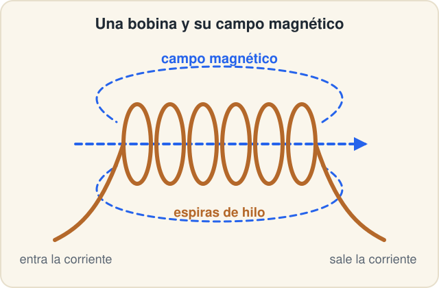

En la lata de Amparo había una cajita rotulada *ferritas varias*, llena de anillos y barritas de un material gris oscuro, y junto a ella varios carretes de hilo de cobre barnizado. «Con esto se hacen las bobinas», dijo Vicente. «Un trozo de hilo enrollado. No hay componente más tonto de aspecto ni más listo de comportamiento.»

La bobina es la pareja del condensador: hace con la corriente justo lo contrario. Pero para entender por qué un simple hilo enrollado hace algo, hay que dar antes un rodeo por el magnetismo y por una palabra que ya asomó en la sección 3, con el imán y el clip: *campo*. Ahora la miramos despacio. Por eso la bobina, como el condensador, ocupa dos lecciones. En esta verás qué es un campo, qué relación hay entre electricidad y magnetismo y por qué una bobina se resiste a los cambios de corriente. En la siguiente, lo que eso significa para la corriente continua y para la alterna.

## Qué es un campo

Recuerda el imán y el clip de la sección 3. Antes de que se toquen, el clip salta hacia el imán. Entre los dos no hay nada, solo aire, y sin embargo el imán ha tirado del clip **a distancia**. Entonces dijimos que el imán crea a su alrededor un **campo**. Esta es la definición, con más cuidado:

> **Campo:** la zona que rodea a un objeto en la que ese objeto ejerce una fuerza sobre otros sin tocarlos.

No es nada exótico; llevas toda la vida dentro de uno. La Tierra tira de ti sin tocarte: estás en su campo gravitatorio. Un campo es simplemente la manera de decir «aquí se nota una fuerza».

En este curso aparecen dos:

- El **campo eléctrico** rodea a las cargas eléctricas. Es el que hace que los electrones se repelan sin tocarse, y el que transmitía el «empujón» por los cables en la sección 2. Ya lo has visto trabajar en el condensador: entre sus dos placas cargadas hay un campo eléctrico, y es en él donde queda guardada la energía.
- El **campo magnético** rodea a los imanes. Es el que mueve el clip y orienta la aguja de una brújula.

Un campo es más intenso cerca del objeto que lo crea y se debilita al alejarse. Y, cosa importante para lo que viene, **un campo contiene energía**: cuesta trabajo crearlo, y ese trabajo se recupera cuando el campo desaparece.

## Primer descubrimiento: la corriente crea magnetismo

Hasta 1820, electricidad y magnetismo se estudiaban como cosas sin relación. Ese año, el profesor danés Hans Christian Ørsted estaba dando una clase con una pila y un cable, y vio que la aguja de una brújula que tenía cerca se desviaba cada vez que conectaba la corriente.

La brújula solo se mueve ante un campo magnético. La conclusión era inevitable:

> **Toda corriente eléctrica crea un campo magnético a su alrededor.**

Mientras circula corriente por un cable, el cable se comporta como un imán débil. Si cesa la corriente, el campo desaparece.

El campo de un cable recto es muy flojo. Pero si enrollas el cable en muchas vueltas, los campos de todas las vueltas se suman en el interior del rollo y el resultado es un campo intenso. Acabas de fabricar un **electroimán**, y también el componente de esta lección.

> **Bobina** (también llamada *inductor*): un hilo conductor enrollado en espiral. Cada vuelta se llama **espira**.

Por fuera es lo que parece: unas vueltas de hilo de cobre barnizado (el barniz es aislante, para que las espiras no se toquen entre sí). A veces el hilo se enrolla en el aire, y a veces alrededor de un **núcleo** de hierro o de **ferrita**, una cerámica gris oscura con propiedades magnéticas: lo que había en la cajita de Amparo. El núcleo concentra el campo magnético y lo multiplica muchas veces.

## Segundo descubrimiento: el magnetismo que cambia crea electricidad

Si la corriente crea magnetismo, ¿podrá el magnetismo crear corriente? El inglés Michael Faraday lo persiguió durante años sin éxito: por potente que fuera el imán que ponía junto a un hilo, no pasaba nada. En 1831 lo consiguió, y la clave estaba en un detalle. La aguja de su medidor solo daba un saltito **en el momento** en que el campo magnético aparecía, desaparecía o se movía; por ejemplo, al acercar o alejar un imán de una bobina. En cuanto el campo se quedaba quieto, la aguja volvía a cero.

> **Un campo magnético que cambia induce una tensión en los conductores que atraviesa.** Si el campo no cambia, por intenso que sea, no induce nada.

A este fenómeno se le llama **inducción electromagnética**. Es el principio de los generadores de las centrales eléctricas (un imán girando junto a bobinas), del transformador que verás dentro de dos lecciones y, como descubrirás en la sección 6, de las propias ondas de radio.

La palabra clave es **cambia**. Guárdala, porque explica todo lo que sigue.

## La bobina se induce a sí misma

Ahora junta los dos descubrimientos en una sola bobina.

1. Haces pasar una corriente por la bobina. Esa corriente crea un campo magnético en su interior (Ørsted).
2. Si la corriente **cambia** —sube o baja—, el campo magnético cambia con ella.
3. Ese campo que cambia está atravesando las espiras de la propia bobina, así que induce una tensión en ella (Faraday).
4. Y esa tensión inducida aparece siempre en el sentido que **se opone al cambio** que la ha provocado.

—¿Y por qué siempre en contra? —preguntó Marina—. ¿No podría salir a favor alguna vez?

—Piensa qué pasaría —dijo Vicente—. Subes un poco la corriente, la bobina empuja a favor, la corriente sube más, la bobina empuja más todavía… La corriente crecería sola, sin fin, sin que nadie pusiera la energía. Sería una máquina que da energía gratis, y de esas no hay.

—O sea, que la bobina se pone la zancadilla a sí misma —resumió Lucía.

—Se la pone cuando intentas cambiarle la corriente. Si la corriente quiere subir, la bobina empuja en contra para que no suba tan deprisa. Si quiere bajar, empuja a favor para que no baje tan deprisa. Mientras la corriente se queda quieta, la bobina no hace nada: es un trozo de hilo y punto.

> Una bobina **se opone a los cambios de la corriente** que la atraviesa. No se opone a la corriente en sí, sino a que varíe.

### La imagen del agua: un volante de inercia

En el circuito de agua, una bobina es **un volante de inercia**: una turbina metida en la tubería y unida a un disco de hierro muy pesado, que gira casi sin rozamiento.

Cuidado, que no es la rueda de paletas de la sección 2. Aquella hacía un trabajo (moler grano) y se quedaba con la presión del agua. Esta no hace ningún trabajo: solo cuesta ponerla en marcha y cuesta pararla.

- Al arrancar la bomba, el disco pesado tarda en coger velocidad. Al principio frena el agua; el caudal va subiendo poco a poco.
- Una vez que gira a su ritmo, ya no estorba: el agua pasa y el volante gira con ella.
- Si la bomba se para de golpe, el volante, por inercia, sigue girando y **empuja el agua** durante un rato. El caudal no cae de golpe.

El volante no se opone a que el agua circule; se opone a que el caudal cambie. Eso es la **inercia**, y la bobina es la inercia de la electricidad. La energía que el volante guarda en su giro, la bobina la guarda en su campo magnético.

Dónde cojea: un volante real tiene algo de rozamiento y acabaría parándose; la bobina ideal no pierde nada. Y en la bobina no hay nada que gire: lo que «pesa» es su campo magnético.

Esta inercia tiene una consecuencia espectacular. Si cortas de golpe la corriente de una bobina, el campo magnético se derrumba en un instante, y un cambio tan brusco induce una tensión altísima, de cientos o miles de voltios, aunque la bobina estuviera alimentada con 12. En las tuberías pasa lo mismo y tiene nombre, *golpe de ariete*: el porrazo que dan cuando se cierra un grifo de golpe y el agua en marcha no tiene adónde ir. Así saltan las chispas de las bujías de un coche, y por eso chisporrotean los interruptores que cortan la corriente de un motor, que por dentro está lleno de bobinas.

## La inductancia: cuánta inercia

> **Inductancia:** la medida de cuánto se opone una bobina a los cambios de corriente. Se escribe con la letra **L** y se mide en **henrios (H)**.

**Un henrio** es la inductancia de una bobina en la que, cuando la corriente cambia a un ritmo de 1 amperio cada segundo, aparece una tensión de 1 voltio que se opone al cambio.

El henrio, como el faradio, es una unidad grande. Las bobinas de radio se miden en **milihenrios (mH)** y sobre todo en **microhenrios (µH)**: mil microhenrios hacen un milihenrio.

La inductancia de una bobina depende de cómo esté hecha. Es mayor:

- cuantas **más espiras** tenga. Y crece deprisa: con el doble de espiras, la inductancia se multiplica por cuatro, porque hay el doble de campo y además el doble de espiras que lo notan;
- cuanto **mayor sea su diámetro**;
- cuanto **más corta y apretada** sea, a igualdad de espiras (si la estiras como un muelle, la inductancia baja);
- si tiene **núcleo** de hierro o ferrita en vez de aire.

Lo de estirar y apretar no es una curiosidad: muchas bobinas de radio se ajustan exactamente así, separando un poco sus espiras o metiendo y sacando un núcleo de ferrita con un tornillo.

## Donde la gente se lía

- **«Un imán junto a un cable produce corriente.»** Solo si el imán se mueve o el campo cambia. Un campo quieto no induce nada.
- **«La bobina se opone a la corriente.»** Se opone a que la corriente *cambie*.
- **«Una bobina es una resistencia enrollada.»** Su hilo tiene algo de resistencia, pero su efecto principal no es ese y, a diferencia de la resistencia, no convierte la energía en calor: la guarda en su campo y la devuelve.
- **«El campo magnético es algo que circula por el hilo.»** El campo está en el espacio que rodea al hilo, y sobre todo dentro de la bobina. Por el hilo circula la corriente.
- **Confundir los dos descubrimientos.** Ørsted: una corriente crea un campo magnético (siempre). Faraday: un campo magnético crea tensión (solo si cambia).

## Compruébalo tú

1. Dejas un imán potente quieto dentro de una bobina conectada a un voltímetro. ¿Qué marca el voltímetro?
2. ¿Y mientras sacas el imán?
3. Por una bobina circula una corriente constante de 2 A. ¿Hay campo magnético en su interior? ¿Se induce alguna tensión en la bobina?
4. A una bobina le añades un núcleo de ferrita. ¿Su inductancia aumenta o disminuye?
5. Tienes una bobina de 10 espiras y le das otras 10 vueltas de hilo, hasta 20. ¿Qué le pasa aproximadamente a su inductancia?
6. Convierte 2.200 µH a milihenrios.
7. Al abrir el interruptor de un circuito con una bobina grande salta una chispa en los contactos. ¿Por qué?

**Soluciones**

1. Cero. El campo no cambia, así que no induce ninguna tensión.
2. Marca una tensión mientras el imán se mueve, porque el campo que atraviesa la bobina está cambiando. En cuanto el imán se detiene o ya está lejos, vuelve a cero.
3. Sí hay campo magnético: toda corriente lo crea. Pero no se induce tensión, porque la corriente no cambia y el campo tampoco.
4. **Aumenta**: el núcleo concentra y multiplica el campo.
5. Se multiplica aproximadamente por **cuatro**.
6. Subir un peldaño, coma tres a la izquierda: **2,2 mH**.
7. Al cortar la corriente de golpe, el campo magnético se derrumba, y ese cambio tan brusco induce una tensión muy alta, suficiente para que salte la chispa en el aire entre los contactos.

## En una frase

Toda corriente crea un campo magnético, y todo campo magnético que cambia induce tensión; por eso una bobina, que es un hilo enrollado, se opone a los cambios de la corriente que la atraviesa, tanto más cuanto mayor es su inductancia (en henrios).

Con esto ya puedes adivinar qué hará una bobina con una corriente que nunca cambia y con otra que no para de cambiar.
