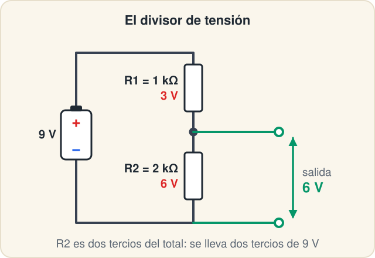

En la lección anterior viste que dos resistencias en serie se reparten la tensión de la fuente. Hoy vamos a usar ese reparto a propósito. De ahí sale uno de los circuitos más usados de toda la electrónica, tan sencillo que solo tiene dos piezas: el **divisor de tensión**. El mando de volumen de cualquier radio es uno.

Después veremos qué ocurre al conectar en serie y en paralelo los otros dos componentes de la sección 4, condensadores y bobinas, porque uno de los dos va al revés de lo que uno espera.

## El divisor de tensión

Supón que tienes una batería de 9 V y necesitas 6 V para un circuito pequeño. No hace falta otra batería. Basta con dos resistencias en serie y tomar la tensión de una de ellas.

Coloca en serie una resistencia R1 de 1 kΩ y otra R2 de 2 kΩ, y conecta el conjunto a los 9 V. Ya sabes calcular lo que pasa:

1. Resistencia total: 1.000 + 2.000 = 3.000 Ω.
2. Corriente: I = U / R = 9 / 3.000 = 0,003 A (3 mA), la misma en las dos.
3. Caída en R2: U = I × R = 0,003 × 2.000 = **6 V**.
4. Caída en R1: 0,003 × 1.000 = 3 V. (Y 6 + 3 = 9: todo cuadra.)

Entre los dos extremos de R2 hay 6 V. Si conectas ahí tu circuito pequeño —un cable al punto donde se unen las dos resistencias y otro al extremo inferior de R2—, tienes tus 6 V.

### La fórmula, y cómo leerla

Los pasos 1 a 3 se pueden juntar en una sola fórmula. La corriente es U / (R1 + R2), y la tensión en R2 es esa corriente multiplicada por R2:

**U2 = U × R2 / (R1 + R2)**

No la memorices como una ristra de letras. Léela así: *la tensión en R2 es la tensión total multiplicada por la parte que R2 representa del total de resistencia.* En el ejemplo, R2 es 2.000 de un total de 3.000, es decir, dos tercios. Y dos tercios de 9 V son 6 V.

Con esa lectura, muchos divisores se resuelven de cabeza:

- **Dos resistencias iguales:** cada una es la mitad del total, así que cada una se lleva la mitad de la tensión. Con 12 V, 6 V y 6 V.
- **R2 es el triple que R1:** R2 es tres partes de cuatro. Se lleva tres cuartos de la tensión.

**Ejemplo.** *Un divisor con R1 = 10 kΩ y R2 = 5 kΩ se conecta a 12 V. ¿Qué tensión hay en R2?*

U2 = 12 × 5 / (10 + 5) = 12 × 5 / 15 = 12 × 1/3 = **4 V**

(Aquí hemos dejado las resistencias en kilohmios sin convertir. Se puede porque en la fórmula hay kilohmios arriba y abajo de la división, y se anulan. Lo que importa es que las dos estén en la misma unidad.)

### El mando de volumen es un divisor

En la sección 4 conociste el **potenciómetro**: una resistencia con un tercer contacto que se desliza a lo largo de ella cuando giras el eje. Ese contacto móvil parte la resistencia en dos trozos, uno por encima y otro por debajo. Son R1 y R2, y al girar el mando cambias el reparto: un divisor de tensión ajustable.

En un mando de volumen, la señal de audio entra por los extremos y sale por el contacto móvil. Con el mando abajo, R2 es casi nada y sale casi nada. Con el mando arriba, R2 es casi todo y sale casi toda la señal.

Los divisores están por todas partes: fijan las tensiones con las que trabajan los transistores, reducen las tensiones grandes para que un instrumento pueda medirlas, ajustan niveles entre etapas.

### La letra pequeña del divisor

—Entonces —dijo Lucía—, con dos resistencias y la batería del coche me hago un cargador de móvil de 5 voltios y me ahorro comprarlo.

—No te lo recomiendo —dijo Dani—. El divisor da la tensión que has calculado *mientras no le conectes nada que pida corriente*. En cuanto le cuelgas algo, ese algo queda en paralelo con R2, y un paralelo…

—…tiene menos resistencia que la menor —terminó Marina.

—Eso. Hazlo con el divisor de antes, el de 1 kΩ y 2 kΩ que daba 6 V. Cuélgale a la salida algo que tenga 2 kΩ. Abajo ya no hay 2 kΩ: hay 2 kΩ en paralelo con 2 kΩ, o sea, 1 kΩ. Ahora las dos mitades del divisor son iguales y salen 9 × 1/2 = 4,5 V, no 6. Y cuanta más corriente pida lo que cuelgas, más se hunde. El divisor sirve para dar una tensión de referencia a cosas que apenas consumen. Para alimentar aparatos hace falta un regulador, que es la cuarta aduana de la fuente (lección 6).

Es el límite del divisor, y conviene conocerlo: **lo que conectes a la salida forma parte del circuito y cambia el reparto.**

## Bobinas y condensadores, en serie y en paralelo

Las resistencias no son lo único que se combina. Las reglas para los otros dos componentes caen en el examen, y una de ellas va al revés de lo que uno espera.

**Las bobinas se comportan como las resistencias.** En serie se suman: la corriente tiene que vencer la inercia de una y después la de la otra, y cada una aporta la suya. En paralelo se combinan con la fórmula de los inversos, y el total es menor que la menor. (Esto vale si las bobinas están lo bastante separadas para que el campo magnético de una no alcance a la otra. Si se acoplan, la cuenta cambia: es lo que pasa en un transformador.)

**Los condensadores van al revés.** Para verlo, recuerda de qué depende la capacidad de un condensador: crece con la superficie de las placas y disminuye cuando las placas se alejan.

- **En paralelo**, las placas de un condensador quedan unidas a las del otro: es como tener un solo condensador con las placas más grandes. Más superficie, más capacidad. **En paralelo, las capacidades se suman.**
- **En serie**, un condensador va detrás del otro. Hay dos separaciones seguidas en el camino: es como un solo condensador con las placas el doble de alejadas. (Con el agua: dos membranas de goma seguidas en la misma tubería ceden menos que una sola.) Menos capacidad. **En serie, se usa la fórmula de los inversos, y el total es menor que el menor.**

Los atajos son los mismos que conoces, cambiados de sitio: dos condensadores iguales **en serie** dan la mitad; dos distintos en serie, producto partido por suma.

| | En serie | En paralelo |
|---|---|---|
| **Resistencias** | Se suman | Inversos: menor que la menor |
| **Bobinas** | Se suman | Inversos: menor que la menor |
| **Condensadores** | **Inversos: menor que el menor** | **Se suman** |

**Ejemplos:**

- *100 nF y 220 nF en paralelo:* 100 + 220 = **320 nF**.
- *Dos condensadores de 47 µF en serie:* dos iguales, la mitad: **23,5 µF**.
- *6 µF y 3 µF en serie:* (6 × 3) / (6 + 3) = 18 / 9 = **2 µF**. Comprobación: menor que el menor.
- *Dos bobinas de 10 µH en serie:* **20 µH**. En paralelo: **5 µH**.

¿Para qué pondría alguien condensadores en serie, si pierde capacidad? Porque a cambio la tensión se reparte entre ellos, y el conjunto aguanta más voltios que cada uno por separado. (Si son iguales, se la reparten a partes iguales; si no, el de menor capacidad se queda con más tensión, y hay que tenerlo en cuenta.) Y en paralelo se ponen, sencillamente, para conseguir una capacidad mayor de la que se tiene a mano: en las fuentes de alimentación es habitual ver varios electrolíticos grandes lado a lado.

## Donde la gente se lía

- **Aplicar a los condensadores la regla de las resistencias.** Es el error preferido del examen. Condensadores en paralelo se suman; en serie, disminuyen.
- **Creer que el divisor «gasta» la tensión que sobra en R1 sin más consecuencias.** La reparte, sí, pero solo mantiene el reparto si a la salida no se le pide corriente apreciable.
- **Olvidar que lo que se conecta a la salida de un divisor cambia el divisor.** Queda en paralelo con la resistencia de abajo y baja la tensión de salida.

## Compruébalo tú

1. Un divisor con R1 = 3 kΩ y R2 = 1 kΩ se conecta a 12 V. ¿Qué tensión hay en R2?
2. Un divisor de dos resistencias iguales de 47 kΩ se conecta a 5 V. ¿Qué tensión hay en cada una? Resuélvelo sin fórmula.
3. Giras un potenciómetro hasta que el contacto móvil queda a un cuarto del recorrido contando desde abajo. Si entran 8 V, ¿cuántos salen, aproximadamente?
4. Tres condensadores de 100 pF en paralelo. ¿Capacidad total?
5. Un condensador de 20 nF y otro de 30 nF en serie. ¿Capacidad total?
6. Dos bobinas de 50 µH en paralelo, sin acoplamiento entre ellas. ¿Inductancia total?
7. A un divisor de dos resistencias de 10 kΩ alimentado con 12 V le conectas en la salida una carga de 10 kΩ. ¿Qué tensión había antes en la salida y cuál hay ahora?

**Soluciones**

1. R2 es 1 de un total de 4 kΩ: la cuarta parte. 12 × 1/4 = **3 V**. (Con la fórmula: 12 × 1 / (3 + 1) = 3 V.)
2. Iguales: cada una se lleva la mitad. **2,5 V**.
3. La parte de abajo (R2) es un cuarto de la resistencia total, así que sale un cuarto de la tensión: **2 V**.
4. En paralelo se suman: **300 pF**.
5. En serie, producto partido por suma: (20 × 30) / (20 + 30) = 600 / 50 = **12 nF**. Menor que el menor: correcto.
6. Bobinas en paralelo, como resistencias; dos iguales, la mitad: **25 µH**.
7. Antes: dos iguales, la mitad, **6 V**. Ahora la parte de abajo es 10 kΩ en paralelo con 10 kΩ, es decir, 5 kΩ, de un total de 15 kΩ: un tercio. 12 × 1/3 = **4 V**.

## En una frase

Dos resistencias en serie reparten la tensión en proporción a su valor, y eso es un divisor (mientras a la salida no se le pida corriente); las bobinas se combinan como las resistencias, y los condensadores al revés: suman en paralelo.

Hasta aquí, cada componente por su lado. En la lección siguiente juntamos una bobina y un condensador y aparece lo que Dani llamó la palabra más bonita del idioma: el circuito resonante.
