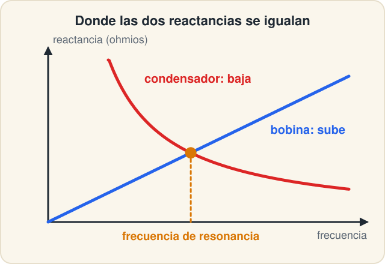

En el club, Dani llamó «columpio» a la pareja de una bobina y un condensador, y dijo que ese columpio era la sintonía. Esta lección y la siguiente desmontan esa frase pieza a pieza. Son las más importantes de la sección, porque el circuito resonante es lo que permite a una radio quedarse con una sola emisora entre las miles que le llegan a la vez.

Al terminar esta sabrás qué es la impedancia, por qué una bobina y un condensador juntos tienen un ritmo propio y cómo se calcula ese ritmo sin pelearte con ristras de ceros. En la siguiente verás qué cambia según se conecten en serie o en paralelo.

## Primero, una palabra pendiente: impedancia

En la sección 4 viste que, con corriente alterna, tres componentes se oponen al paso de la corriente, cada uno a su manera:

- La **resistencia** se opone siempre igual, sea cual sea la frecuencia, y convierte la energía en calor.
- El **condensador** se opone con su **reactancia capacitiva** (XC), que **baja** cuando la frecuencia sube.
- La **bobina** se opone con su **reactancia inductiva** (XL), que **sube** cuando la frecuencia sube.

Las tres oposiciones se miden en ohmios. A la oposición total que presenta un circuito a la corriente alterna, combinando todo lo que haya dentro, se le llama **impedancia**:

> **Impedancia (Z):** la oposición total de un circuito al paso de la corriente alterna. Se mide en **ohmios (Ω)**.

La impedancia es a la alterna lo que la resistencia es a la continua, y la ley de Ohm sigue valiendo si pones Z en el lugar de R: **I = U / Z**.

Dice «combinando» y no «sumando» a propósito: resistencias y reactancias no se suman sin más, y en la lección siguiente verás cómo se combinan. La razón está en una diferencia de fondo que conviene tener clara desde ya. Una resistencia **gasta** la energía: la convierte en calor y no la devuelve. Un condensador y una bobina **no la gastan: la guardan un momento y la devuelven**. El condensador la guarda en su campo eléctrico cuando se carga y la suelta al descargarse. La bobina la guarda en su campo magnético mientras pasa corriente y la suelta cuando la corriente decae. Son dos almacenes, no dos estufas.

De esa capacidad de guardar y devolver sale todo lo que sigue.

## Dos almacenes que se pasan la energía

Carga un condensador con una batería, retira la batería y conecta el condensador a una bobina. No hay nada más en el circuito: ninguna fuente. Lo que ocurre se entiende mirando cuatro instantes:

1. **El condensador está cargado y la corriente es cero.** Toda la energía está en el condensador. Empieza a descargarse a través de la bobina, pero la bobina, que se opone a los cambios de corriente, no deja que la corriente arranque de golpe: va creciendo poco a poco.
2. **El condensador se ha vaciado y la corriente es máxima.** Toda la energía está ahora en el campo magnético de la bobina. Y la bobina tampoco deja que la corriente se detenga de golpe: tiene inercia. La corriente sigue circulando en el mismo sentido y empieza a cargar el condensador al revés.
3. **El condensador está cargado al revés y la corriente es cero.** La placa que antes era positiva ahora es la negativa. Toda la energía ha vuelto al condensador, que empieza a descargarse otra vez, ahora en sentido contrario.
4. **El condensador se ha vaciado de nuevo y la corriente es máxima, en sentido contrario.** La energía está otra vez en la bobina, cuya inercia vuelve a cargar el condensador como estaba al principio.

Y del instante 4 se vuelve al 1. La energía va y viene de un almacén al otro, y la corriente del circuito cambia de sentido una y otra vez: es una corriente alterna, que se ha puesto en marcha sola.

Es exactamente lo que le pasa a un columpio. Arriba del todo está quieto y tiene toda su energía en forma de altura. Al pasar por abajo no tiene altura, pero va a máxima velocidad: la energía está en el movimiento. La inercia lo sube por el otro lado, hasta que se detiene arriba, y vuelve. Altura, velocidad, altura, velocidad. El condensador cargado es el columpio arriba; la corriente en la bobina es el columpio pasando por abajo a toda velocidad.

En el circuito de agua se ve con las dos imágenes de la sección 4. El condensador es la membrana de goma que cierra la tubería; la bobina, el volante de inercia. La membrana tensada empuja el agua, el agua pone en marcha el volante, y el volante, por su inercia, sigue moviendo agua hasta tensar la membrana hacia el otro lado.

Como en un columpio de verdad, el vaivén no dura siempre. El hilo de la bobina tiene algo de resistencia, y en cada viaje una pequeña parte de la energía se pierde en calor. Las oscilaciones se van apagando, igual que un columpio al que nadie empuja. Para mantenerlas hay que reponer esa energía con pequeños empujones dados a su ritmo. De eso se encargan los osciladores, en la última lección de la sección.

> **Circuito resonante** (también *circuito sintonizado* o *circuito LC*): una bobina y un condensador conectados entre sí, que intercambian energía a un ritmo propio.

## El ritmo propio: la frecuencia de resonancia

Un columpio tiene su ritmo y no hay forma de hacerle ir a otro: si es largo, va despacio; si es corto, deprisa. Un circuito LC, igual. La frecuencia a la que la energía va y viene se llama **frecuencia de resonancia**, se escribe **f₀** («efe sub cero») y depende solo de dos cosas: la inductancia de la bobina (L) y la capacidad del condensador (C).

El sentido de esa dependencia se entiende sin fórmulas:

- Un **condensador más grande** tarda más en llenarse y vaciarse. El vaivén se hace más lento.
- Una **bobina más grande** tiene más inercia: la corriente tarda más en arrancar y en parar. El vaivén se hace más lento.

> **A más L o más C, menor frecuencia de resonancia. A menos L o menos C, mayor frecuencia.**

Esta regla cae en el examen casi siempre, y explica cómo sintonizaban las radios antiguas. Aquel mando grande giraba **condensadores variables**: unas placas que se enfrentaban más o menos. Al girarlo cambiaba C, y con C cambiaba la frecuencia propia de los circuitos resonantes del aparato.

### La fórmula

**f₀ = 1 / (2π × √(L × C))**

Con L en henrios y C en faradios, el resultado sale en hercios. Parece un monstruo, pero cada trozo dice algo que ya sabes:

- **L × C está abajo, dividiendo.** Cuanto mayores sean L y C, menor sale la frecuencia. Es la regla de arriba.
- **La raíz cuadrada (√)** indica que el efecto no es proporcional, sino más suave. La raíz cuadrada de un número es el número que, multiplicado por sí mismo, da el primero: la raíz de 9 es 3, la de 100 es 10. Consecuencia práctica: para bajar la frecuencia a la mitad no basta con duplicar el condensador; hay que hacerlo **cuatro** veces mayor (porque la raíz de 4 es 2).
- **2π** es un número fijo, aproximadamente 6,28. Aparece en todas las fórmulas de oscilaciones porque las matemáticas describen un vaivén como una vuelta completa a un círculo, y una vuelta completa mide 2π. Lo viste ya en las fórmulas de las reactancias.

### El atajo que se usa de verdad

El inconveniente de la fórmula es práctico: las bobinas de radio se miden en millonésimas de henrio y los condensadores en billonésimas de faradio, y meter eso en una calculadora es llenar la pantalla de ceros. Por eso existe una versión ya preparada para las unidades habituales, que da exactamente lo mismo:

**f₀ (en MHz) = 159 / √(L × C)**, con **L en microhenrios (µH)** y **C en picofaradios (pF)**

(El 159 no tiene misterio: es lo que queda al hacer 1 / 2π y ajustar los ceros de las unidades.)

**Ejemplo.** *¿Cuál es la frecuencia de resonancia de una bobina de 10 µH con un condensador de 100 pF?*

1. **L × C** = 10 × 100 = 1.000.
2. **Raíz cuadrada** de 1.000, con la calculadora: 31,6.
3. **159 entre eso:** 159 / 31,6 ≈ **5,03 MHz**.

Una bobina de unas pocas vueltas y un condensador diminuto resuenan en plena onda corta.

**Otro ejemplo.** *Con la misma bobina de 10 µH, ¿a qué frecuencia resuena con un condensador de 400 pF?*

L × C = 4.000; su raíz, 63,2; 159 / 63,2 ≈ **2,5 MHz**. El condensador es cuatro veces mayor y la frecuencia ha bajado a la mitad, como avisaba la raíz.

Y al revés: para subir de 5 a 10 MHz sin cambiar la bobina, el condensador tendría que ser la cuarta parte, 25 pF.

## Qué tiene de especial esa frecuencia

Recuerda las dos reactancias: la de la bobina sube con la frecuencia y la del condensador baja. Si vas subiendo la frecuencia desde cero, una crece y la otra mengua, así que tiene que haber una frecuencia, y solo una, en la que **las dos valen lo mismo**.

Esa frecuencia es justamente la de resonancia. No hace falta creérselo; se puede comprobar con el ejemplo de antes (10 µH, 100 pF, 5,03 MHz) y las dos fórmulas de la sección 4:

- Bobina: XL = 2π × f × L = 6,28 × 5.030.000 × 0,00001 ≈ **316 Ω**
- Condensador: XC = 1 / (2π × f × C) = 1 / (6,28 × 5.030.000 × 0,0000000001) ≈ **316 Ω**

Iguales. A cualquier otra frecuencia, una de las dos gana: por debajo de 5,03 MHz estorba más el condensador; por encima, la bobina.

> **En la frecuencia de resonancia, la reactancia de la bobina y la del condensador son iguales: XL = XC.**

Que sean iguales no parece gran cosa. Lo que lo hace importante es que, además, son *contrarias*, y cuando dos cosas iguales y contrarias se encuentran, se anulan. Qué significa eso, y qué consecuencias tiene según cómo se conecten la bobina y el condensador, es el asunto de la lección siguiente.

## Donde la gente se lía

- **«A más bobina o más condensador, más frecuencia.»** Al revés. Columpio más grande, vaivén más lento: la frecuencia baja.
- **«Duplico el condensador y la frecuencia baja a la mitad.»** No: por la raíz cuadrada, baja solo a un 71 %. Para la mitad hay que cuadruplicarlo.
- **Usar el atajo con las unidades equivocadas.** El 159 solo vale con microhenrios y picofaradios, y da megahercios.
- **Creer que una reactancia gasta energía como una resistencia.** Solo la resistencia la convierte en calor. La reactancia la almacena y la devuelve.
- **Pensar que el circuito LC oscila para siempre.** Las pérdidas lo van apagando; hace falta algo que reponga la energía.

## Compruébalo tú

1. En un circuito resonante sustituyes el condensador por otro de mayor capacidad. ¿La frecuencia de resonancia sube, baja o no cambia?
2. Quieres que un circuito LC resuene a una frecuencia más alta. Di dos cosas que puedes hacer.
3. En el vaivén de un circuito LC, ¿dónde está la energía en el instante en que la corriente es máxima? ¿Y cuando la corriente es cero?
4. Calcula con el atajo la frecuencia de resonancia de una bobina de 4 µH con un condensador de 100 pF.
5. Para bajar la frecuencia de resonancia a un tercio sin tocar la bobina, ¿por cuánto hay que multiplicar la capacidad?
6. Un circuito resuena a 7 MHz. A esa frecuencia, la reactancia de su bobina es de 440 Ω. ¿Cuánto vale la de su condensador?
7. ¿Por qué las oscilaciones de un circuito LC real se van apagando?

**Soluciones**

1. **Baja.** Más capacidad, vaivén más lento.
2. Reducir la capacidad del condensador o reducir la inductancia de la bobina (o las dos).
3. Con corriente máxima, toda en el campo magnético de la **bobina** (el condensador está vacío). Con corriente cero, toda en el **condensador**, que está cargado.
4. L × C = 4 × 100 = 400; su raíz, 20; 159 / 20 = **7,95 MHz**, casi 8 MHz.
5. Por **nueve**: la raíz cuadrada de 9 es 3.
6. También **440 Ω**: en resonancia, XL = XC.
7. Porque el hilo de la bobina tiene resistencia, y en cada vaivén una parte de la energía se convierte en calor.

## En una frase

Una bobina y un condensador juntos se pasan la energía de uno a otro a un ritmo propio, la frecuencia de resonancia, que baja cuando L o C aumentan y que se calcula con f₀ = 159 / √(L × C) en megahercios, microhenrios y picofaradios; a esa frecuencia, sus dos reactancias son iguales.

En la lección siguiente, lo que ocurre cuando a ese circuito le llega una señal de fuera, y por qué da resultados opuestos conectarlo en serie o en paralelo.
