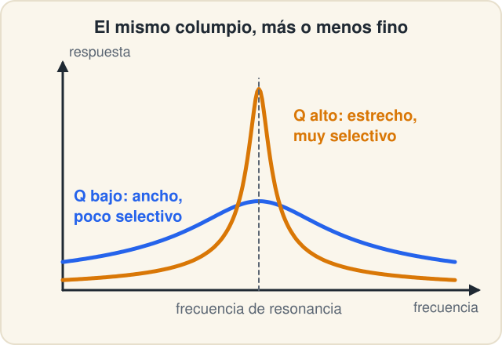

La lección anterior terminó en un punto concreto: a la frecuencia de resonancia, la reactancia de la bobina y la del condensador valen lo mismo. Con el ejemplo de 10 µH y 100 pF, las dos eran de 316 Ω a 5,03 MHz.

Aquí vemos qué se hace con eso. Al terminar sabrás por qué esas dos reactancias se anulan, qué diferencia hay entre conectar bobina y condensador en serie o en paralelo —pregunta clásica de examen— y qué es el factor Q, el número que dice lo fino que es el «columpio».

## Iguales y contrarias

Recuerda de la sección 4 cómo se comporta cada componente frente a una alterna:

- En una **bobina**, la tensión va un cuarto de ciclo **por delante** de la corriente.
- En un **condensador**, la tensión va un cuarto de ciclo **por detrás** de la corriente.

(Es lo mismo que viste allí, dicho desde el otro lado: si en la bobina la corriente va retrasada respecto a la tensión, la tensión va adelantada respecto a la corriente.)

Ahora pon los dos en serie. Por los dos pasa la misma corriente. Respecto a esa corriente, la tensión de la bobina va un cuarto de ciclo adelantada y la del condensador un cuarto retrasada: entre una y otra hay **medio ciclo**. Están en **oposición de fase**, y en la sección 3 viste lo que eso significa: cuando una sube, la otra baja, y al juntarlas se restan.

Por eso las reactancias de una bobina y un condensador no se suman: **se restan**. A la diferencia se le llama *reactancia neta*. Y si las dos son iguales —que es justo lo que pasa en resonancia—, la resta da cero: se anulan.

—O sea —dijo Marina—, que cada uno por separado estorba trescientos ohmios, y los dos juntos no estorban nada.

—A esa frecuencia, y solo a esa —dijo Dani—. Lo que la bobina pide en cada instante es justo lo que el condensador está devolviendo. Se lo pasan entre ellos y de fuera no hace falta nada.

Lo que eso significa en la práctica depende de cómo estén conectados.

## En serie: impedancia mínima

Bobina y condensador uno detrás de otro, en el camino de la señal. A la frecuencia de resonancia sus reactancias se anulan, y lo único que queda para oponerse a la corriente es la pequeña resistencia del hilo. La **impedancia es mínima** y la **corriente es máxima**.

Para todas las demás frecuencias, las reactancias no se anulan y el circuito estorba: a las bajas las frena el condensador; a las altas, la bobina.

Un LC serie es una puerta que solo se abre de par en par para una frecuencia.

## En paralelo: impedancia máxima

Bobina y condensador uno al lado del otro. A la frecuencia de resonancia ocurre el vaivén de la lección anterior: la energía circula *por dentro*, de la bobina al condensador y vuelta, y el conjunto apenas necesita tomar corriente del exterior, solo la justa para reponer las pérdidas. Visto desde fuera, un circuito que casi no toma corriente es un circuito con una **impedancia altísima**. En resonancia, la **impedancia del LC paralelo es máxima**.

—Eso es al revés de todo lo que me habéis contado —protestó Marina—. En paralelo siempre había *menos* resistencia.

—Con resistencias, sí —dijo Dani—. Pero esto son dos reactancias contrarias. A frecuencias bajas, la corriente se cuela por la bobina, que para lo lento es casi un cable. A frecuencias altas se cuela por el condensador, que para lo rápido es casi un cable también. Solo a la frecuencia de resonancia no se cuela por ninguno, porque lo que quiere uno es justo lo que devuelve el otro.

Un LC paralelo es, pues, un tapón para una sola frecuencia. Y un tapón da dos resultados opuestos según dónde se ponga:

- **Entre el camino de la señal y masa.** Todas las frecuencias que no son la suya encuentran por él un camino fácil hacia masa y se pierden. La de resonancia encuentra el tapón, no puede escaparse y es la única que sigue adelante. De las mil emisoras que traía la antena, queda una. Es el **circuito de sintonía** clásico.
- **En el propio camino de la señal.** Aquí el tapón corta el paso precisamente a su frecuencia y deja pasar las demás. A este uso se le llama **trampa**, y lo encontrarás en las antenas de la sección 8.

| | LC en serie | LC en paralelo |
|---|---|---|
| Impedancia en resonancia | **Mínima** | **Máxima** |
| Corriente que toma en resonancia | Máxima | Mínima |
| Imagen | Una puerta abierta solo para esa frecuencia | Un tapón solo para esa frecuencia |
| En el camino de la señal | La deja pasar (y frena las demás) | Le corta el paso (trampa) |
| Entre el camino y masa | Se la traga y la elimina | Impide que se escape (sintonía) |

La pareja «serie, mínima; paralelo, máxima» es pregunta clásica de examen.

## Cuando además hay resistencia: la impedancia completa

Queda pendiente cómo se combina una resistencia con una reactancia. No se suman, y la razón es otra vez la fase.

En una resistencia, la tensión va al compás de la corriente. En una reactancia va un cuarto de ciclo desplazada. Cuando la tensión de la resistencia está en su cresta, la de la reactancia está pasando por cero, y al revés: sus máximos nunca coinciden. Por eso el total es menor que la suma de los dos. Las matemáticas de dos cosas desfasadas un cuarto de ciclo son las de los dos lados de una esquina en ángulo recto, y el total es la diagonal:

**Z = √(R² + X²)**

donde X es la reactancia neta (la de la bobina menos la del condensador) y el «²» significa multiplicar el número por sí mismo.

**Ejemplo.** *Un circuito serie tiene R = 30 Ω y una reactancia neta X = 40 Ω. ¿Cuál es su impedancia?*

Z = √(30² + 40²) = √(900 + 1.600) = √2.500 = **50 Ω** (y no 70).

En resonancia, X vale cero y queda Z = R: solo la resistencia, como hemos dicho.

## El factor Q: lo fino que es el columpio

Dos circuitos pueden resonar a la misma frecuencia y comportarse de forma muy distinta. La diferencia está en sus pérdidas.

Un columpio bien engrasado, al que das un empujón, se balancea decenas de veces antes de pararse. Uno oxidado se para en tres. Con los circuitos LC pasa igual: cuanta menos resistencia tenga el hilo de la bobina, menos energía se pierde en cada vaivén.

Esa cualidad se mide con el **factor de calidad**, o **factor Q** (de *quality*): compara lo que el circuito almacena con lo que pierde. Se calcula dividiendo la reactancia de la bobina en resonancia entre la resistencia de pérdidas:

**Q = XL / R**

Es un número sin unidades. En el ejemplo de siempre, la bobina tenía 316 Ω de reactancia; si su hilo tiene 3 Ω de resistencia, Q = 316 / 3 ≈ **105**.

> **Q alto:** pocas pérdidas. El circuito responde con mucha fuerza a su frecuencia exacta y casi nada a las vecinas: es muy **selectivo**.
> **Q bajo:** muchas pérdidas. Responde con desgana a una franja ancha de frecuencias: es poco selectivo.

A la anchura de la franja a la que el circuito responde bien se le llama **ancho de banda** (B). «Bien» tiene una definición precisa, con los decibelios de la sección 3: la franja llega, a cada lado, hasta donde la respuesta ha caído a la mitad de potencia, es decir, 3 dB. Y se relaciona con el Q de la forma más sencilla posible:

**B = f₀ / Q**

*El ancho de banda es la frecuencia de resonancia dividida entre el factor Q.* A más Q, franja más estrecha.

**Ejemplo.** *Un circuito resuena a 7 MHz y tiene un Q de 100. ¿Qué ancho de banda tiene?*

B = 7.000.000 / 100 = **70.000 Hz = 70 kHz**

Deja pasar bien desde unos 6,965 hasta unos 7,035 MHz. Con un Q de 10, la franja sería de 700 kHz: más de tres veces la banda de 40 metros entera, que mide 200 kHz.

No siempre interesa el Q más alto posible: una voz ocupa unos cuantos kilohercios, y un circuito demasiado estrecho la recortaría. Se elige el Q que deja pasar lo que se quiere y nada más.

## Donde la gente se lía

- **Cruzar serie y paralelo.** Serie: en resonancia, impedancia mínima. Paralelo: máxima. Truco para no dudar: en serie las dos reactancias contrarias están en fila y *se anulan*, luego no queda casi nada que estorbe.
- **Leer «tapón» como «rechaza».** El LC paralelo tapona su frecuencia. Si el tapón está en la salida hacia masa, esa frecuencia se queda (sintonía); si está en el camino, no pasa (trampa).
- **Sumar resistencia y reactancia.** 30 Ω y 40 Ω dan 50 Ω, no 70.
- **Confundir Q alto con «mejor» en todo.** Q alto es más selectivo, y eso significa también más estrecho.

## Compruébalo tú

1. Un circuito LC **serie** recibe una señal exactamente a su frecuencia de resonancia. ¿La corriente que lo atraviesa es grande o pequeña?
2. ¿Por qué el circuito de sintonía que se pone entre la señal y masa es un LC **paralelo** y no uno serie?
3. A cierta frecuencia, una bobina tiene XL = 500 Ω y el condensador que está en serie con ella, XC = 200 Ω. ¿Cuál es la reactancia neta? ¿Está el circuito en resonancia?
4. Un circuito serie tiene R = 6 Ω y una reactancia neta X = 8 Ω. ¿Cuánto vale su impedancia?
5. La bobina de un circuito resonante tiene una reactancia de 400 Ω en resonancia y una resistencia de 5 Ω. ¿Cuál es su factor Q?
6. Un circuito resuena a 3,6 MHz y tiene un Q de 60. ¿Cuál es su ancho de banda?
7. Dos circuitos resuenan a 14 MHz; uno tiene Q = 50 y el otro Q = 200. ¿Cuál separará mejor dos emisoras muy próximas?

**Soluciones**

1. **Grande.** En serie y en resonancia la impedancia es mínima, así que la corriente es máxima.
2. Porque el paralelo tiene impedancia **máxima** en resonancia: no deja que esa frecuencia se escape a masa, mientras que todas las demás sí se escapan. Un LC serie en ese sitio haría justo lo contrario: mandaría a masa precisamente la frecuencia de resonancia.
3. Se restan: 500 − 200 = **300 Ω**. **No** está en resonancia: para eso tendrían que ser iguales. Como gana la bobina, la frecuencia está por encima de la de resonancia.
4. Z = √(6² + 8²) = √(36 + 64) = √100 = **10 Ω**.
5. Q = XL / R = 400 / 5 = **80**.
6. B = f₀ / Q = 3.600.000 / 60 = **60.000 Hz = 60 kHz**.
7. El de **Q = 200**: su ancho de banda es 14.000 / 200 = 70 kHz, frente a los 280 kHz del otro. Más estrecho, más selectivo.

## En una frase

En resonancia, las reactancias de bobina y condensador son iguales y contrarias y se anulan: en serie queda una impedancia mínima (una puerta para esa frecuencia) y en paralelo una impedancia máxima (un tapón), y el factor Q = XL / R dice lo estrecha que es la respuesta: B = f₀ / Q.

Con un circuito resonante se selecciona una frecuencia. Con unos cuantos componentes más se puede decidir qué franjas enteras del espectro pasan y cuáles no. Son los filtros.
