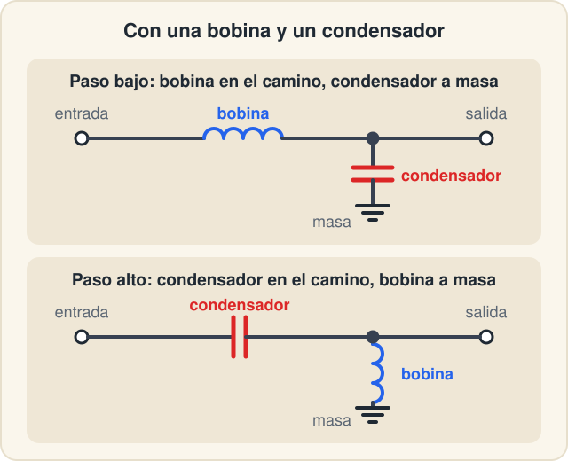

Dani comparó los filtros de una radio con el de una cafetera: deja pasar el café y retiene los posos, solo que aquí los posos son frecuencias.

Por una antena, por un cable o por un altavoz no viaja nunca una sola frecuencia: viajan muchas a la vez, las que quieres y las que no. Un filtro es el circuito que las separa. Hay cuatro tipos y los cuatro caen en el examen. Al terminar esta lección sabrás qué hace cada uno, cómo se construyen con las piezas que ya conoces, cómo reconocerlos en un esquema y dónde está cada uno dentro de una estación de radio.

## Qué es un filtro

> **Filtro:** circuito que deja pasar unas frecuencias y debilita otras.

Cuatro palabras de vocabulario, y ya puedes hablar de filtros:

- **Banda de paso:** las frecuencias que el filtro deja pasar.
- **Banda atenuada** (o *de rechazo*): las que debilita. *Atenuar* es la palabra técnica para «debilitar»; la **atenuación** se mide en decibelios, que conociste en la sección 3.
- **Frecuencia de corte (fc):** la frontera entre una y otra.
- **Pendiente:** lo brusca que es esa frontera.

Sobre la frontera hay que decir algo con honradez: ningún filtro corta como un cuchillo. No hay una frecuencia que pase entera y la de al lado que no pase nada. La atenuación va creciendo poco a poco al alejarse de la banda de paso. Por convenio, se llama frecuencia de corte al punto donde la señal ya ha perdido **la mitad de su potencia**, es decir, **3 dB** (recuerda: −3 dB es dividir la potencia entre dos).

Los filtros buenos tienen una pendiente fuerte: pasada la frecuencia de corte, la atenuación crece muy deprisa. Se consigue poniendo más componentes, uno detrás de otro: un filtro de dos piezas es suave; uno de cinco o siete ya es una pared respetable.

## El filtro más simple del mundo

No hace falta nada nuevo para construir un filtro. Basta el divisor de tensión, cambiando una pieza.

Recuerda el divisor: dos resistencias en serie, y la salida se toma en la de abajo. La tensión se reparte según lo que estorba cada una.

Ahora sustituye la resistencia de abajo por un **condensador**. El condensador también estorba, pero su estorbo —su reactancia— depende de la frecuencia:

- A **frecuencias bajas**, el condensador estorba mucho. En el reparto se lleva casi toda la tensión, y como la salida se toma en él, **la señal sale casi entera**.
- A **frecuencias altas**, el condensador casi no estorba: es prácticamente un cable que une la salida con masa. Se lleva una parte minúscula de la tensión, y **a la salida no queda casi nada**.

Acabas de construir un filtro que deja pasar las frecuencias bajas y atenúa las altas: un **filtro paso bajo**. Es un divisor de tensión cuyo reparto cambia con la frecuencia.

La frecuencia de corte de este filtro de resistencia y condensador se calcula con una fórmula de la misma familia que las que ya has visto:

**fc = 1 / (2π × R × C)**

Cuanto mayores son R y C, más lento es el circuito y más baja la frecuencia de corte. Por ejemplo, con R = 1.000 Ω y C = 0,00000016 F (160 nF): fc = 1 / (6,28 × 1.000 × 0,00000016) ≈ 1.000 Hz. Deja pasar los graves y va atenuando lo que hay por encima de 1 kHz.

Un aviso para quien quiera hacer la cuenta del reparto: la frecuencia de corte es justo aquella en la que la reactancia del condensador iguala a la resistencia. Podría pensarse que entonces cada uno se lleva la mitad de la tensión, como en un divisor de dos resistencias iguales. No es así, porque una resistencia y una reactancia no se suman sin más (lo viste en la lección anterior): al condensador le queda el 71 % de la tensión, que equivale a la mitad de la *potencia*. Por eso el corte está en −3 dB.

Si intercambias las dos piezas —el condensador arriba, en el camino de la señal, y la resistencia abajo—, obtienes lo contrario: a las frecuencias bajas las frena el condensador y no llegan a la salida; las altas pasan. Es un **filtro paso alto**.

## Los cuatro tipos

**Paso bajo.** Deja pasar las frecuencias por **debajo** de la de corte y atenúa las que están por encima. Es el filtro más importante para un radioaficionado, por una razón que ya conoces de la sección 3: todo transmisor produce, además de su señal, **armónicos**, que son copias no deseadas en el doble, el triple, el cuádruple de su frecuencia. Los armónicos están siempre por encima de la señal. Un filtro paso bajo a la salida del transmisor deja pasar la señal y corta los armónicos antes de que lleguen a la antena.

**Paso alto.** Al revés: deja pasar las frecuencias por **encima** de la de corte y atenúa las de abajo. Uso clásico: en la entrada de antena de un televisor, para que pasen los canales de televisión (frecuencias muy altas) y no entre la señal de onda corta de un vecino radioaficionado (frecuencias más bajas).

**Paso banda.** Deja pasar solo una **franja** intermedia y atenúa lo que queda por debajo y por encima. Es el filtro de la selectividad: el que permite a un receptor quedarse con una emisora y descartar a las vecinas. Un circuito resonante es un paso banda natural, y su factor Q decide la anchura de la franja.

**Rechazo de banda** (también *elimina banda*, o *notch*, que en inglés significa «muesca»). Es el negativo del anterior: lo deja pasar todo **menos** una franja estrecha. Sirve para eliminar una interferencia concreta —un pitido fijo en mitad de una conversación, por ejemplo— sin estropear lo demás.

| Filtro | Deja pasar | Uso típico en una estación |
|---|---|---|
| **Paso bajo** | Lo que está por debajo del corte | Salida del transmisor: eliminar armónicos |
| **Paso alto** | Lo que está por encima del corte | Entrada del televisor: rechazar la onda corta |
| **Paso banda** | Solo una franja | Receptor: seleccionar la señal deseada |
| **Rechazo de banda** | Todo menos una franja | Eliminar una interferencia concreta |

## Filtros con bobinas y condensadores

Los filtros de resistencia y condensador son sencillos pero tienen un defecto: la resistencia gasta parte de la señal también en la banda de paso. En radio, donde cada vatio cuenta, los filtros se hacen con **bobinas y condensadores**, que no gastan energía. Además, combinando los dos se consiguen pendientes mucho más fuertes.

La receta se deduce de lo que sabes de cada pieza:

- La **bobina** deja pasar lo lento y frena lo rápido.
- El **condensador** frena lo lento y deja pasar lo rápido.

**Para un paso bajo:** bobinas en el camino de la señal (en serie) y condensadores entre el camino y masa. Las frecuencias altas tropiezan con las bobinas, y lo poco que consigue pasar se escapa a masa por los condensadores. Las bajas atraviesan las bobinas sin problema y los condensadores no las dejan escapar.

**Para un paso alto:** al revés. Condensadores en el camino y bobinas a masa.

**Para un paso banda:** circuitos resonantes. Un LC serie en el camino de la señal (puerta abierta solo para su frecuencia) o un LC paralelo entre el camino y masa (tapón que impide que esa frecuencia, y solo esa, se escape).

**Para un rechazo de banda:** los mismos circuitos resonantes, cambiados de sitio. Un LC paralelo en el camino (tapón para su frecuencia) o un LC serie a masa (sumidero que se traga solo esa frecuencia).

Con tres piezas se consiguen pendientes mayores, y las dos disposiciones clásicas llevan el nombre de la letra que dibujan en el esquema:

- Filtro en **π** («pi»): dos elementos hacia masa, uno a cada lado, y uno en el camino entre ellos. Un paso bajo en π son dos condensadores a masa con una bobina en medio. Es el filtro típico de la salida de un transmisor.
- Filtro en **T**: dos elementos en el camino y uno hacia masa en el centro. Un paso bajo en T son dos bobinas en el camino con un condensador a masa entre ellas.

Y para un paso banda extraordinariamente estrecho se usa un **filtro de cristal**: una o varias láminas de cuarzo, que se comportan como circuitos resonantes de un Q altísimo. Conocerás el cuarzo en la última lección de la sección.

### Cómo reconocer un filtro en un esquema

No hace falta memorizar dibujos. Basta hacerse dos preguntas y contestarlas con lo que sabes de cada componente, teniendo presente una regla: **si en algún punto el camino queda unido a masa por algo que para esa señal es un cable, la señal se escapa por ahí y no llega a la salida**, aunque el camino siga dibujado hasta el final.

1. **¿Qué le pasa a una señal muy lenta, casi continua?** Para ella, cada bobina es un simple cable y cada condensador es un circuito abierto. Sigue el camino con el dedo: ¿llega a la salida sin encontrar un corte ni una fuga a masa?
2. **¿Qué le pasa a una señal rapidísima?** Para ella es al revés: cada condensador es un cable y cada bobina, un circuito abierto. ¿Llega a la salida?

Si la lenta llega y la rápida no, es un paso bajo. Si la rápida llega y la lenta no, un paso alto. Si no llega ni la lenta ni la rápida, solo puede pasar una franja intermedia: es un paso banda (y verás en él un circuito resonante). Si llegan las dos, lo único que puede faltar es una franja intermedia: un rechazo de banda.

## Dónde están los filtros en una estación

- **A la salida del transmisor**, un paso bajo que elimina los armónicos. Los equipos comerciales lo llevan dentro, uno para cada banda. Emitir armónicos es interferir a otros servicios.
- **En el receptor**, un paso banda ancho a la entrada, que deja entrar solo la banda que escuchas, y después filtros paso banda muy estrechos —muchos de ellos, filtros de cristal— que separan tu señal de las vecinas. En la sección 7 sabrás por qué se colocan donde se colocan.
- **En la fuente de alimentación**, condensadores que hacen de paso bajo para que la continua salga limpia. Es la lección siguiente.
- **En el televisor del vecino**, si hace falta, un paso alto. Esa historia llega en la sección 10.

## Donde la gente se lía

- **Confundir el nombre con lo que elimina.** El nombre dice lo que **pasa**. Un paso bajo deja pasar lo bajo (y elimina lo alto).
- **«Para quitar los armónicos, un paso alto, porque los armónicos son frecuencias altas.»** Justo al revés: como son altas y quieres quitarlas, necesitas el filtro que solo deja pasar lo bajo.
- **Creer que la frecuencia de corte es una pared.** Es el punto donde ya se ha perdido la mitad de la potencia (3 dB). A partir de ahí la atenuación sigue creciendo de forma gradual.
- **Pensar que un filtro «amplifica» lo que deja pasar.** Solo quita. Incluso en la banda de paso pierde un poco: es su *pérdida de inserción*.

## Compruébalo tú

1. Tu transmisor emite en 7 MHz y produce armónicos en 14 y 21 MHz. ¿Qué tipo de filtro pones a su salida, y entre qué frecuencias debería estar su corte?
2. En una conversación por radio se oye de fondo un pitido fijo y molesto de una sola frecuencia. ¿Qué filtro lo elimina sin estropear la voz?
3. Un filtro tiene un condensador en el camino de la señal y una bobina entre ese camino y masa. ¿De qué tipo es? Razónalo con las dos preguntas.
4. ¿Cuánta potencia de la señal queda, respecto a la original, justo en la frecuencia de corte de un filtro?
5. Un receptor debe quedarse con una señal de 14,200 MHz y rechazar tanto las de 14,190 como las de 14,210. ¿Qué tipo de filtro necesita?
6. ¿Por qué en radiofrecuencia se prefieren los filtros de bobinas y condensadores a los de resistencias y condensadores?
7. Un filtro tiene un condensador a masa, después una bobina en el camino y después otro condensador a masa. ¿Cómo se llama esa disposición y qué tipo de filtro es?

**Soluciones**

1. Un **paso bajo**, con el corte por encima de 7 MHz y por debajo de 14 MHz (por ejemplo, hacia 9 o 10 MHz): pasa la señal y se atenúan todos los armónicos.
2. Un **rechazo de banda** (*notch*) sintonizado a la frecuencia del pitido.
3. Señal muy lenta: el condensador en el camino es un circuito abierto, no llega (y además la bobina, que para ella es un cable, la mandaría a masa). Señal muy rápida: el condensador es un cable y la bobina a masa es un circuito abierto, así que llega a la salida sin fugas. Pasa lo rápido y no lo lento: **paso alto**.
4. **La mitad** (una atenuación de 3 dB).
5. Un **paso banda** estrecho, centrado en 14,200 MHz.
6. Porque bobinas y condensadores no convierten la señal en calor, así que apenas pierden en la banda de paso, y además permiten pendientes mucho más fuertes.
7. Es un filtro en **π**. Para lo lento, la bobina es un cable y los condensadores no dejan escapar nada: pasa. Para lo rápido, la bobina corta el camino y los condensadores lo mandan a masa: no pasa. Es un **paso bajo**.

## En una frase

Un filtro deja pasar unas frecuencias y atenúa otras: el paso bajo, las de abajo (y por eso quita los armónicos de un transmisor); el paso alto, las de arriba; el paso banda, una franja; y el rechazo de banda, todo menos una franja.

En la lección siguiente vemos la «palabra» completa que Dani tuvo que reparar en el receptor gris, y en la que trabajan juntas casi todas las piezas que conoces: la fuente de alimentación.
