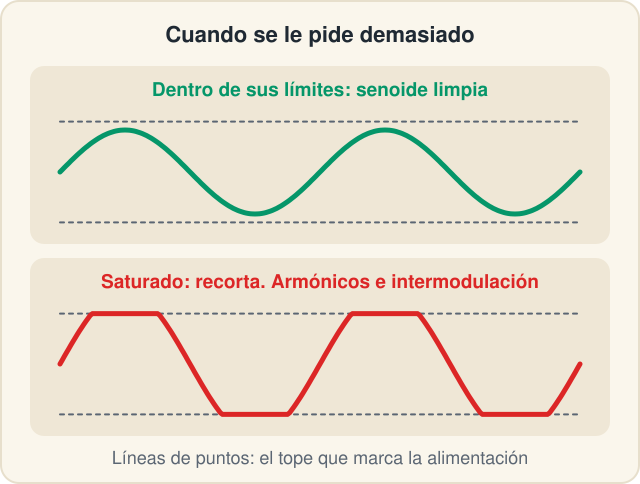

La señal que una emisora lejana deja en tu antena es de millonésimas de voltio, y la que mueve un altavoz, de varios voltios: entre una cosa y otra tiene que crecer millones de veces. Ese trabajo lo hace una sola «palabra», repetida en cadena: el **amplificador**.

En la sección 4 conociste su pieza central, el transistor. Aquí verás la etapa completa: qué significa amplificar, cómo se mide, por qué existen varias *clases* de amplificador —la pregunta favorita del examen en este tema— y qué ocurre cuando a uno se le pide más de lo que puede dar.

## Amplificar no es crear energía

Recuerda la imagen de la sección 4: un transistor es un **grifo**. Una señal pequeña mueve la manecilla, y la manecilla gobierna un caudal grande.

Lo primero que hay que tener claro es de dónde sale ese caudal grande. No sale de la señal: sale de la **fuente de alimentación**. La señal débil no se «hincha»; lo único que hace es dirigir. El amplificador toma energía de la fuente y la entrega a la salida *con la forma* que la señal de entrada le va marcando.

> **Amplificador:** etapa que entrega a su salida una copia más grande de la señal que recibe a su entrada, usando energía de la fuente de alimentación.

Es como la dirección asistida de un coche: tú giras con dos dedos y las ruedas se mueven con una fuerza que no has puesto tú, sino el motor. Tus dedos solo dicen hacia dónde.

## La ganancia

Cuánto amplifica un amplificador se llama **ganancia**: cuántas veces mayor es la salida que la entrada.

> **Ganancia de potencia = potencia de salida / potencia de entrada**

Si entran 2 W y salen 20 W, la ganancia es 10.

En radio la ganancia casi nunca se da en «veces», sino en **decibelios**, y aquí se ve por qué eran tan útiles. Recuerda la tabla de la sección 3:

| Decibelios | La potencia se multiplica por |
|---|---|
| 3 dB | 2 |
| 6 dB | 4 |
| 10 dB | 10 |
| 20 dB | 100 |
| 30 dB | 1.000 |

Y recuerda la regla: sumar decibelios equivale a multiplicar. Como un equipo es una cadena de amplificadores (y de filtros y cables, que pierden), la ganancia total se obtiene **sumando** los decibelios de cada etapa y restando los de las pérdidas.

**Ejemplo.** *Una señal pasa por un amplificador de 20 dB, luego por un filtro que pierde 3 dB y luego por otro amplificador de 10 dB. ¿Cuál es la ganancia total?* 20 − 3 + 10 = **27 dB**.

**Otro ejemplo.** *Un amplificador de 13 dB recibe 5 W. ¿Cuánto entrega?*

13 dB = 10 dB + 3 dB, es decir, × 10 y × 2: × 20. Entrega 5 × 20 = **100 W**.

Una precisión: esa tabla es para **potencias**. A veces la ganancia se da como relación de **tensiones** (cuántas veces mayor es la tensión de salida que la de entrada), y entonces, como viste en la sección 3, los decibelios valen el doble: duplicar la tensión son 6 dB, y multiplicarla por diez, 20 dB. La razón es que la potencia va con el cuadrado de la tensión (P = U² / R): el doble de tensión es el cuádruple de potencia, y el cuádruple de potencia son 6 dB.

## El rendimiento

De la energía que un amplificador toma de la fuente, solo una parte sale convertida en señal. El resto se queda en el transistor en forma de calor. A la proporción se le llama **rendimiento**, igual que en la sección 2:

> **Rendimiento = potencia de señal que sale / potencia que consume de la fuente**

Un amplificador que consume 200 W de la fuente y entrega 100 W de señal tiene un rendimiento del 50 %. Los otros 100 W son calor que hay que evacuar con radiadores y ventiladores.

El rendimiento depende, sobre todo, de una decisión de diseño: cuánto tiempo pasa el grifo abierto. Y esa decisión es la que distingue las **clases** de amplificador.

## Las clases: cuánto tiempo conduce el transistor

Piensa en la señal de entrada como una senoide: sube, baja, se hace negativa, vuelve. El transistor puede estar conduciendo durante todo ese ciclo, durante la mitad o durante un ratito. Lo decide el punto en el que se deja el grifo cuando no hay señal: su **punto de reposo**, que se ajusta con una pequeña tensión fija aplicada a su entrada, la **polarización**. (Ojo con la palabra: en los diodos, «polarización directa o inversa» hablaba del sentido en que se conectan. Aquí significa otra cosa: la tensión fija de reposo. Recuerda que un transistor de silicio empieza a conducir hacia los 0,7 V.)

### Clase A: el grifo a medio abrir

En reposo, el grifo está abierto a la mitad. La señal lo abre un poco más o lo cierra un poco, y en ningún momento llega a cerrarse del todo. El transistor **conduce durante el ciclo completo**.

- **Lo bueno:** la salida es una copia fidelísima de la entrada. Es la clase más fiel, la más **lineal**.
- **¿Y la mitad negativa de la onda, si un transistor solo conduce en un sentido?** No hace falta que la corriente cambie de sentido: sube y baja alrededor del valor de reposo. Un condensador a la salida bloquea esa parte fija y deja pasar solo el vaivén, que ya es una alterna completa.
- **Lo malo:** el transistor gasta corriente todo el tiempo, haya señal o no. El rendimiento es pésimo, del 25 al 30 % en la práctica (el máximo teórico es el 50 %). Mucho calor para poca potencia.

Se usa donde las señales son pequeñas y la fidelidad importa: las primeras etapas de los receptores, los preamplificadores de audio.

### Clase B: cada transistor, medio ciclo

En reposo, el grifo está **cerrado**. Solo se abre cuando la señal lo empuja en un sentido; durante el otro medio ciclo permanece cerrado. El transistor **conduce medio ciclo**.

Un solo transistor así entregaría media onda, que no sirve. Por eso se usan **dos**, montados uno al revés del otro: el segundo se abre justo en el medio ciclo en que el primero se cierra. Uno se ocupa de los semiciclos positivos y el otro de los negativos, y sus salidas se juntan para recomponer la onda entera. A este montaje se le llama *contrafase* o, en inglés, *push-pull*: uno empuja y el otro tira.

- **Lo bueno:** sin señal no hay consumo. El rendimiento sube al 60-70 %.
- **Lo malo:** en el momento del relevo, cuando un transistor deja de conducir y el otro aún no ha empezado, queda un pequeño escalón en la onda. Se llama *distorsión de cruce*.

### Clase AB: el compromiso

Es una clase B a la que se deja el grifo **un poquito abierto** en reposo. Cada transistor conduce algo más de medio ciclo, de modo que durante el relevo los dos están conduciendo a la vez y el escalón desaparece.

- Casi tan fiel como la clase A, con un rendimiento cercano al de la B: alrededor del 50-60 %.

Es la clase estándar de los **amplificadores lineales** de radio, los que amplifican señales cuya forma hay que respetar. En particular, es la que se usa para la **banda lateral única (SSB)**, el modo de voz de la onda corta que conocerás en la sección 6. En SSB, la información viaja en los cambios de tamaño de la señal; un amplificador que no respete esos tamaños destroza la voz.

### Clase C: a golpes

En reposo, el grifo está cerrado *y bien apretado*: hace falta que la señal de entrada suba bastante para que llegue a abrirlo. El transistor **conduce menos de medio ciclo**: solo durante un pulso breve, cerca de la cresta de la onda.

—Pero entonces lo que sale no se parece en nada a lo que entra —objetó Lucía—. Entran ondas y salen golpes.

—Salen golpes —admitió Dani—. Y ahora dime: ¿cómo empujas tú un columpio? ¿Lo acompañas con la mano todo el recorrido?

—No. Le doy un empujón corto cada vez que vuelve.

—Y aun así el columpio hace un vaivén suave y completo. Pues a la salida de un amplificador clase C hay un circuito resonante, un columpio LC. El transistor le da un golpe breve en cada ciclo, y el circuito resonante completa el resto de la onda él solo.

Esa es la clave de la clase C: los pulsos del transistor mantienen en marcha un circuito resonante, y es este el que entrega una senoide a la salida.

- **Lo bueno:** el transistor pasa casi todo el tiempo cerrado y, cuando conduce, lo hace a fondo. El rendimiento es excelente: hasta el 70-80 %.
- **Lo malo, primera parte:** la clase C **no puede copiar los cambios de tamaño** de la señal que le entra: entre un tamaño de entrada y otro, la salida no guarda la proporción. No sirve para amplificar una señal cuya información esté ya en su amplitud.
- **Lo malo, segunda parte:** esos golpes están llenos de **armónicos**. Detrás de un clase C hace falta siempre un buen filtro paso bajo.

¿Para qué sirve entonces? Para los modos en los que la amplitud no lleva información: la telegrafía (**CW**), donde la señal simplemente está o no está, y la **FM**, donde la información viaja en pequeños cambios de frecuencia y la amplitud es constante.

### El resumen que pregunta el examen

| Clase | El transistor conduce… | Fidelidad | Rendimiento aproximado | Sirve para |
|---|---|---|---|---|
| **A** | Todo el ciclo | Máxima | 25-30 % | Señales pequeñas, etapas de entrada |
| **B** | Medio ciclo (dos transistores en contrafase) | Buena, con distorsión de cruce | 60-70 % | Audio, potencia |
| **AB** | Algo más de medio ciclo | Muy buena | 50-60 % | **Amplificadores lineales: SSB** |
| **C** | Menos de medio ciclo | Mala: no respeta la amplitud | 70-80 % | **Solo CW y FM** |

La frase que hay que llevarse grabada: **la clase C no sirve para SSB.**

## Cuando se le pide demasiado: la saturación

Todo grifo tiene un tope: abierto del todo, no da más. Un amplificador tampoco puede entregar más tensión que la que le da su fuente.

Si la señal de entrada es tan grande que la salida «querría» superar ese tope, las crestas de la onda no pueden seguir subiendo y salen **recortadas**, planas por arriba y por abajo. Se dice que el amplificador está **saturado**, y al recorte se le llama también *clipping*.

Una onda recortada ya no es una senoide, y el recorte fabrica frecuencias que no estaban en la entrada. Son de dos clases, y conviene no confundirlas:

- **Armónicos.** Ya los conoces de la sección 3: copias en el doble, el triple, el cuádruple de la frecuencia. Caen muy lejos de tu señal, y el filtro paso bajo de la salida del transmisor los elimina.
- **Productos de intermodulación.** Una voz no es una sola frecuencia, sino muchas a la vez. Cuando un amplificador las recorta, se mezclan entre sí y nacen frecuencias nuevas. Las más dañinas aparecen pegadas a las originales: si en tu señal hay dos frecuencias A y B, surgen otras en 2A − B y en 2B − A, a pocos kilohercios. Ningún filtro paso bajo puede quitarlas, porque caen junto a tu propia frecuencia.

Las segundas son las que arruinan la convivencia. Tu señal «se ensancha», invade los canales de al lado y molesta a quien está hablando allí. A eso se le llama *splatter* («salpicadura»), y volverá con detalle en la sección 7.

Es la falta de educación técnica más común en las bandas, y tiene un remedio muy simple: **no llevar el equipo al máximo**. Subir la ganancia del micrófono, o la potencia con que se alimenta la entrada del amplificador (su *excitación*), más allá de lo que da limpio no te hace llegar más lejos; te hace llegar más sucio.

## Donde la gente se lía

- **«El amplificador aumenta la energía de la señal.»** La energía la pone la fuente. La señal solo dirige.
- **«La clase C es la mejor porque rinde más.»** Rinde más a costa de no respetar la amplitud. Para SSB es inservible.
- **«Más ganancia de micrófono, más alcance.»** Pasado el límite, más distorsión y más interferencia a los demás, con el mismo alcance.
- **«El filtro paso bajo lo limpia todo.»** Quita los armónicos. La intermodulación de un amplificador saturado cae al lado de tu señal y ningún filtro la quita: solo se evita no saturando.
- **Sumar ganancias en veces.** En veces se multiplican; lo que se suma son los decibelios.

## Compruébalo tú

1. Un amplificador recibe 0,5 W y entrega 50 W. ¿Cuál es su ganancia, en veces y en decibelios?
2. Una cadena tiene un amplificador de 10 dB, un cable que pierde 3 dB y un amplificador de 6 dB. ¿Cuál es la ganancia total, en decibelios y en veces (de potencia)?
3. Un amplificador consume 250 W de la fuente y entrega 150 W de señal. ¿Cuál es su rendimiento y cuánto calor disipa?
4. Tienes que amplificar una señal de SSB. ¿Qué clase eliges, y cuál descartas de entrada?
5. ¿Por qué un amplificador en clase C necesita un circuito resonante a su salida?
6. Un amplificador entrega a su salida una tensión diez veces mayor que la de su entrada. ¿Cuál es su ganancia de tensión en decibelios?
7. Un compañero te dice que tu voz suena «ancha y sucia» y que te oye también a varios kilohercios de tu frecuencia. ¿Qué es lo primero que revisas?

**Soluciones**

1. 50 / 0,5 = **100 veces**, que son **20 dB**.
2. 10 − 3 + 6 = **13 dB**. En veces: × 10, ÷ 2, × 4 = **× 20**.
3. Rendimiento: 150 / 250 = 0,6, un **60 %**. Calor: 250 − 150 = **100 W**.
4. **Clase AB** (lineal). Se descarta la **clase C**, que no respeta la amplitud.
5. Porque el transistor solo entrega pulsos breves; el circuito resonante, empujado por esos pulsos a su ritmo, es el que reconstruye la senoide completa (y además ayuda a filtrar los armónicos).
6. **20 dB**: para tensiones, multiplicar por diez son 20 dB (y duplicar, 6 dB).
7. Que no estés saturando el amplificador: ganancia de micrófono o nivel de excitación demasiado altos. Lo que tu compañero oye a unos kilohercios es intermodulación (*splatter*), no armónicos, así que un filtro no lo arregla: se bajan los niveles hasta que la señal sale limpia.

## En una frase

Un amplificador entrega una copia mayor de la señal usando energía de la fuente; su ganancia se mide en decibelios, su clase (A, B, AB o C) indica cuánto del ciclo conduce el transistor —más fidelidad cuanto más conduce, más rendimiento cuanto menos—, y si se le pide más de lo que puede, recorta la onda y genera armónicos e intermodulación.

Queda la última palabra de la sección, y sale de hacerle a un amplificador algo que en principio parece un error: conectar su salida a su propia entrada.
