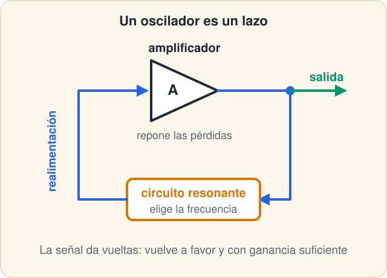

Toda señal de radio empieza en algún sitio: alguien tiene que fabricar una corriente alterna de la frecuencia exacta que marca el dial. La «palabra» que hace eso es el **oscilador**, corazón de todo transmisor y de casi todo receptor.

Esta lección explica cómo consigue un circuito ponerse a oscilar solo, qué decide su frecuencia y por qué una lámina de cuarzo marca el ritmo de todas las radios (y de todos los relojes) del planeta. Al final, con todas las palabras aprendidas, leeremos de un tirón el receptor gris del rastro.

## El pitido del micrófono

Seguro que lo has oído en alguna fiesta de pueblo: alguien acerca el micrófono al altavoz y la megafonía suelta un pitido agudo que hace que todo el mundo se tape los oídos.

Lo que ha pasado es esto. El micrófono recoge un ruido cualquiera, por pequeño que sea. El amplificador lo amplifica y lo saca por el altavoz. El micrófono, que está cerca, recoge ese sonido del altavoz, ya más fuerte. El amplificador lo amplifica otra vez. Sale más fuerte aún. Vuelve a entrar. En una fracción de segundo, el sistema se ha puesto a sonar solo, sin que nadie le hable, y no parará hasta que alguien aleje el micrófono.

A eso de que **una parte de la salida vuelva a la entrada** se le llama **realimentación**. En la megafonía es un accidente. En un oscilador es exactamente lo que se busca.

> **Oscilador:** un amplificador cuya salida se devuelve en parte a su propia entrada, de modo que genera por sí mismo una señal alterna continua, sin necesidad de ninguna señal de entrada.

Para que un circuito oscile y se mantenga oscilando hacen falta dos condiciones:

1. **Ganancia suficiente.** Lo que vuelve a la entrada, después de dar la vuelta completa, tiene que ser al menos tan grande como lo que había. Si en cada vuelta se pierde un poco, la oscilación se apaga. El amplificador está ahí para reponer las pérdidas.
2. **Que vuelva a tiempo.** La señal devuelta tiene que llegar *en fase* con la de entrada: empujando cuando esta empuja. Es como empujar un columpio: solo sirve si empujas a favor, en el momento justo. A la realimentación que llega a favor se le llama **realimentación positiva**.

(Existe también la contraria, la **realimentación negativa**, en la que la señal devuelta llega en oposición de fase y se opone a la entrada. No hace oscilar: al contrario, frena y estabiliza. Se usa a propósito en los amplificadores para que sean más fieles. El regulador de la fuente, que cierra el grifo cuando la tensión sube, es un ejemplo.)

¿Y de dónde sale la primera señal, si no hay entrada? Del ruido. En cualquier circuito hay siempre una agitación eléctrica mínima, y basta ese susurro para que la bola de nieve eche a rodar.

## Quién decide la frecuencia

El pitido de la megafonía tiene siempre un tono concreto, no es un ruido cualquiera. El sistema «elige» la frecuencia a la que la vuelta completa le sale mejor.

En un oscilador no se deja esa elección al azar. En el camino de la realimentación se coloca un **circuito resonante**: el columpio de las lecciones 3 y 4. Como solo responde bien a su propia frecuencia, es la única que da la vuelta con fuerza suficiente, y el circuito oscila a esa frecuencia y a ninguna otra.

Ahora se entiende del todo lo que quedó pendiente en la lección 3. Un circuito LC al que se le da un empujón oscila, pero se va apagando por las pérdidas. Un oscilador es ese mismo LC más un amplificador que, en cada vaivén, le devuelve justo la energía que ha perdido. El circuito resonante pone el ritmo; el amplificador pone la energía para que no se pare.

Lo que se le pide a un oscilador son dos cosas:

- **Estabilidad:** que la frecuencia no se mueva. A que se vaya desplazando poco a poco, casi siempre por el calor, se le llama **deriva**.
- **Pureza:** que entregue una senoide limpia, sin armónicos ni ruido alrededor.

Según lo que se use como circuito resonante, hay dos grandes familias.

### El oscilador LC

Usa una bobina y un condensador. Su gran ventaja es que **se puede variar**: con un condensador variable (o con un *varicap*, el diodo de la sección 4 cuya capacidad cambia con la tensión) se mueve la frecuencia a voluntad. Por eso al oscilador LC ajustable se le llama **VFO**, del inglés *Variable Frequency Oscillator*, oscilador de frecuencia variable. En los equipos clásicos, como el receptor gris, el mando grande de sintonía giraba dos condensadores variables montados en el mismo eje: uno movía la frecuencia de este oscilador y el otro, la del filtro de entrada. Por qué un receptor necesita un oscilador que se mueva con el dial es el asunto central de la sección 7.

Su defecto es la estabilidad. Una bobina y un condensador cambian ligeramente de valor con la temperatura, y con ellos cambia la frecuencia. Los equipos antiguos había que dejarlos «calentar» un buen rato, y aun así derivaban.

### El oscilador de cristal de cuarzo

El cuarzo es un mineral con una propiedad curiosa, la **piezoelectricidad**: si lo aprietas, aparece una tensión eléctrica entre sus caras; y al revés, si le aplicas una tensión, se deforma. (El chispero de muchos mecheros de cocina funciona así: un golpe a un cristal produce la chispa.)

Una lámina fina de cuarzo, tallada con precisión, tiene una frecuencia propia de vibración mecánica, igual que una copa de cristal o un diapasón. Si se coloca entre dos contactos y se le aplica una tensión alterna de esa frecuencia, vibra con muchísima fuerza. Visto desde el circuito, se comporta como un circuito resonante, pero de una calidad que ninguna bobina real puede alcanzar: su factor Q es de decenas de miles, cuando el de un buen circuito LC ronda el centenar.

Un Q tan alto significa una respuesta estrechísima, y eso se traduce en una frecuencia clavada.

> **El oscilador de cristal de cuarzo es el más estable de todos.** Es pregunta fija de examen.

Por eso hay un cristal de cuarzo en cada reloj, en cada ordenador y en cada emisora. Su limitación es la contraria a la del LC: **su frecuencia es fija**, la que le dio la talla. Se puede retocar apenas una fracción minúscula. (Para frecuencias muy altas, la lámina tendría que ser demasiado fina; entonces se la hace vibrar en un múltiplo impar de su frecuencia básica, llamado *sobretono*.)

Esa misma resonancia finísima sirve para otra cosa que quedó anunciada en la lección de los filtros: puesto en el camino de una señal en lugar de en un oscilador, un cristal solo deja pasar una franja estrechísima alrededor de su frecuencia. Varios cristales combinados forman un **filtro de cristal**, el paso banda más selectivo de un receptor.

## Variable *y* estable: el PLL

Durante décadas hubo que elegir: frecuencia variable o frecuencia estable. Las dos cosas a la vez parecían incompatibles, y una radio las necesita las dos: hay que poder recorrer toda la banda, y al parar en una frecuencia hay que quedarse clavado en ella.

La solución se llama **PLL**, siglas inglesas de *Phase-Locked Loop*, bucle enganchado en fase, y la idea es la de un músico que afina su instrumento comparándolo sin cesar con un diapasón.

Un PLL tiene tres piezas:

- Un **oscilador de cristal de cuarzo**, del que se obtiene (dividiendo su frecuencia) una referencia fija y exacta. Es el diapasón.
- Un **oscilador controlado por tensión**, que se abrevia **VCO** (del inglés *Voltage Controlled Oscillator*): un LC con un varicap, cuya frecuencia cambia al cambiar la tensión que se le aplica. Es el instrumento, que puede dar cualquier nota pero tiende a desafinarse.
- Un **comparador de fase**, que vigila continuamente al segundo contra el primero. En cuanto el VCO se adelanta o se retrasa lo más mínimo, el comparador corrige la tensión que lo controla y lo devuelve a su sitio. Entre el comparador y el VCO hay un **filtro paso bajo** que suaviza esa corrección, para que llegue como una tensión tranquila y no a tirones.

El truco para poder elegir la frecuencia es que al comparador no se le presenta la señal del VCO tal cual, sino **dividida** por un número que tú eliges desde el teclado o el dial. Si la referencia es de 10 kHz y pides dividir por 700, el bucle obligará al VCO a estar exactamente en 700 × 10 kHz = 7.000 kHz. Si pides 701, saltará a 7.010 kHz. Cada frecuencia que se obtiene tiene la exactitud del cristal.

A este conjunto se le llama también **sintetizador de frecuencia**. Su evolución actual, la **síntesis digital directa (DDS)**, calcula con un circuito digital, número a número, la senoide de la frecuencia pedida, al ritmo que marca un cristal, y permite pasos de un hercio o menos.

Para el examen, quédate con la idea: **PLL (o sintetizador) = frecuencia variable con la estabilidad de un cristal**, y con sus piezas: referencia de cristal, comparador de fase, filtro paso bajo, VCO y divisor. Es la razón de que un equipo moderno muestre la frecuencia con precisión de hercio y no se mueva de ella en toda la tarde, algo que para el receptor gris del rastro, con su VFO de bobina y condensador, era ciencia ficción.

## El texto completo, de izquierda a derecha

Ya tienes todas las palabras. Dani dijo que con ellas una placa «se convierte en un texto que se lee de izquierda a derecha». Vamos a leer el receptor gris:

1. **Antena.** Entrega una mezcla de miles de señales, todas debilísimas.
2. **Filtro paso banda.** Un circuito resonante que deja pasar solo la banda que interesa. En el receptor gris lo movía el mando de sintonía, con uno de sus dos condensadores variables.
3. **Amplificador.** Levanta lo que ha pasado. Clase A: son señales pequeñas y hay que tratarlas con fidelidad.
4. **Mezclador, con su oscilador.** Aquí la señal se combina con la del oscilador interno, el que movía el otro condensador del mismo mando. Qué es esa «mezcla» y por qué es la idea más ingeniosa de la radio es el tema de la sección 7; de momento, quédate con que en un receptor también hay un oscilador, y con que el dial lo mueve.
5. **Filtro estrecho.** Separa la señal deseada de sus vecinas inmediatas. En los buenos receptores, un filtro de cristal.
6. **Más amplificadores.** Todavía es una señal de radiofrecuencia, pero ya de buen tamaño.
7. **Detector.** Extrae de la señal de radio la voz o el morse que lleva dentro; el más simple es el diodo detector de la sección 4. Sin él, al altavoz solo llegaría radiofrecuencia, que no se oye. A esta operación se le llama también *demodular*, y la entenderás en la sección 6.
8. **Amplificador de audio y altavoz.**

Y por debajo de todo, alimentando cada etapa, la **fuente de alimentación** con sus cuatro aduanas.

Un transmisor se escribe con las mismas palabras, en otro orden: **oscilador** (nace la frecuencia) → etapas que le añaden la voz (sección 6) → **amplificadores** cada vez mayores, el último de clase AB o C según el modo → **filtro paso bajo** que elimina los armónicos → antena.

Fuente, columpio, filtro, amplificador, oscilador. Con esas cinco palabras está escrito cualquier equipo de radio.

## Donde la gente se lía

- **«Un oscilador necesita una señal de entrada.»** No: la fabrica él. Solo necesita alimentación.
- **Confundir oscilador y amplificador.** El amplificador hace más grande una señal que le llega. El oscilador es un amplificador realimentado que genera la suya.
- **«El cuarzo es más estable y además se puede sintonizar.»** Es el más estable, pero su frecuencia es fija. Lo variable y estable a la vez es el PLL.
- **«La realimentación siempre hace oscilar.»** Solo la positiva (la que llega a favor) y con ganancia suficiente. La negativa estabiliza.
- **Un aviso para más adelante:** un amplificador en el que parte de la salida se cuela hasta la entrada puede ponerse a oscilar sin que nadie se lo pida, igual que la megafonía, y emitir donde no debe. Volverá en la sección 7.

## Compruébalo tú

1. Un amplificador devuelve parte de su salida a su entrada, pero en oposición de fase. ¿Oscilará? ¿Y si la devuelve en fase pero muy debilitada, de modo que en cada vuelta la señal se hace más pequeña?
2. En un oscilador LC, ¿qué componente o conjunto de componentes decide la frecuencia? ¿Y cuál repone la energía que se pierde?
3. ¿Qué tipo de oscilador ofrece mayor estabilidad de frecuencia, y a qué propiedad del material se debe su funcionamiento?
4. Un equipo antiguo va cambiando ligeramente de frecuencia durante la primera media hora de uso. ¿Cómo se llama ese defecto y cuál es su causa más probable?
5. Un PLL usa una referencia de 5 kHz y su divisor está en 2.900. ¿A qué frecuencia trabaja el VCO? ¿Y si pasas el divisor a 2.901?
6. En la cadena de un receptor, ¿qué bloque convierte la señal de radiofrecuencia en sonido, y qué pasaría si faltara?

**Soluciones**

1. En ninguno de los dos casos. En oposición de fase la realimentación es negativa: frena en vez de empujar. Y en fase pero sin ganancia suficiente, la oscilación se va apagando. Hacen falta las dos condiciones a la vez: en fase y con ganancia que compense las pérdidas.
2. La frecuencia la decide el **circuito resonante** (la bobina y el condensador). La energía la repone el **amplificador** (el transistor, que la toma de la fuente).
3. El **oscilador de cristal de cuarzo**. Se basa en la **piezoelectricidad**: el cuarzo se deforma al aplicarle tensión y produce tensión al deformarse, y tiene una frecuencia de vibración mecánica muy precisa.
4. **Deriva** de frecuencia. Causa más probable: el calentamiento, que cambia ligeramente el valor de la bobina y el condensador del oscilador LC.
5. 2.900 × 5 kHz = 14.500 kHz = **14,5 MHz**. Con 2.901: 14.505 kHz, es decir, **5 kHz más arriba**. El salto mínimo es el valor de la referencia.
6. El **detector** (o demodulador). Sin él, al altavoz llegaría radiofrecuencia amplificada, que ni el altavoz puede reproducir ni el oído oír.

## En una frase

Un oscilador es un amplificador que se realimenta a sí mismo en fase y con ganancia suficiente, y cuya frecuencia fija un circuito resonante: variable pero poco estable si es de bobina y condensador, fijísima si es un cristal de cuarzo, y las dos cosas a la vez si un PLL engancha un oscilador variable (VCO) a un cristal.

Con esto terminas los circuitos. El material siguiente es el resumen de la sección en formato de chuleta. Y en la sección 6 por fin sale la señal al aire: verás cómo se sube una voz a esa frecuencia que el oscilador acaba de fabricar.
