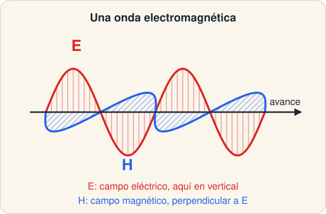
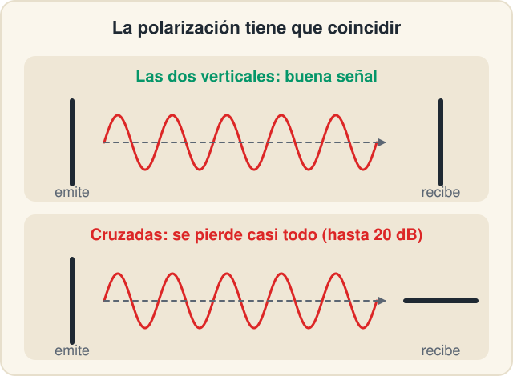

En la sección 3, Vicente explicó con un palo y un estanque por qué una corriente alterna rápida se escapa del cable: si mueves el palo despacio, el agua se acomoda y no pasa nada; si lo agitas deprisa, salen ondas que se alejan y ya no vuelven. Allí avisamos de que era una imagen a la que le faltaban los nombres, y de que cojeaba en un punto: las ondas del estanque necesitan agua y las de radio no necesitan nada.

Hoy ponemos los nombres. Lo que hace de agua son dos campos, y vas a ver por qué, una vez sueltos, se sostienen solos. Al terminar sabrás qué es exactamente una onda de radio por dentro, por qué el tamaño de la antena importa tanto, qué significa que una onda esté «polarizada» y por qué la señal se debilita con la distancia aunque nada la frene.

## Dos viejos conocidos, ahora con letra

En la sección 4, al estudiar los imanes y las bobinas, viste qué es un **campo**: la manera de decir «aquí se nota una fuerza», a distancia y sin tocar. Y conociste dos:

- El **campo eléctrico**, que rodea a las cargas. Es el que había entre las placas de un condensador cargado. Se representa con la letra **E**.
- El **campo magnético**, que rodea a los imanes y a toda corriente. Es el del interior de una bobina. Se representa con la letra **H**. (Ojo: no tiene nada que ver con el henrio de las bobinas, que es una unidad y también se escribe H. Aquí H es el nombre del campo.)

Una antena, de momento, es un trozo de conductor por el que hacemos ir y venir la corriente. A su alrededor están las dos cosas a la vez: los electrones que se amontonan primero en un extremo y luego en el otro crean un campo eléctrico, y la corriente que va y viene entre ambos crea un campo magnético.

Mientras nada cambia, un campo se queda quieto donde está, como la atracción que rodea a un imán que nadie mueve. Con el palo en el estanque ya viste lo que ocurre cuando la corriente cambia deprisa: los campos no tienen tiempo de acomodarse y una parte se aleja.

> **Radiar:** que una parte de la energía de una corriente alterna abandone el conductor en forma de campos que se alejan y no vuelven.

—Pero si se suelta de la antena, ¿qué la mantiene viva? —preguntó Marina—. Una ola necesita agua. ¿Esto qué necesita?

—Nada —dijo Dani—. Y esa es la parte que más cuesta tragarse.

## Dos campos que se fabrican el uno al otro

La respuesta sale de juntar dos hechos. El primero lo conoces de la sección 4, y solo hay que mirarlo con más cuidado.

**Faraday:** un campo magnético que cambia induce una tensión en un conductor. Ahora bien, una tensión es un empujón sobre las cargas, y a ese empujón lo llamamos campo eléctrico. El conductor solo sirve para notarlo: el campo eléctrico aparece igual aunque allí no haya ningún cable. Dicho sin cable: **un campo magnético que cambia hace aparecer un campo eléctrico.**

**Maxwell:** en 1865, el físico escocés James Clerk Maxwell completó la pareja con la pieza que faltaba. **Un campo eléctrico que cambia hace aparecer un campo magnético**, también sin cables ni corrientes.

Con las dos piezas, el círculo se cierra:

1. El campo eléctrico que cambia junto a la antena hace aparecer un campo magnético.
2. Ese campo magnético no ocupa solo el punto donde nació: rodea ese lugar, igual que el campo de un cable rodea al cable, y por tanto llega un poco más lejos. Y como acaba de aparecer, está cambiando.
3. Al cambiar, hace aparecer a su vez un campo eléctrico que rodea ese nuevo lugar, otro poco más lejos.
4. Y así sucesivamente.

Cada campo fabrica al otro, un paso más allá. La pareja avanza sola, sin cargas, sin cables y sin ningún material que la sostenga. Por eso cruza igual el aire que el vacío.

> **Onda electromagnética:** un campo eléctrico y un campo magnético que oscilan juntos y se regeneran mutuamente mientras avanzan por el espacio. Una onda de radio es una onda electromagnética.

Maxwell calculó a qué velocidad debía avanzar esa pareja y le salió la velocidad de la luz, la **c** que ya conoces: así se supo que la luz era esto mismo. En 1888, Heinrich Hertz fabricó por primera vez esas ondas con un circuito y las detectó al otro lado de su laboratorio.

## Por qué importa el tamaño de la antena

En la sección 3 quedó dicho que «rápido» y «lento» dependían mucho del tamaño del conductor. Ahora se puede ver por qué.

Los cambios del campo se propagan a la velocidad de la luz, y lo que avanzan durante un vaivén completo de la corriente es, por definición, una longitud de onda.

- Si el conductor es **muy pequeño** comparado con la longitud de onda, cualquier cambio lo recorre entero en una fracción mínima del vaivén. Al campo le sobra tiempo para acomodarse a lo largo de todo el conductor antes de que la corriente se invierta. Para ese conductor, la corriente es «lenta», y casi no radia.
- Si el conductor mide **del orden de media longitud de onda o un cuarto**, el tiempo que tarda un cambio en recorrerlo es comparable al que tarda la corriente en invertirse. El campo ya no llega a acomodarse. Para ese conductor, la misma corriente es «rápida», y radia bien.

«Rápido», por tanto, quiere decir «rápido para el tamaño de ese conductor». Por eso la radio usa frecuencias altas: son las que tienen longitudes de onda lo bastante cortas para construir antenas a su medida. A 7 MHz, la longitud de onda es 300 / 7 ≈ 43 metros, y media onda son unos 21 metros de hilo, que caben en una azotea. A 145 MHz, un cuarto de onda es medio metro: la varilla de un walkie.

## Cómo es la onda por dentro

Tres hechos sobre la forma de la onda, que el examen pregunta:

1. El campo eléctrico y el campo magnético son **perpendiculares entre sí**: si uno oscila de arriba abajo, el otro oscila de izquierda a derecha.
2. Los dos son **perpendiculares a la dirección en que avanza la onda**. Si la onda viene hacia ti, los campos oscilan en el plano de una pared que tuvieras delante, nunca hacia delante y hacia atrás. A las ondas que oscilan «de través» respecto a su avance se las llama **transversales**.
3. Los dos crecen y menguan **a la vez**: cuando uno es máximo, el otro también.

Quizá el tercero te choque. Si cada campo nace del *cambio* del otro, uno esperaría que fuese máximo justo cuando el otro cambia más deprisa, no cuando es máximo. En la onda ya formada, lejos de la antena, no es así: crecen y menguan juntos. Demostrarlo exige las matemáticas de Maxwell; aquí quédate con el dato, que es el que pregunta el examen.

## Polarización: hacia dónde oscila el campo eléctrico

De los dos campos, por convenio, nos fijamos en el eléctrico para describir cómo está orientada la onda.

> **Polarización:** la orientación del campo eléctrico de una onda. Si el campo eléctrico oscila de arriba abajo, la polarización es **vertical**; si oscila de lado a lado, es **horizontal**.

(Es la tercera vez que aparece esta palabra en el curso, y tiene un tercer significado: no guarda relación con la polarización de un diodo ni con la de un transistor.)

La polarización la decide la antena que emite, y es fácil de recordar: el campo eléctrico oscila en la misma dirección en la que los electrones van y vienen por el conductor.

- Una antena **vertical** (la varilla de un walkie, la antena de un coche) emite con polarización **vertical**.
- Una antena **horizontal** (un hilo tendido entre dos puntos de una azotea) emite con polarización **horizontal**.

¿Por qué importa? Porque la antena que recibe funciona al revés: el campo eléctrico de la onda empuja a los electrones del conductor, y solo puede empujarlos bien **a lo largo** del conductor. Si la onda llega con el campo vertical y la antena receptora está tumbada, el campo empuja a los electrones «de través», hacia donde no tienen recorrido, y casi no se induce corriente.

En una comunicación directa, de antena a antena, tener las polarizaciones cruzadas puede hacer perder hasta 20 dB. Recuerda de la sección 3 lo que eso significa: llega la centésima parte de la potencia. Por eso los walkies, todos con su antena vertical, se entienden bien entre sí. Y quienes buscan largas distancias en VHF con antenas direccionales las ponen todos en horizontal: daría igual que todos las pusieran verticales, lo que importa es coincidir.

Dos apuntes para completar el cuadro:

- En onda corta, cuando la señal llega de lejos rebotada en el cielo (lo verás en la sección 9), el rebote revuelve la polarización y llega mezclada. Ahí el asunto pierde casi toda su importancia.
- Existe también la polarización **circular**, en la que el campo eléctrico va girando como un sacacorchos mientras la onda avanza. Se usa con los satélites, que dan vueltas sobre sí mismos y no pueden mantener una orientación fija.

## La señal se reparte, no se gasta

Una onda que viaja por el vacío no pierde energía: no hay nada que la frene. Y sin embargo llega más débil cuanto más lejos estás, porque se abre. La misma energía tiene que repartirse sobre una superficie cada vez mayor, y al doble de distancia esa superficie no es el doble: es **cuatro veces** mayor.

> **En el espacio libre, la señal se debilita con el cuadrado de la distancia:** al doble de distancia llega la cuarta parte de la potencia (−6 dB); al triple, la novena parte.

## Donde la gente se lía

- **«Por el aire viajan electrones.»** No. Los electrones se quedan en la antena, yendo y viniendo. Lo que viaja son los campos. En la antena receptora, esos campos ponen en movimiento a *otros* electrones, los que ya estaban en ella.
- **«Las ondas de radio son una especie de sonido.»** No tienen nada que ver. El sonido es aire que vibra, viaja a 340 metros por segundo y no cruza el vacío. La onda de radio es campo eléctrico y magnético, y viaja casi un millón de veces más deprisa.
- **«La señal se debilita porque el aire la frena.»** En el espacio libre se debilita porque se reparte en una superficie cada vez mayor, no porque nada la absorba.
- **«La polarización es la de la antena receptora.»** La polarización es una propiedad de la onda, y se la da la antena que emite. La receptora solo puede coincidir con ella o no.
- **«La H del campo magnético son henrios.»** Es una coincidencia de letras. El henrio mide bobinas; aquí H es solo el nombre del campo.

## Compruébalo tú

1. ¿Cuánto mide, aproximadamente, una antena de un cuarto de onda para 28 MHz?
2. Una onda llega con el campo eléctrico oscilando de izquierda a derecha. ¿Qué polarización tiene? ¿Cómo estaba colocada, probablemente, la antena que la emitió?
3. En esa misma onda, si avanza hacia ti, ¿en qué dirección oscila el campo magnético?
4. A 10 km de una emisora recibes cierta potencia. Sin obstáculos ni rebotes, ¿qué fracción de esa potencia recibirías a 40 km? ¿Cuántos decibelios menos son?
5. Hablas con un amigo por walkie, los dos de pie, y lo oyes bien. Tu amigo tumba su walkie para dejarlo sobre una mesa y la señal cae mucho. ¿Qué ha pasado?
6. ¿Cuánto tarda una onda de radio en llegar a la Luna, que está a unos 384.000 km?

**Soluciones**

1. La longitud de onda es 300 / 28 ≈ 10,7 m. Un cuarto: 10,7 / 4 ≈ **2,7 metros**.
2. Polarización **horizontal**. La antena emisora estaba, probablemente, tendida en horizontal.
3. En vertical, de arriba abajo: tiene que ser perpendicular al campo eléctrico (que va de izquierda a derecha) y a la dirección de avance (que viene hacia ti).
4. De 10 a 40 km la distancia se multiplica por 4. La potencia se divide entre 4 × 4 = 16: recibes **una dieciseisava parte**. En decibelios: la distancia se ha duplicado dos veces (de 10 a 20 y de 20 a 40), así que son 6 + 6 = **12 dB menos**.
5. Su antena ha pasado de vertical a horizontal mientras la tuya sigue vertical. Las polarizaciones están cruzadas y se pierde gran parte de la señal.
6. Tiempo = distancia / velocidad = 384.000 / 300.000 ≈ **1,3 segundos**. (Por eso quien rebota señales en la Luna oye su propio eco unos dos segundos y medio después: ida y vuelta.)

## En una frase

Lo que se suelta de la antena son dos campos, el eléctrico y el magnético, que se fabrican el uno al otro y avanzan juntos a la velocidad de la luz sin necesitar ningún medio; oscilan perpendiculares entre sí y al avance, la orientación del eléctrico es la polarización, y la señal se debilita con la distancia porque se reparte, no porque se gaste.

Ya tenemos una onda capaz de cruzar el mundo. El problema es que, tal cual, no dice nada. En la lección siguiente le subimos una voz encima.
