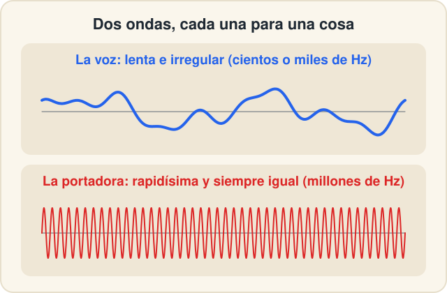

Ya sabes fabricar una onda de radio: basta un oscilador (el circuito de la sección 5 que genera una senoide estable) y una antena del tamaño adecuado. Esa onda cruzará medio mundo. Pero quien la reciba al otro lado solo sabrá una cosa: que alguien ha encendido un transmisor. Una senoide pura, siempre igual, no cuenta nada.

Esta lección responde a la pregunta de cómo se le sube un mensaje encima. La operación se llama **modular**, y todo lo que queda de sección —el morse, la AM, la banda lateral de las «voces de pato», la FM de tu futuro walkie— son maneras distintas de hacerla. Al terminar sabrás qué es una portadora, qué tres cosas se le pueden cambiar a una onda y por qué todo mensaje, lo quieras o no, ocupa un trozo de dial.

## Por qué no se puede radiar la voz directamente

Lo primero que se le ocurre a cualquiera es lo más simple: conectar el micrófono a un amplificador y el amplificador a una antena. Al fin y al cabo, el micrófono ya convierte la voz en una corriente alterna.

—¿Y por qué no se hace así? —preguntó Marina—. Me ahorraría entender todo lo demás.

—Por dos razones —dijo Dani—. Con cualquiera de las dos ya bastaría.

**Primera razón: la antena.** La voz humana, convertida en corriente, es una mezcla de frecuencias bajas. Para entender lo que alguien dice basta con conservar las que van aproximadamente de 300 a 3.000 Hz. A ese tramo se le llama **banda vocal**. (Recuerda de la sección 3 que las frecuencias que el oído percibe, de unos 20 a unos 20.000 Hz, son las *audiofrecuencias*; la banda vocal es la parte de ellas imprescindible para la palabra.)

En la lección anterior viste que una antena radia bien cuando mide del orden de media longitud de onda. Haz la cuenta para un tono de 1.000 Hz, que son 0,001 MHz:

λ = 300 / 0,001 = 300.000 metros = 300 km

Media onda son 150 kilómetros de antena. No hay azotea para eso.

**Segunda razón: el sitio.** Aunque alguien lograra construir esa antena, todas las voces del mundo ocuparían las mismas frecuencias, de 300 a 3.000 Hz. Todas las conversaciones del planeta caerían unas encima de otras y no habría forma de separarlas. Sería como si todas las emisoras estuvieran en el mismo punto del dial.

## La solución: una onda que hace de vehículo

La salida es usar dos ondas, cada una para lo que sirve:

- Una onda de **radiofrecuencia**, de frecuencia alta, que es la que sabe viajar: se radia con antenas de tamaño razonable y cada estación puede elegir la suya, distinta de la de los demás.
- La **voz**, de frecuencia baja, que es la que lleva el mensaje pero no sabe viajar.

El truco consiste en hacer que la primera cargue con la segunda.

> **Portadora:** una onda de radiofrecuencia pura y estable, generada por un oscilador, en la frecuencia que has elegido en el dial. Por sí sola no lleva ninguna información: es el vehículo. (En inglés, *carrier*.)

> **Modular:** alterar alguna característica de la portadora al ritmo de la información que quieres enviar. A la señal que contiene la información (la voz, por ejemplo) se le llama **señal moduladora**.

El receptor hace la operación contraria: observa cómo ha sido alterada la portadora y de ahí recupera la información original. A eso se le llama **demodular** o **detectar**.

Una comparación para fijar la idea: la portadora es un camión y la voz es la mercancía. El camión vacío recorre la carretera igual de bien, pero no entrega nada. La mercancía sola no se mueve del almacén. Modular es cargar el camión; demodular, descargarlo en destino.

Fíjate en la diferencia de ritmos, porque es enorme. Una portadora de 7 MHz da siete millones de oscilaciones por segundo. Un sonido de la voz de 1.000 Hz da mil. Durante **una sola** oscilación de la voz, la portadora da siete mil. Vista desde la portadora, la voz es algo lentísimo, y eso es lo que permite que la una cargue con la otra sin estorbarse.

## Qué se le puede cambiar a una onda

Una senoide queda descrita por completo con tres datos, que conoces de la sección 3:

1. Su **amplitud**: lo grande que es la oscilación.
2. Su **frecuencia**: cuántas oscilaciones da por segundo.
3. Su **fase**: en qué punto del ciclo se encuentra en cada instante.

No hay más. Por tanto, solo hay tres maneras de modular una portadora, y cada una da nombre a una familia de modos:

| Lo que se cambia al ritmo de la información | Nombre | Modos que lo usan |
|---|---|---|
| La amplitud | Modulación de **amplitud** | AM, SSB y, en su versión más simple, el morse |
| La frecuencia | Modulación de **frecuencia** | FM |
| La fase | Modulación de **fase** | Muchos modos digitales |

A cada manera concreta de modular se le llama **modo**. Las próximas lecciones recorren los modos uno a uno.

## Todo mensaje ocupa sitio: el ancho de banda

Queda la idea más importante de la lección, y la que más sorprende.

Una portadora pura, sin modular, ocupa en el dial un solo punto: su frecuencia exacta, por ejemplo 7.100.000 Hz, y nada más. Es finísima.

En cuanto la modulas, deja de ser un punto y pasa a ocupar una **franja**: un trozo de dial a los lados de su frecuencia. No es un defecto del transmisor ni algo que se pueda evitar con mejores aparatos. Es inevitable, y en la lección 4 verás exactamente por qué ocurre.

> **Ancho de banda:** el tamaño de la franja de frecuencias que ocupa una señal. Se mide en hercios (o en kilohercios). Una señal que va de 7.100 kHz a 7.103 kHz tiene un ancho de banda de 3 kHz.

Y la regla general:

> **Cuanta más información por segundo se envía, más ancho de banda hace falta como mínimo.**

Piensa en una carretera. Lo que decide cuántos carriles necesita no es cuántos coches pasan en total a lo largo del año, sino cuántos tienen que pasar *por minuto*. Para que pasen más por minuto hacen falta más carriles. Una portadora que no cambia nunca no dice nada y no ocupa nada. Una que cambia despacio (un punto de morse de vez en cuando) dice poco y ocupa poco. Una que cambia deprisa y de forma complicada (una voz, una imagen, un vídeo) dice mucho y ocupa mucho.

Fíjate en el «como mínimo». Ese mínimo lo impone el mensaje; después, cada modo añade lo suyo encima. Por eso, en la tabla siguiente, la misma voz ocupa 2,7 kHz en un modo, 6 en otro y 16 en otro: en las próximas lecciones verás qué paga y qué compra cada uno.

Unos valores para situarte, que irán apareciendo en las lecciones siguientes:

| Lo que se envía | Ancho de banda aproximado |
|---|---|
| Morse a mano | 150 Hz |
| Voz en banda lateral única (SSB) | 2.700 Hz |
| Voz en AM | 6.000 Hz |
| Voz en FM de radioaficionado | 16.000 Hz |
| Un canal de televisión digital | 8.000.000 Hz |

La consecuencia práctica es la que gobierna toda la radio: **el dial es un terreno limitado y cada señal ocupa su parcela.** Dos señales cuyas franjas se pisan se interfieren. Por eso las estaciones se separan unas de otras, por eso existen los planes de banda que reparten el terreno por usos, y por eso un siglo de ingeniería de radio se resume, como decía Dani, en gente encontrando maneras de decir más gastando menos.

La carretera explica también un truco que verás en la lección 7. Como lo que cuenta es la *rapidez* y no la cantidad total, el mismo mensaje enviado más despacio ocupa menos. Hay modos digitales que tardan quince segundos en decir una frase corta y, a cambio, caben en una franja mínima.

## Donde la gente se lía

- **«La voz viaja por el aire y la portadora la acompaña.»** Por el aire solo viaja una cosa: la portadora modulada. La voz no viaja aparte; viaja *escrita* en los cambios de la portadora.
- **«La frecuencia del dial es la frecuencia de la voz.»** No. El dial indica la frecuencia de la portadora (millones de hercios). La voz tiene frecuencias de cientos o miles de hercios.
- **«Modular es amplificar.»** Amplificar es hacer la señal más grande sin cambiar su forma. Modular es cambiarle a la portadora la amplitud, la frecuencia o la fase para que lleve un mensaje.
- **«Con un transmisor muy bueno, la señal no ocuparía ancho de banda.»** Imposible. El mínimo lo impone la información, no la calidad del aparato. Un mal transmisor puede ocupar *más* de lo necesario, pero ninguno puede ocupar menos de ese mínimo.
- **«Ancho de banda y banda son lo mismo.»** Una *banda* es un tramo del espectro reservado a un uso (la banda de 40 metros, de 7.000 a 7.200 kHz). El *ancho de banda* es lo que ocupa una señal concreta dentro de ella.

## Compruébalo tú

1. ¿Qué longitud de onda tiene una corriente alterna de 3.000 Hz, la frecuencia más alta de la banda vocal? ¿Cuánto mediría una antena de media onda para ella?
2. Un transmisor emite una portadora perfecta en 14.200 kHz y nadie habla por el micrófono. ¿Qué información recibe quien la sintoniza? ¿Qué ancho de banda ocupa?
3. Una señal ocupa desde 7.150 kHz hasta 7.156 kHz. ¿Cuál es su ancho de banda?
4. La banda de 40 metros tiene en España 200 kHz de ancho (de 7.000 a 7.200 kHz). Si solo hubiera señales de 2,7 kHz, bien pegadas unas a otras, ¿cuántas cabrían, aproximadamente? ¿Y si fueran de 6 kHz?
5. Un transmisor de datos hace que su portadora oscile unas veces en 7.100,0 kHz y otras en 7.100,2 kHz, según el dato que toca enviar, sin cambiarle el tamaño. ¿De cuál de las tres maneras está modulando?
6. Dos estaciones envían el mismo texto en morse. Una lo teclea el doble de rápido que la otra. ¿Cuál ocupa más ancho de banda?

**Soluciones**

1. 3.000 Hz son 0,003 MHz. λ = 300 / 0,003 = 100.000 m = **100 km**. Media onda: **50 km** de antena. Impracticable.
2. Ninguna información, salvo que hay un transmisor encendido en esa frecuencia. Como no cambia, ocupa un punto: su ancho de banda es prácticamente **cero**.
3. 7.156 − 7.150 = **6 kHz**.
4. 200 / 2,7 ≈ **74 señales**. De 6 kHz cabrían 200 / 6 ≈ **33**. Menos de la mitad: de ahí el interés por los modos estrechos.
5. De **frecuencia**: lo que cambia al ritmo de la información es el número de oscilaciones por segundo. Si le cambiara el tamaño sería de amplitud, y si le cambiara el punto del ciclo, de fase.
6. La que teclea más rápido: envía más información por segundo y, por tanto, ocupa más ancho de banda.

## En una frase

La voz no puede radiarse sola, así que se usa una onda de radiofrecuencia como vehículo —la portadora— y se le altera la amplitud, la frecuencia o la fase al ritmo del mensaje: eso es modular; y toda portadora modulada ocupa una franja del dial, su ancho de banda, tanto mayor cuanta más información por segundo lleva.

Empezamos por la forma más simple imaginable de modular, la primera que existió: encender y apagar la portadora.
