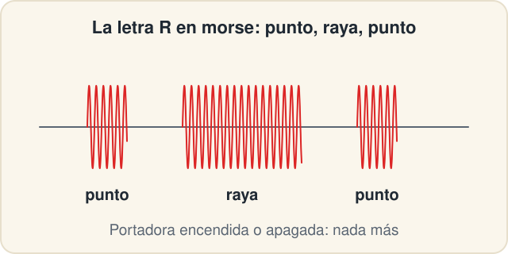

La manera más sencilla de hacer que una portadora diga algo no necesita micrófono ni voz: basta un interruptor. Portadora encendida, portadora apagada. Es el modo más antiguo de la radio y sigue vivo en todas las bandas: es el pitido rítmico que Vicente lee de oído mientras prepara café.

En esta lección verás cómo funciona ese modo, por qué llega donde la voz no llega y, sobre todo, un fenómeno que usaremos durante el resto de la sección y en toda la sección 7: el **batido**. Es la clave de por qué el morse suena como suena y, más adelante, de por qué una voz mal sintonizada suena a pato.

## Encender y apagar: el modo CW

Se toma una portadora y se interrumpe con una llave, que no es más que un interruptor cómodo de pulsar. A encender y apagar la portadora con la llave se le llama **manipular**. Una pulsación corta es un **punto**; una pulsación tres veces más larga, una **raya**. Con combinaciones de puntos y rayas se forma cada letra, según el **código morse**: la A es punto-raya, la N es raya-punto, la S son tres puntos, la O tres rayas.

> **CW:** el modo de transmisión que consiste en encender y apagar una portadora siguiendo el código morse. Las siglas vienen del inglés *Continuous Wave*, «onda continua».

El nombre parece una broma, porque es precisamente la onda que más se interrumpe. Tiene una explicación histórica: los primeros transmisores, a principios del siglo XX, producían la señal con chispas, y cada chispa daba una ráfaga que se apagaba sola en un instante. Cuando se inventaron los osciladores, capaces de dar una onda limpia y sostenida mientras se mantenía pulsada la llave, se la llamó «continua» para distinguirla de aquellas ráfagas. Y con ese nombre se quedó.

En la clasificación de la lección anterior, el CW es una modulación de amplitud llevada al extremo: la amplitud solo tiene dos valores, toda o ninguna.

## El alfiler: por qué el morse llega donde la voz no llega

Recuerda la regla de la lección anterior: cuanta más información por segundo, más ancho de banda. El morse a mano envía muy poca información por segundo —unas pocas letras—, así que ocupa muy poco: entre **100 y 200 Hz**. Una voz en banda lateral única ocupa unos 2.700 Hz. Donde cabe una conversación de voz caben unas dieciocho de morse (2.700 / 150 = 18). Y la regla funciona también dentro del propio morse: quien teclea el doble de rápido ocupa, más o menos, el doble.

Esa estrechez tiene una consecuencia que vale oro cuando las señales son débiles. Para entenderla hay que saber una cosa sobre el **ruido**: ese soplido de fondo que se oye en cualquier receptor no está en una frecuencia concreta, sino repartido por todo el dial, como una lluvia fina que cae por igual en todas partes.

Un receptor solo deja pasar una franja del dial, la que su filtro selecciona (recuerda los filtros paso banda de la sección 5). Cuanto más ancha es esa franja, más lluvia de ruido entra.

- Para recibir voz hay que abrir una franja de 2.700 Hz. Entra el ruido de 2.700 Hz.
- Para recibir morse basta abrir una franja de 150 Hz. Entra el ruido de 150 Hz: dieciocho veces menos.

La señal de morse, en cambio, entra entera en los dos casos, porque toda su potencia está concentrada en esos 150 Hz. Con el mismo transmisor, la señal de morse sobresale del ruido unas dieciocho veces más que la de voz. En decibelios, unos 12 dB de ventaja (con la tabla de la sección 3, 12 dB son ×16; para ×18 salen 12,5). Es como haber multiplicado por dieciocho la potencia del transmisor.

Es la imagen de Dani: toda tu energía concentrada en un alfiler. Por eso, con 5 vatios de CW —menos que una bombilla de nevera— se cruza el Atlántico en un día normal.

Una nota práctica: si la portadora se enciende y se apaga de golpe, de forma brusca, cada conmutación es un cambio rapidísimo, y los cambios rápidos ocupan mucho ancho de banda. La señal se ensancha y los vecinos de dial oyen un chasquido en cada punto y cada raya. Se llaman **chasquidos de manipulación** (en inglés, *key clicks*). Los transmisores bien hechos los evitan haciendo que la portadora suba y baje con suavidad, en unas milésimas de segundo, en lugar de a golpes.

## El problema: una portadora no suena a nada

Aquí aparece una dificultad que no es evidente. Sintonizas una señal de morse. Te llega una portadora de 7.030.000 Hz que aparece y desaparece. ¿Qué se oye en el altavoz?

—Un pitido que aparece y desaparece —dijo Marina.

—No se oye nada —dijo Dani—. O casi nada. Siete millones de hercios no es un sonido: tu oído llega a veinte mil. La portadora está ahí, pero es inaudible. Lo más que oirías es un leve cambio en el soplido de fondo cada vez que aparece.

Hace falta un truco para convertir «hay portadora» en un sonido que el oído perciba. El truco es el batido.

## El batido: cuando dos tonos casi iguales se juntan

Empecemos con sonido, que se puede comprobar con una guitarra.

Dos cuerdas afinadas exactamente igual, tocadas a la vez, suenan como una sola nota sostenida. Pero si una está un poco desafinada, se oye algo curioso: la nota sube y baja de volumen de forma regular, *uaaa-uaaa-uaaa*. Cuanto más desafinadas, más rápido es el vaivén. Los músicos afinan justamente así: van tensando la cuerda hasta que el vaivén se hace lento y desaparece.

Ese vaivén es el **batido**, y se entiende con una idea de la sección 3: la fase.

Supón dos tonos, uno de 440 Hz y otro de 444 Hz. En un instante dado van a la par, en fase: cuando uno empuja, el otro también, y se suman. El sonido es fuerte. Pero el de 444 va un poco más deprisa y poco a poco se adelanta. Al cabo de un rato lleva medio ciclo de ventaja: ahora, cuando uno empuja, el otro tira. Están en oposición de fase y se anulan. El sonido casi desaparece. Sigue adelantándose, y cuando lleva un ciclo entero de ventaja vuelven a coincidir: sonido fuerte otra vez.

(En la sección 3 comparábamos la fase de dos ondas de la *misma* frecuencia, que mantienen siempre la misma ventaja una sobre otra. Aquí las frecuencias son un poco distintas, y por eso la ventaja va cambiando poco a poco: ese cambio continuo es justo lo que produce el vaivén.)

¿Cada cuánto ocurre eso? El tono rápido da 444 ciclos por segundo y el lento 440: le saca 4 ciclos de ventaja cada segundo. Vuelven a coincidir, por tanto, 4 veces por segundo.

> **Batido:** cuando se juntan dos oscilaciones de frecuencias parecidas, el resultado se refuerza y se debilita rítmicamente. La frecuencia de ese vaivén es la **diferencia** entre las dos frecuencias.

## El BFO: fabricar un tono con una resta

Ahora traslada la idea a la radio. La señal de morse llega en 7.030.000 Hz, inaudible. Dentro del receptor hay un pequeño oscilador que genera su propia onda, muy cerca de esa frecuencia: por ejemplo, en 7.030.700 Hz. También inaudible.

Las dos se juntan en un circuito llamado **mezclador**, que conocerás a fondo en la sección 7. Por ahora basta con saber qué entrega: una señal nueva cuya frecuencia es la diferencia entre las dos.

7.030.700 − 7.030.000 = **700 Hz**

Setecientos hercios sí es un sonido: un pitido agudo y agradable. (En los receptores reales esta mezcla no se hace directamente a la frecuencia de la señal, sino después de haberla trasladado a otra frecuencia fija, como verás en la sección 7. La resta es la misma.) Y solo existe mientras llega la portadora. Cuando el operador lejano suelta la llave, no hay nada que restar y el pitido calla. El altavoz reproduce así, punto por punto y raya por raya, lo que la llave va haciendo a miles de kilómetros.

> **BFO** (*Beat Frequency Oscillator*, oscilador de frecuencia de batido): el oscilador del receptor que se mezcla con la señal recibida para producir, por diferencia de frecuencias, un tono audible.

De aquí salen dos hechos que sorprenden:

- **El tono del morse no lo pone el transmisor: lo pone tu receptor.** La estación lejana solo envía una portadora que aparece y desaparece. Lo agudo o grave que suene depende de la diferencia entre su frecuencia y la de tu BFO.
- **Por eso el tono cambia al girar el dial.** Al mover la sintonía, mueves la distancia entre tu BFO y la señal. Si la diferencia pasa de 700 a 400 Hz, el pitido se vuelve más grave. Cada operador lo deja donde le resulta más cómodo de oír.

Y una ventaja añadida. Si en la franja que escuchas hay dos estaciones de morse a la vez, una en 7.030.000 Hz y otra en 7.030.300 Hz, con el BFO en 7.030.700 Hz la primera suena a 700 Hz y la segunda a 400 Hz. Dos notas distintas, como dos instrumentos. Un oído entrenado sigue a una e ignora a la otra.

Donde cojea la comparación con la guitarra: con las cuerdas, lo que oyes es una nota que sube y baja de volumen, y es tu oído quien percibe ese vaivén. En la radio las dos frecuencias son inaudibles, y hace falta un circuito, el mezclador, que convierta ese vaivén en una señal eléctrica real de 700 Hz capaz de mover un altavoz. La aritmética es la misma; el aparato que la aprovecha, no.

## Donde la gente se lía

- **«CW significa que la onda es continua, sin cortes.»** Es el modo en que más se corta. El nombre solo la distingue de las chispas de hace un siglo.
- **«CW y morse son lo mismo.»** El morse es el código (qué puntos y rayas forman cada letra). El CW es la forma de transmitirlo por radio: encendiendo y apagando una portadora. El morse también se puede enviar con una linterna.
- **«El transmisor de morse emite un pitido.»** Emite una portadora de radiofrecuencia, que no suena a nada. El pitido nace en el receptor.
- **«El batido tiene la frecuencia de la suma.»** El batido que se oye es la **diferencia**. (En el mezclador también aparece la suma, pero cae en frecuencias altísimas que no nos interesan aquí.)
- **«El morse es un modo anticuado que ya no sirve.»** De los modos que puede manejar una persona sin ordenador, es el que más rendimiento saca a cada vatio. Sigue siendo el recurso cuando la señal es mínima.

## Compruébalo tú

1. Dos diapasones suenan a la vez, uno a 256 Hz y otro a 259 Hz. ¿Cuántas veces por segundo sube y baja el volumen?
2. Una señal de CW llega en 14.050.000 Hz y el BFO de tu receptor está en 14.050.600 Hz. ¿Qué tono oyes?
3. Giras un poco el dial y el BFO queda en 14.050.900 Hz. ¿Qué le pasa al tono?
4. ¿Y si dejaras el BFO exactamente en 14.050.000 Hz, la misma frecuencia que la señal?
5. Con un filtro de 500 Hz en lugar de uno de 2.500 Hz, ¿cuántas veces menos ruido entra en el receptor?
6. Un compañero dice que su amigo «tiene una voz muy grave en morse». ¿Tiene sentido la frase?

**Soluciones**

1. La diferencia: 259 − 256 = **3 veces por segundo**.
2. 14.050.600 − 14.050.000 = **600 Hz**.
3. La diferencia pasa a ser 900 Hz: el tono se vuelve **más agudo**.
4. La diferencia sería 0 Hz: no hay tono. No se oiría nada, aunque la señal esté llegando. (A esto se le llama *batido cero*.)
5. 2.500 / 500 = **5 veces menos** ruido. La señal de morse, que cabe entera en los 500 Hz, pasa igual.
6. No. El tono no depende de la estación que transmite, sino de dónde está sintonizado el receptor de quien escucha. Otro oyente puede estar oyéndolo mucho más agudo.

## En una frase

El CW consiste en encender y apagar una portadora al ritmo del morse; ocupa solo unos 150 Hz, lo que concentra toda la potencia en un alfiler, y como una portadora no suena a nada, el receptor la mezcla con un oscilador propio, el BFO, para obtener un tono audible cuya frecuencia es la diferencia entre las dos.

El morse solo sabe decir «encendido» y «apagado». En la lección siguiente damos el salto a la voz: en vez de dos tamaños de portadora, todos los intermedios.
