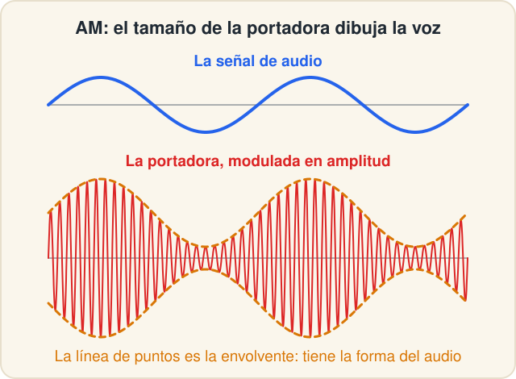
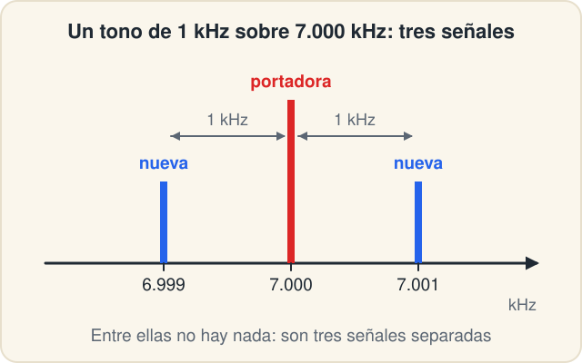

El morse solo conoce dos tamaños de portadora: toda o nada. El paso siguiente es evidente: si en lugar de encenderla y apagarla la hacemos crecer y menguar suavemente, siguiendo la forma de la voz, la portadora podrá llevar una conversación. Eso es la **modulación de amplitud**, la AM de las radios de toda la vida.

En esta lección está el folio que Dani dibujó en el club, el de las «tres jorobas». Vas a entender de dónde salen esas tres jorobas, cosa que casi ningún libro explica y que es la clave de todo lo que viene después. Al terminar sabrás calcular cuánto dial ocupa una señal de AM y por qué se dice que gasta dos tercios de su potencia en una portadora que no dice nada.

## La idea: el tamaño de la portadora dibuja la voz

Recuerda que el micrófono convierte la voz en una tensión que sube y baja. En AM, esa tensión gobierna la **amplitud** de la portadora:

- Cuando la tensión de la voz sube, la portadora se hace más grande.
- Cuando baja, la portadora se hace más pequeña.
- Cuando no hay voz, la portadora se queda en su tamaño normal, constante.

La frecuencia de la portadora no cambia en ningún momento: sigue oscilando a sus siete millones de veces por segundo. Lo único que varía es el tamaño de esas oscilaciones.

Si dibujas la señal resultante y unes con una línea las crestas de la portadora, esa línea reproduce la forma de la voz. Se llama **envolvente**, porque envuelve a la portadora por arriba y por abajo.

> **Modulación de amplitud (AM):** modo en el que la amplitud de la portadora varía al ritmo de la señal moduladora. La forma de la voz queda dibujada en la envolvente de la onda.

Recuperar la voz en el receptor es muy fácil: un diodo deja pasar solo la mitad superior de la señal (rectifica, como en la sección 4) y un condensador alisa las oscilaciones rápidas de la portadora. Lo que queda es la envolvente: la voz. Ese circuito se llama **detector de envolvente**, y con él funcionaban las radios de galena de hace un siglo.

## La sorpresa: aparecen frecuencias nuevas

Hasta aquí todo parece sencillo: una portadora de 7.000 kHz que cambia de tamaño. Uno pensaría que sigue ocupando un único punto del dial, el de 7.000 kHz.

No es así, y para verlo vamos a hacer el experimento más simple posible. En lugar de una voz, que es una mezcla complicada, modulamos la portadora con un único tono puro de **1 kHz**: un silbido. La portadora de 7.000 kHz crece y mengua mil veces por segundo.

Ahora recuerda el batido de la lección anterior. Allí juntábamos dos ondas de frecuencias parecidas y obteníamos una onda cuyo tamaño subía y bajaba al ritmo de la *diferencia* entre ellas.

Léelo al revés:

> Una onda cuyo tamaño sube y baja rítmicamente **es lo mismo** que varias ondas de tamaño constante y frecuencias vecinas, sumadas.

No es una manera de hablar. Son dos descripciones de la misma señal, igual que «una docena» y «doce» describen la misma cantidad de huevos. Y cuando se hace la cuenta para nuestro silbido, la portadora que crece y mengua mil veces por segundo resulta ser exactamente la suma de **tres** ondas, todas de tamaño constante:

| Frecuencia | Qué es |
|---|---|
| 6.999 kHz | Una onda nueva, 1 kHz **por debajo** de la portadora |
| 7.000 kHz | La portadora original, intacta |
| 7.001 kHz | Otra onda nueva, 1 kHz **por encima** de la portadora |

Puedes comprobarlo con lo que sabes del batido. La portadora (7.000) y la onda de 7.001 están separadas 1 kHz: juntas, se refuerzan y se debilitan mil veces por segundo. La portadora y la de 6.999, lo mismo. Las tres juntas dan justo una onda de 7.000 kHz cuyo tamaño sube y baja mil veces por segundo: nuestra portadora modulada. No hemos añadido nada; la hemos descrito de otra manera.

—¿Y eso cómo se sabe? —dijo Marina—. ¿No será una forma de hacer las cuentas y ya está?

—Se sabe porque se puede escuchar —contestó Dani—. Pon el receptor como para morse, con un filtro muy estrecho, y pasea el dial despacio. En 7.000 te sale un pitido fijo, como el de una portadora cualquiera. En 6.999 te sale otro, más flojo. En 7.001, otro igual. Y entre medias, silencio. Están ahí, las tres, cada una en su sitio.

—¿Y por qué dos nuevas y no una?

—Porque con una sola al lado de la portadora ya habría batido, y el tamaño subiría y bajaría. Pero la onda no iría del todo a su ritmo: sería como un reloj que a ratos adelanta un poco y a ratos atrasa. La segunda, puesta al otro lado y a la misma distancia, produce el desajuste contrario y lo anula. Con las dos, el reloj va clavado y lo único que cambia es el tamaño.

La regla general es esta:

> Al modular en amplitud una portadora de frecuencia **f** con un tono de frecuencia **a**, aparecen dos señales nuevas: una en **f + a** y otra en **f − a**.

Esta es la razón, prometida en la lección 2, de que toda señal modulada ocupe una franja: cambiar la portadora *crea* frecuencias a su alrededor.

## De un silbido a una voz: las bandas laterales

Una voz no es un tono, sino una mezcla de muchísimos tonos a la vez, repartidos por la banda vocal, de 300 a 3.000 Hz. Cada uno de ellos hace lo mismo que el silbido: produce su propia pareja de señales, una por encima de la portadora y otra por debajo, a una distancia igual a su frecuencia.

- El tono más grave de la voz, de 300 Hz (0,3 kHz), produce señales en 7.000,3 y en 6.999,7 kHz.
- El más agudo, de 3.000 Hz (3 kHz), las produce en 7.003 y en 6.997 kHz.
- Todos los intermedios rellenan el espacio entre unas y otras.

El resultado son dos franjas enteras, una a cada lado de la portadora:

> **Banda lateral superior** (en inglés *Upper Side Band*, **USB**): la franja que queda por encima de la portadora. En el ejemplo, de 7.000,3 a 7.003 kHz.
>
> **Banda lateral inferior** (*Lower Side Band*, **LSB**): la franja que queda por debajo. En el ejemplo, de 6.997 a 6.999,7 kHz.

Cada banda lateral contiene la voz completa. La superior la contiene «al derecho» (los graves cerca de la portadora y los agudos lejos, hacia arriba) y la inferior la contiene reflejada como en un espejo (los agudos lejos, hacia abajo). Son dos copias del mismo mensaje.

Ahí tienes las tres jorobas de Dani: la portadora en el centro y una banda lateral a cada lado.

## Cuánto ocupa una señal de AM

Mirando el dibujo, la cuenta sale sola. La señal se extiende desde el extremo de la banda inferior hasta el extremo de la superior, y cada una llega tan lejos de la portadora como la frecuencia más alta del audio.

**Ancho de banda de AM = 2 × frecuencia máxima del audio**

Para una voz que llega hasta 3 kHz: 2 × 3 = **6 kHz**. Es un dato que el examen pide con frecuencia.

Fíjate en que el ancho de banda **no** depende de la frecuencia de la portadora ni de la potencia. Una emisora de AM ocupa 6 kHz tanto si emite en 1 MHz como si emite en 28 MHz, con 1 vatio o con 1.000.

## Las cuentas de la potencia: tres billetes para viajar uno

Ahora viene la mala noticia de la AM. Mira las tres ondas del experimento del silbido y pregúntate: ¿en cuál de ellas está el mensaje?

- La portadora, en 7.000 kHz, es una onda de tamaño constante. Es exactamente igual haya voz o no la haya, y sea cual sea lo que se dice. **No lleva ninguna información.**
- Cada banda lateral depende por completo de lo que se dice: está donde está y tiene el tamaño que tiene según la voz. **Toda la información está en las bandas laterales**, y por duplicado.

Y sin embargo, la mayor parte de la potencia se va a la portadora. En el mejor de los casos, cuando se modula al máximo posible con un tono, el reparto es este:

| Parte de la señal | Fracción de la potencia total |
|---|---|
| Portadora | dos tercios (67 %) |
| Banda lateral superior | una sexta parte (17 %) |
| Banda lateral inferior | una sexta parte (17 %) |

**Ejemplo.** *Un transmisor de AM emite una portadora de 100 W y se modula al máximo con un tono. ¿Cómo se reparte la potencia?*

Cada banda lateral lleva la cuarta parte de la potencia de la portadora: 25 W. En total salen 100 + 25 + 25 = 150 W. De esos 150 W, solo 25 —los de una banda lateral— son imprescindibles para que el mensaje llegue. Los otros 125 W son la portadora, que no dice nada (100 W, dos tercios del total), y una copia repetida (25 W, una sexta parte).

Es la frase de Dani: pagar tres billetes para que viaje uno. Con voz normal, que no llega al máximo casi nunca, la proporción es todavía peor.

A la intensidad con que se modula se la llama **profundidad de modulación** y se expresa en tanto por ciento. Se mide sobre la envolvente, comparando su punto más alto con su punto más bajo:

**profundidad = (máximo − mínimo) / (máximo + mínimo)**

*Cuanto más se diferencian las crestas de los valles de la envolvente, más profunda es la modulación.* Si la envolvente sube hasta 150 V y baja hasta 50 V, la profundidad es (150 − 50) / (150 + 50) = 100 / 200 = 0,5: un 50 %. Sin modulación, máximo y mínimo son iguales y la profundidad es cero.

La profundidad importa porque de ella depende cuánta potencia va a las bandas laterales. Al 50 %, cada banda lateral lleva solo un 6 % de la potencia de la portadora: con 60 W de portadora, menos de 4 W. Al 100 %, lleva el 25 %, que es el caso de la tabla anterior.

Al 100 %, la envolvente llega a anularse por un instante en los valles y sube al doble de su tamaño normal en las crestas (lo que, en ese instante, es cuatro veces la potencia de la portadora): es el máximo. Si se intenta pasar de ahí (por hablar demasiado fuerte o subir demasiado la ganancia del micrófono), la envolvente se deforma, la voz se oye distorsionada y la señal se ensancha e invade las frecuencias vecinas. Se llama **sobremodulación**, y volveremos a ella en la sección 7.

## Entonces, ¿por qué sigue existiendo?

Con esas cuentas, uno esperaría que la AM hubiera desaparecido. Sigue viva por dos virtudes:

- **El receptor es sencillísimo.** Un diodo y poco más. Durante décadas eso significó millones de radios baratas en todas las casas.
- **Se sintoniza sin esfuerzo.** Como la portadora viaja con la señal, el receptor no tiene que adivinar nada. Aunque no estés exactamente en la frecuencia, la voz suena natural.

Por eso la usan la radiodifusión en onda media y onda corta y la aviación: pilotos y controladores hablan en AM. En radioafición hoy es minoritaria.

## Donde la gente se lía

- **«En AM cambia la frecuencia de la portadora.»** No. Cambia su amplitud. La frecuencia de la portadora se queda fija.
- **«Las bandas laterales son un efecto secundario, un defecto.»** Son la señal. El mensaje está en ellas y solo en ellas.
- **«La portadora lleva la voz.»** La portadora no lleva nada: es la misma hables o calles. Sirve de referencia para que el receptor lo tenga fácil.
- **«A más potencia, más ancho de banda.»** El ancho de banda lo fija la frecuencia más alta del audio, no la potencia.
- **«El ancho de banda de AM es igual a la frecuencia máxima del audio.»** Es el **doble**: hay una banda a cada lado.

## Compruébalo tú

1. Una portadora de 3.700 kHz se modula en amplitud con un tono de 2 kHz. ¿En qué frecuencias aparecen señales?
2. Una emisora de onda media transmite música con audio de hasta 4,5 kHz. ¿Qué ancho de banda ocupa?
3. Esa emisora tiene su portadora en 1.000 kHz. ¿Desde qué frecuencia hasta cuál se extiende su señal?
4. Un transmisor de AM tiene una portadora de 60 W y se modula al máximo con un tono. ¿Qué potencia lleva cada banda lateral? ¿Cuánta potencia sale en total?
5. En una señal de AM, el locutor se calla. ¿Qué sigue saliendo por la antena?
6. Dos emisoras de AM con audio de hasta 5 kHz quieren emitir sin pisarse. ¿Qué separación mínima deben tener sus portadoras?

**Soluciones**

1. En la portadora y a 2 kHz a cada lado: **3.698 kHz, 3.700 kHz y 3.702 kHz**.
2. 2 × 4,5 = **9 kHz**. (Es justo la separación que tienen entre sí las emisoras de onda media en Europa.)
3. 4,5 kHz a cada lado de la portadora: **de 995,5 a 1.004,5 kHz**.
4. Cada banda lateral lleva la cuarta parte de la portadora: 60 / 4 = **15 W**. En total, 60 + 15 + 15 = **90 W**.
5. La **portadora**, sola, con la misma potencia de siempre: sale igual hables o calles. Las bandas laterales desaparecen porque no hay audio que las produzca.
6. Cada una ocupa 5 kHz a cada lado de su portadora. Para que la banda superior de una no toque la inferior de la otra, las portadoras deben separarse 5 + 5 = **10 kHz**.

## En una frase

En AM la amplitud de la portadora sigue la forma de la voz, y ese cambio de tamaño hace aparecer dos copias del mensaje, las bandas laterales, una a cada lado de la portadora: la señal ocupa el doble de la frecuencia máxima del audio y gasta la mayor parte de su potencia en una portadora que no dice nada.

Si la portadora no informa y una de las dos copias sobra… la pregunta siguiente se hace sola. Es la que dio origen a las voces de pato.
