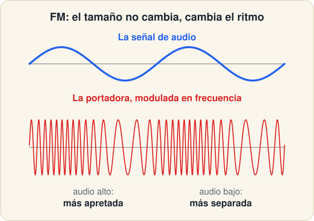

—¿Y la FM? —había preguntado Marina en el club—. En el coche no hay patos.

No los hay, ni tampoco el chisporroteo que acompaña a las emisoras de onda media cuando pasas junto a una línea eléctrica. La FM es otra manera de pensar: en lugar de tocar el tamaño de la portadora, se le mueve la frecuencia. Ese cambio de idea tiene un precio alto en ancho de banda y una recompensa enorme en limpieza de sonido.

Es, además, el modo con el que casi todo el mundo empieza: tu primer equipo será, con mucha probabilidad, un portátil de FM. Al terminar esta lección sabrás qué es la desviación, cuánto dial ocupa una señal de FM, por qué es tan resistente al ruido y por qué, a pesar de todo, no se usa en onda corta.

## La idea: la voz empuja la frecuencia

En FM la amplitud de la portadora no se toca: la onda tiene siempre el mismo tamaño. Lo que hace la voz es empujar la **frecuencia** de la portadora un poco hacia arriba y un poco hacia abajo, alrededor de su valor central.

- Cuando la tensión de la voz sube, la portadora oscila un poco más deprisa.
- Cuando baja, oscila un poco más despacio.
- Cuando hay silencio, se queda exactamente en su frecuencia central.

> **Modulación de frecuencia (FM):** modo en el que la frecuencia de la portadora varía alrededor de un valor central al ritmo de la señal moduladora, mientras su amplitud permanece constante.

Para que la imagen se te quede, piensa en alguien que te transmite un mensaje silbando desde la otra acera de una calle ruidosa. Tiene dos maneras de hacerlo: variando el **volumen** del silbido o variando su **altura**, de más grave a más agudo. Con el ruido del tráfico, el volumen te llega alterado y es imposible seguirlo con precisión. La altura, en cambio, te llega intacta: un silbido agudo sigue siendo agudo por mucho ruido que haya. La AM escribe el mensaje en el volumen; la FM, en la altura.

## Dos cosas distintas que se mueven

Aquí está el punto donde casi todo el mundo se confunde, así que vamos despacio. En una señal de FM hay dos «cuántos» diferentes:

1. **Cuánto se aparta** la frecuencia de su valor central. Depende de lo **fuerte** que hables: un susurro la mueve poco, un grito la mueve mucho.
2. **Cuántas veces por segundo** va y viene. Depende de lo **agudo** que sea el sonido: un tono de 1.000 Hz la hace ir y venir mil veces por segundo.

Al primero se le pone nombre y límite:

> **Desviación:** lo máximo que la frecuencia de la portadora se aparta de su valor central, hacia arriba o hacia abajo.

En la FM de radioaficionado, la desviación habitual es de **±5 kHz**. (El signo ± se lee «más menos» y quiere decir «esa cantidad hacia cada lado».) Una portadora de 145.500 kHz con esa desviación se pasea, hablando fuerte, entre 145.495 y 145.505 kHz. Conviven dos variantes: la clásica, con ±5 kHz de desviación y canales separados 25 kHz, y una más estrecha, con unos ±2,5 kHz y canales separados 12,5 kHz, que es la que recogen los planes de banda actuales para aprovechar mejor el sitio. Los equipos suelen traer las dos, rotuladas como FM «ancha» (la de ±5 kHz) y «estrecha» (la de ±2,5 kHz); en inglés, *wide* y *narrow*. En este curso usaremos esas dos palabras solo con ese significado.

El transmisor lleva un circuito que impide pasar de la desviación máxima por mucho que grites: en FM, gritar al micrófono no te hace llegar más lejos. (Ese limitador puede estar mal ajustado, y entonces la señal se pasa de ancha e invade el canal vecino: se llama *sobredesviación* y la verás en la sección 7.)

En el receptor, un circuito llamado **discriminador** hace el trabajo inverso: convierte cada subida y bajada de frecuencia en una subida y bajada de tensión. Lo que sale es la voz.

## Cuánto ocupa: la regla de Carson

A primera vista, si la portadora se mueve 5 kHz hacia cada lado, la señal debería ocupar 10 kHz. Ocupa bastante más.

—Eso no lo entiendo —dijo Marina—. Si la frecuencia no sale nunca de esos cinco kilohercios, ¿cómo va a haber señal más allá?

—Porque hay dos cosas que ensanchan, no una —dijo Dani.

- **La primera** es lo lejos que se pasea la frecuencia: ±5 kHz son ya 10 kHz.
- **La segunda** es que ese paseo es, en sí mismo, un cambio que se le hace a la portadora. Y en la lección 4 viste que **todo cambio en la portadora crea señales nuevas a sus lados**, separadas de ella por la frecuencia del audio. Un audio de 3 kHz las pone 3 kHz más allá, por cada lado.

Para convencerte de que son dos cosas distintas, mira los dos casos extremos:

- **Un susurro agudo.** La desviación es casi nula: la frecuencia apenas se mueve. Queda solo lo segundo: señales laterales a 3 kHz a cada lado. Ancho: 2 × 3 = 6 kHz, igual que una AM.
- **Un tono muy lento y fuerte.** La frecuencia se pasea de punta a punta, pero tan despacio que apenas crea señales laterales. Queda solo lo primero: 2 × 5 = 10 kHz.

En una voz normal ocurren las dos cosas a la vez, y la **regla de Carson** dice simplemente que se suman:

**Ancho de banda de FM ≈ 2 × (desviación + frecuencia máxima del audio)**

*Lo que se pasea la frecuencia, más lo que añaden las señales laterales; y todo multiplicado por dos, porque ocurre a ambos lados de la portadora.*

**Ejemplo.** *FM de radioaficionado: desviación de 5 kHz y voz de hasta 3 kHz.*

2 × (5 + 3) = 2 × 8 = **16 kHz**

**Ejemplo.** *La variante «estrecha»: desviación de 2,5 kHz y voz de hasta 3 kHz.*

2 × (2,5 + 3) = 2 × 5,5 = **11 kHz**

Y un ejemplo que explica algo que has visto mil veces. Las emisoras comerciales de FM, que transmiten música con buena calidad, usan una desviación de 75 kHz y audio de hasta 15 kHz:

2 × (75 + 15) = **180 kHz**

Por eso en el dial de la radio del coche las emisoras de una misma zona nunca están pegadas, sino separadas varios cientos de kilohercios (99,1 · 99,5 · 99,9…), y por eso la FM comercial vive en VHF, entre 87,5 y 108 MHz: ahí hay sitio para franjas tan anchas.

Al cociente entre la desviación y la frecuencia del audio se le llama **índice de modulación**. Con 5 kHz de desviación y un tono de 2,5 kHz, el índice es 5 / 2,5 = 2. Sirve para saber cuál de las dos cosas manda. Con un índice alto, como el de la FM de radiodifusión (75 / 15 = 5), manda la desviación: la señal ocupa mucho y es muy limpia. Con un índice cercano a 1, como el de la FM de voz de los radioaficionados (5 / 3 ≈ 1,7), las dos pesan parecido. (En los libros, a toda la FM de voz se la llama *FM de banda estrecha*, NBFM, por contraste con la de radiodifusión. No lo confundas con el rótulo «estrecha» de tu equipo, que es la variante de ±2,5 kHz.)

## El precio: demasiado ancho para la onda corta

Compara: una voz en SSB ocupa 2,7 kHz; en FM, 16 kHz. Donde hay una estación de FM cabrían seis de SSB.

En las bandas de onda corta el sitio es escaso (toda la banda de 40 metros mide 200 kHz) y todo el planeta las comparte, así que la FM sería un derroche de mala educación. En VHF y UHF hay espacio de sobra: solo la banda de 2 metros mide 2.000 kHz, y su alcance normal es local, con lo que las mismas frecuencias se reutilizan de una ciudad a otra.

Así se reparte el territorio: **FM en VHF y UHF, para comunicación local; SSB en onda corta, para larga distancia.** En FM funcionan también los **repetidores**: estaciones automáticas colocadas en un punto alto, que reciben tu señal y la vuelven a emitir para darle más alcance. Los verás en la sección 11. (La única excepción en HF es la parte más alta de la banda de 10 metros, por encima de 29 MHz, donde sí hay algo de FM.)

## El superpoder: el ruido se queda fuera

¿Qué se obtiene a cambio de tanto ancho? Limpieza.

Casi todo el ruido que estropea una recepción —los chasquidos de una tormenta, el motor de un coche, un interruptor, un cargador barato— se suma a la señal **alterando su amplitud**: le pone picos y dientes encima.

- En AM y en SSB, el mensaje *es* la amplitud. Cualquier pico de ruido se convierte directamente en un chasquido en el altavoz. No hay forma de separarlos.
- En FM, el mensaje está en la frecuencia. La amplitud no significa nada, así que el receptor puede hacer algo drástico: **recortarla**. Un circuito llamado **limitador** rebana la señal por arriba y por abajo y la deja con un tamaño perfectamente plano, llevándose por delante todos los picos de ruido. Después, el discriminador lee los cambios de frecuencia, que siguen intactos.

El resultado es ese sonido limpio y cómodo, «de emisora», que hace de la FM el modo ideal para charlar.

Como la amplitud no importa, el transmisor tampoco tiene que cuidarla. Puede usar amplificadores de clase C (recuerda de la sección 5: los de mejor rendimiento, que deforman la onda), y por eso un portátil de FM saca tanto partido a su batería.

### Donde se acaba el superpoder

La imagen del silbido cojea en un punto importante, y es mejor saberlo antes de llevarse un chasco. La inmunidad al ruido solo funciona **si la señal llega con fuerza suficiente**. Cuando la señal es fuerte, la FM es impecable. Pero si se debilita hasta acercarse al nivel del ruido, la FM no se degrada poco a poco: se llena de soplido y se pierde casi de golpe. Una señal de SSB o de CW, en la misma situación, se seguiría entendiendo entre el ruido.

Por eso, en las mismas bandas de VHF, quien busca contactos lejanos con señales mínimas no usa FM, sino SSB o CW. La FM es para señales cómodas.

Dos consecuencias que notarás desde el primer día:

- Un receptor de FM sin ninguna señal produce un soplido fuerte y continuo. Para no oírlo, los equipos llevan un **silenciador** (en inglés *squelch*) que enmudece el altavoz hasta que aparece una señal.
- **El efecto captura.** Si dos señales de FM llegan a la vez en la misma frecuencia, el receptor no las mezcla: se queda con la más fuerte y la más débil desaparece por completo, como si no existiera. En AM o en SSB se oirían las dos, una encima de otra. Es una bendición frente a interferencias débiles y una maldición cuando la débil eres tú.

## Una prima cercana: la modulación de fase

En la lección 2 viste que la tercera cosa que se puede cambiar en una onda es la fase. Mover la fase de una portadora y mover su frecuencia son operaciones tan emparentadas que el resultado es casi indistinguible: muchos equipos de «FM» generan en realidad su señal modulando la fase, y cualquier receptor de FM la recibe sin notar la diferencia. Si ves las siglas **PM**, es eso.

## Donde la gente se lía

- **«Hablar más fuerte hace que la frecuencia cambie más deprisa.»** Hablar más fuerte hace que se aparte *más* (más desviación). Lo que la hace ir y venir más deprisa es que el sonido sea más agudo.
- **«El ancho de banda de FM es el doble de la desviación.»** Es más: 2 × (desviación + audio máximo).
- **«FM significa VHF.»** FM es una manera de modular. Se usa sobre todo en VHF y UHF porque es ancha, pero no son la misma cosa: en VHF también hay SSB, CW y modos digitales.
- **«La FM llega más lejos porque es más limpia.»** Es más limpia con señales fuertes. Con señales débiles llega *menos* lejos que la SSB.
- **«En FM, más potencia de voz es más alcance.»** La amplitud de la portadora es siempre la misma, grites o susurres.

## Compruébalo tú

1. Un equipo de FM usa una desviación de 4 kHz y deja pasar audio de hasta 3 kHz. ¿Qué ancho de banda ocupa, según la regla de Carson?
2. Una portadora de 433.500 kHz se modula en FM con una desviación de ±5 kHz. ¿Entre qué frecuencias se mueve?
3. Con una desviación de 5 kHz se transmite un tono de 1 kHz. ¿Cuál es el índice de modulación?
4. Subes el volumen de tu voz al doble sin cambiar de tono. En una señal de FM, ¿qué aumenta: la desviación o la velocidad con que la frecuencia va y viene?
5. Estás escuchando a un amigo por un repetidor de FM y, de pronto, su voz desaparece y oyes perfectamente a un desconocido. ¿Qué ha ocurrido?
6. Pasa una moto mal apantallada junto a dos receptores, uno de AM y otro de FM, que reciben señales fuertes. ¿En cuál se oye el chisporroteo? ¿Por qué?
7. En un tramo de 200 kHz, ¿cuántos canales de FM de 16 kHz caben, como mucho?

**Soluciones**

1. 2 × (4 + 3) = 2 × 7 = **14 kHz**.
2. 5 kHz a cada lado: **de 433.495 a 433.505 kHz**.
3. Índice = desviación / frecuencia del audio = 5 / 1 = **5**.
4. La **desviación**: la frecuencia se aparta más de su centro. La velocidad del vaivén depende del tono, que no ha cambiado.
5. El **efecto captura**: ha aparecido en la misma frecuencia una señal más fuerte que la de tu amigo, y el receptor se ha quedado solo con ella.
6. En el de **AM**. El ruido de la moto altera la amplitud de la señal; en AM la amplitud es el mensaje y el ruido se oye. El receptor de FM recorta la amplitud con su limitador y lee solo la frecuencia.
7. 200 / 16 = 12,5: caben **12**.

## En una frase

En FM la voz mueve la frecuencia de la portadora y deja su amplitud constante: ocupa unos 16 kHz —demasiado para la onda corta, perfecto para VHF y UHF—, y a cambio el receptor puede recortar la amplitud y dejar fuera el ruido, siempre que la señal llegue con fuerza suficiente.

Ya conoces los cuatro modos clásicos. Queda la última familia, la más reciente: la de los modos en los que quien modula y quien descifra es un ordenador.
