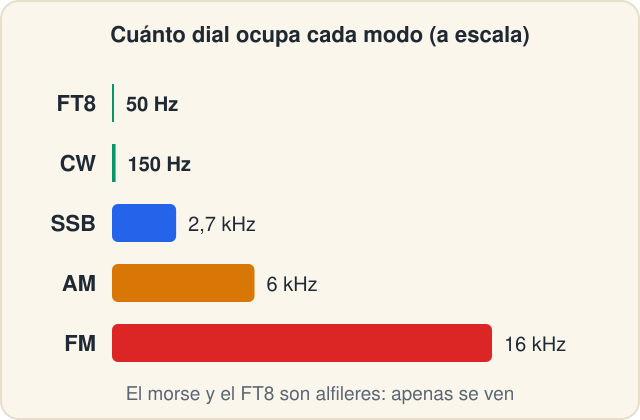

Marina terminó aquella noche con una sola frase en el cuaderno, subrayada dos veces: *ya no oigo ruidos; oigo modos*. Esta última lección de la sección es para que puedas escribir lo mismo. Trae poca teoría nueva: junta lo anterior en tres herramientas de uso diario. Al terminar sabrás reconocer cada modo en la pantalla de un receptor, sabrás en qué parte del espectro vive cada uno y por qué, y sabrás leer la «matrícula» oficial con la que los reglamentos nombran cada tipo de emisión.

## Leer una cascada

Una **cascada** (en inglés *waterfall*) es la forma en que dibujan lo que hay en la banda los receptores modernos y los **SDR**, que son receptores en los que casi todo el trabajo lo hace un programa de ordenador (los de websdr.org lo son; verás cómo funcionan en la sección 7). De izquierda a derecha están las frecuencias, como en el dial. En vertical corre el tiempo: según el programa, lo más reciente aparece arriba y va cayendo, o aparece abajo y va subiendo. Y el brillo indica la fuerza de la señal.

En ese dibujo, cada modo deja una huella que ya puedes interpretar, porque es su espectro, el mismo de las lecciones anteriores, visto desde arriba:

| Lo que ves | Qué es | Por qué tiene esa forma |
|---|---|---|
| Una columna ancha, simétrica, con una línea central muy brillante y continua | **AM** | La línea es la portadora; a cada lado, una banda lateral |
| Una mancha de unos 3 kHz, sin línea central, que aparece y desaparece con las palabras | **SSB** | Una sola banda lateral; sin voz no hay señal |
| Un hilo finísimo a trazos, cortos y largos | **CW** | Una portadora que se enciende y se apaga |
| Un grupo de rayitas muy finas que empiezan y terminan todas a la vez cada 15 segundos | **FT8** | Muchas estaciones en turnos sincronizados |

(La FM no sale en el dibujo porque vive en otras bandas, pero también tiene su huella: una franja ancha que se retuerce con la voz y que, en los silencios, se reduce a una línea, la portadora sola.)

## Cada modo, en su hábitat

Esta es la tabla que resume la sección. Cada modo ocupa lo que ocupa y vive donde le conviene.

| Modo | Qué se cambia en la portadora | Ancho de banda típico | Dónde vive | Su punto fuerte |
|---|---|---|---|---|
| **CW** (morse) | Encendida o apagada | 100–200 Hz | HF sobre todo | Máxima eficacia con medios mínimos |
| **AM** | La amplitud | 6 kHz | Radiodifusión, aviación | Receptor sencillísimo |
| **SSB** | La amplitud (sin portadora y con una sola banda lateral) | 2,4–2,7 kHz | Voz en HF | Toda la potencia en el mensaje |
| **FM** | La frecuencia | 11–16 kHz | VHF y UHF local, repetidores | Sonido limpio, sin ruido |
| **FT8** y otros digitales | Frecuencia o fase, a saltos | de 31 Hz a unos cientos de Hz | HF con señales débiles | Descifra por debajo del ruido |

El orden de menor a mayor ancho es pregunta habitual de examen: **digitales estrechos y CW, después SSB, después AM, después FM.**

## La matrícula de cada emisión

Cada tipo de emisión tiene una denominación oficial internacional de tres símbolos, una especie de matrícula:

- El **primero** (una letra) dice cómo se modula la portadora: **A**, amplitud con las dos bandas laterales; **J**, banda lateral única con portadora suprimida; **F**, frecuencia; **G**, fase.
- El **segundo** (una cifra) dice qué tipo de señal modula: **1**, digital sin tonos de audio intermedios; **2**, digital mediante tonos de audio; **3**, analógica (una voz).
- El **tercero** (una letra) dice qué se transmite: **A**, telegrafía para leer de oído; **B**, telegrafía para máquinas; **D**, datos; **E**, telefonía (voz).

Las cuatro que conviene reconocer:

| Denominación | Modo |
|---|---|
| **A1A** | Morse (CW) |
| **A3E** | Voz en AM |
| **J3E** | Voz en SSB |
| **F3E** | Voz en FM |

Y, con las tres reglas anteriores, puedes leer las demás aunque no las hayas visto nunca. **G3E** es voz con modulación de fase. **F1B** es el RTTY cuando el transmisor salta directamente de frecuencia. **J2B** y **J2D** son telegrafía para máquinas y datos enviados como tonos de audio a través de un transmisor de SSB: así salen al aire el RTTY, el PSK31 o el FT8 en casi todas las estaciones.

**Ejemplo.** *¿Qué es una emisión F3E?* F: se modula la frecuencia. 3: la señal que modula es analógica. E: lo que se transmite es telefonía, es decir, voz. Es la voz en FM de un walkie.

## Donde la gente se lía

- **«La cascada muestra el sonido.»** Muestra el espectro: qué frecuencias están ocupadas y con cuánta fuerza, a lo largo del tiempo.
- **«Una señal ancha en la cascada es una señal fuerte.»** El ancho indica el modo; la fuerza la indica el brillo. Una FM débil es ancha y una portadora fortísima es un hilo.
- **«Cada banda tiene su modo.»** Cada banda tiene modos habituales, pero en casi todas conviven varios. En 40 metros hay CW, SSB y digitales, cada uno en su tramo.
- **«A3E y J3E son lo mismo, porque las dos son voz.»** La E final dice que son voz; la primera letra dice que una es AM con sus dos bandas y la otra es banda lateral única.

## Compruébalo tú

1. Ordena de menor a mayor ancho de banda: voz en AM, PSK31, voz en FM, RTTY, voz en SSB.
2. En la cascada ves un hilo fino y continuo, sin cortes, que lleva así varios minutos. ¿Qué puede ser?
3. En la cascada ves una mancha de unos 3 kHz que aparece y desaparece, pegada por su lado derecho a una frecuencia fija. ¿Qué modo es, y qué banda lateral?
4. ¿Qué modo elegirías para cada cosa? (a) Charlar con un compañero del club por el repetidor del pueblo, con un portátil. (b) Hablar de viva voz con una estación de Argentina en la banda de 20 metros. (c) Intentar un contacto con una antena de balcón y 10 W cuando las señales apenas se distinguen.
5. Lee estas dos denominaciones aplicando las tres reglas: G3E y J2B.
6. Lee esta denominación sin haberla visto antes: F2D.

**Soluciones**

1. **PSK31** (31 a 60 Hz) < **RTTY** (unos 250 Hz) < **SSB** (2,7 kHz) < **AM** (6 kHz) < **FM** (11 a 16 kHz).
2. Una **portadora sin modular**: alguien ajustando su equipo, una interferencia o una baliza (una estación automática que emite continuamente para que se pueda comprobar si hay propagación). Si fuera CW se vería a trazos; si llevara voz, tendría anchura.
3. Voz en **SSB**, banda lateral **inferior** (LSB): la señal se extiende hacia abajo desde la frecuencia de la portadora suprimida, que es su borde derecho.
4. (a) **FM**, en VHF o UHF. (b) **SSB**, en banda lateral superior (USB), porque 20 metros está por encima de 10 MHz. (c) **FT8**, o **CW** si sabes morse.
5. **G3E**: G, modulación de fase; 3, señal analógica; E, telefonía. Es voz con modulación de fase, la prima de la FM. **J2B**: J, banda lateral única con portadora suprimida; 2, digital mediante tonos de audio; B, telegrafía para máquinas. Es, por ejemplo, el RTTY enviado como tonos a través de un transmisor de SSB.
6. F: modulación de frecuencia. 2: digital mediante tonos de audio. D: datos. Son **datos enviados como tonos sobre un transmisor de FM**; es, por ejemplo, como funciona el APRS.

## En una frase

Cada modo deja en la cascada la huella de su espectro, ocupa lo que su manera de modular exige —del alfiler del morse a la franja ancha de la FM— y vive en la parte del espectro donde ese ancho y sus virtudes encajan; y su denominación oficial de tres símbolos dice cómo se modula, con qué y para transmitir qué.

Con esto terminas la sección. El material siguiente es su resumen, en formato de chuleta, para repasar antes del examen.
