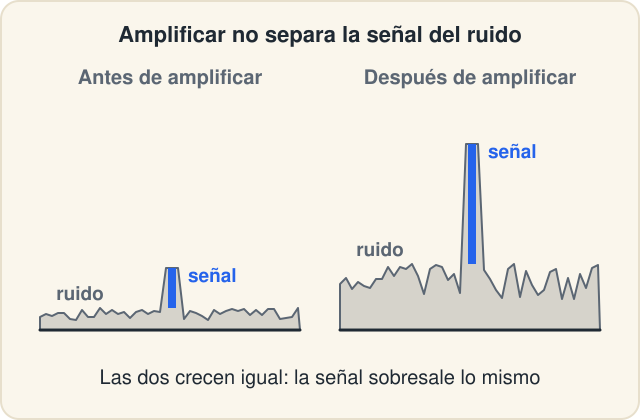

Vicente levantó la tapa de su transceptor y le dijo a Marina que dos mil componentes no se miran de uno en uno: se miran por bloques. Antes de abrir el plano de esos bloques conviene saber para qué están ahí. Esta lección no describe ningún circuito. Describe el **problema** que un receptor tiene que resolver; cuando se entiende, la solución de las lecciones siguientes resulta casi obvia.

Al terminar sabrás qué tres cosas se le piden a un receptor, por qué amplificar mucho no basta para oír lejos y por qué la idea más sencilla de receptor —un filtro que se mueve con el dial— no funciona bien.

## Lo que llega a la antena

Un cable colgado en una azotea no recibe «una emisora». Recibe **todas a la vez**. En ese hilo aparecen, sumadas en una sola corriente diminuta, la emisora de radiodifusión de medio megavatio, el radioaficionado de Uruguay que llega con un susurro y el chisporroteo del cargador de móvil del vecino.

Y sus tamaños son muy distintos. Una emisora potente y cercana puede poner en la antena centésimas de voltio. Una estación lejana y débil pone décimas de **microvoltio** (µV, la millonésima parte de un voltio). Entre una y otra puede haber una proporción de cien mil a uno en tensión, y a veces están separadas por muy poco en el dial.

El receptor tiene que quedarse con **una sola** de esas señales, hacerla millones de veces más grande y convertirla en sonido. De ahí salen tres exigencias, las tres con nombre de examen.

## Primera exigencia: oír lo débil (sensibilidad)

> **Sensibilidad:** la capacidad de un receptor para recibir señales muy débiles y hacerlas utilizables. Se expresa como la señal más pequeña con la que todavía se entiende el mensaje, en microvoltios (µV) o en dBm. Son dos maneras de decir lo mismo: la primera da la tensión que la señal pone en la entrada de antena, y la segunda, la potencia que entrega. **Cuanto menor es esa cifra, más sensible es el receptor.**

Fíjate en que va al revés de lo que el instinto espera: un receptor de 0,2 µV es *más* sensible que uno de 1 µV, porque se conforma con menos.

—Eso tiene fácil arreglo —dijo Marina—. Si la señal es pequeña, se amplifica más y ya está. Amplificadores sabemos hacer.

—Sabemos, y son baratos —dijo Vicente—. Y aun así no sirve. Cuando pierdes una emisora en el coche y subes el volumen, ¿qué oyes?

—Soplido. Más fuerte.

—Pues eso.

### El ruido: el suelo que no se puede quitar

Junto a cualquier señal hay siempre **ruido**: una agitación eléctrica al azar, sin mensaje, que en el altavoz suena como un soplido continuo. Tiene dos orígenes:

- **El ruido que entra por la antena.** Tormentas (aunque estén a miles de kilómetros), el Sol, y sobre todo los aparatos eléctricos de alrededor: cargadores, lámparas LED, motores.
- **El ruido que fabrica el propio receptor.** En la sección 2 viste que los electrones libres de un conductor se agitan al azar sin parar. Esa agitación es una corriente pequeñísima y desordenada, y un amplificador potente la amplifica también. Todo componente añade un poco de soplido propio.

Lo que decide si una señal se entiende no es su tamaño, sino cuánto sobresale por encima del ruido.

> **Relación señal/ruido:** cuántas veces es más fuerte la señal que el ruido que la acompaña. Se da en decibelios de potencia. Con 10 dB, la señal tiene diez veces la potencia del ruido y una voz se entiende con comodidad; con 0 dB, señal y ruido son iguales y la voz se pierde.

La imagen que vamos a usar en esta lección es un bar lleno. Quieres oír a un amigo que te habla en voz baja desde la otra punta de la barra. El murmullo general es el ruido. Si te pones un audífono que lo amplifica todo, la voz de tu amigo te llega más fuerte… y el murmullo también, en la misma proporción. No has ganado nada. Un amplificador multiplica por igual todo lo que le entra: la relación entre señal y ruido es la misma que había. Y como añade además su propio soplido, en realidad sale un poco peor.

—Entonces, ¿para qué se amplifica? —preguntó Marina.

—Porque sin amplificar no oirías nada, y porque detrás vienen muchas etapas más, cada una con su soplido —dijo Vicente—. Si la primera hace la señal cien veces mayor añadiendo muy poco ruido, el ruido de todas las siguientes resulta insignificante a su lado: llega cuando la señal ya es grande. Por eso la que cuenta es la primera etapa. Es la única que ve la señal cuando todavía es tan pequeña como el ruido.

De aquí salen dos conclusiones prácticas:

- **La sensibilidad no la limita la amplificación, sino el ruido.** Un buen receptor no es el que más amplifica, sino el que menos ruido propio añade, sobre todo en su primera etapa. Por eso a esa primera etapa se le llama *amplificador de bajo ruido*. La cifra que dice cuánto empeora un receptor la relación señal/ruido de lo que le entra se llama **figura de ruido**, y se da en decibelios: cuanto más baja, mejor.
- **Una cifra de sensibilidad solo significa algo si dice para qué relación señal/ruido.** La forma habitual es: «0,2 µV para 10 dB de relación señal/ruido». Es decir: con 0,2 µV en la antena, la señal ya sobresale 10 dB del soplido del propio receptor.

Y un dato que te ahorrará dinero: en onda corta (HF), el ruido que entra por la antena es casi siempre mucho mayor que el del receptor, así que cualquier equipo moderno tiene sensibilidad de sobra. Allí lo que marca la diferencia es la segunda exigencia.

## Segunda exigencia: separar lo que está junto (selectividad)

En el bar no solo hay murmullo. Justo al lado de tu amigo hay un señor contando un chiste a gritos. Aunque el murmullo fuera bajo, ese vecino te tapa la conversación. Y aquí el bar ya no da más de sí como comparación: tu oído no tiene forma de quedarse con una voz y cerrar el paso a la otra. Un receptor sí la tiene, porque cada estación emite en una frecuencia distinta, y existe una pieza capaz de dejar pasar unas frecuencias y no otras.

> **Selectividad:** la capacidad de un receptor para separar la señal deseada de otras que están muy próximas en frecuencia. La dan los **filtros**, y se expresa como el ancho de la franja de frecuencias que el receptor deja pasar. Cuando se habla de rechazar a la estación del canal de al lado se le llama también *selectividad de canal adyacente*.

Recuerda de la sección 5 el filtro paso banda: deja pasar una franja de frecuencias y atenúa lo que queda por encima y por debajo. Un receptor selectivo es el que tiene un paso banda **tan ancho como la señal que quiere recibir y apenas nada más**. Y recuerda de la sección 6 cuánto ocupa cada modo. De las dos cosas sale esta tabla:

| Modo | Ancho de la señal | Filtro adecuado |
|---|---|---|
| CW (morse) | unos 150 Hz | 250 a 500 Hz |
| SSB (voz en HF) | unos 2,7 kHz | 2,4 a 2,7 kHz |
| AM | 6 kHz | 6 kHz |
| FM de radioaficionado | 11 a 16 kHz | 12 a 15 kHz |

La regla es orientativa, y la tabla lo muestra en sus dos extremos: en morse se deja algo de holgura, para no tener que afinar el dial al hercio; en FM se acepta recortar un poco los bordes de la señal, que apenas llevan información.

Un filtro bastante más ancho que la señal deja entrar a los vecinos y, además, deja entrar más ruido (el ruido está repartido por todas las frecuencias: cuanto más ancha es la ventana, más ruido cabe por ella). Un filtro claramente más estrecho que la señal le recorta parte del mensaje.

El examen pregunta las dos definiciones, y la opción incorrecta suele ser la definición de la otra. No las cruces: **sensibilidad es oír lo débil; selectividad es separar lo cercano.**

## Tercera exigencia: no moverse del sitio (estabilidad)

Si una ventana de 500 Hz colocada sobre una señal de morse se desplaza 300 Hz, la señal se queda fuera. Y en SSB, como viste en la sección 6, un error de un par de cientos de hercios ya convierte la voz en la de un pato.

> **Estabilidad:** la capacidad de un receptor (o de un transmisor) para mantenerse en la frecuencia sintonizada sin desplazarse con el paso del tiempo o con los cambios de temperatura. Al desplazamiento lento e involuntario se le llama **deriva**.

La frecuencia que sintoniza un receptor la fija un oscilador, y uno hecho con bobina y condensador cambia de frecuencia cuando esas piezas se calientan. La solución ya la conoces de la sección 5: el **cristal de cuarzo**, casi insensible a la temperatura, y los sintetizadores (PLL), que cambian de frecuencia conservando la exactitud del cristal.

## La idea sencilla, y por qué no basta

Con lo que sabes de la sección 5 podrías diseñar un receptor: un circuito resonante LC con un condensador variable hace de filtro paso banda sintonizable, y al girar el mando la ventana se desplaza hasta la emisora que quieres. Detrás, amplificadores, y al final algo que saque el sonido.

Ese receptor existió: el *receptor de radiofrecuencia sintonizada*, habitual en los años veinte. Tiene un defecto de fondo, y es que le pide al filtro dos cosas incompatibles:

- que sea **muy estrecho**, para separar vecinos,
- y que sea **móvil**, para recorrer toda la banda.

Haz la cuenta con lo que aprendiste del factor Q en la sección 5: el ancho de la ventana de un circuito resonante es su frecuencia dividida entre su Q. Dándole la vuelta, el Q que hace falta es la frecuencia dividida entre el ancho que quieres.

- Para una ventana de 3 kHz en 300 kHz: Q = 300 / 3 = 100. Un buen circuito de bobina y condensador llega.
- Para la misma ventana de 3 kHz en 30 MHz (30.000 kHz): Q = 30.000 / 3 = **10.000**.

Un circuito de bobina y condensador, por bueno que sea, se queda en unos pocos cientos. El cristal de cuarzo alcanza esos valores de sobra… pero su frecuencia es fija: no se puede sintonizar. Y aun en las frecuencias bajas, donde las bobinas llegan, un solo circuito resonante no basta para cortar limpiamente a los vecinos; hay que poner varios seguidos, y entonces hay que moverlos todos a la vez, exactamente a la par, cada vez que se toca el dial.

—O sea, que el filtro bueno no se puede mover, y el que se mueve no es bueno —resumió Marina.

—Exactamente. Y la salida de ese callejón es de las ideas más bonitas de la radio —dijo Vicente—. Si el filtro bueno no puede ir hasta la emisora, se trae la emisora hasta el filtro.

## Donde la gente se lía

- **«Un receptor más sensible es el que más amplifica.»** No. Es el que menos ruido propio añade. Amplificar sube por igual la señal y el ruido.
- **«Sensibilidad y selectividad son más o menos lo mismo.»** Son problemas distintos: una va de señales débiles, la otra de señales cercanas. Un receptor puede ser muy sensible y nada selectivo, y entonces oye muy bien… a todos a la vez.
- **«Cuanto más estrecho el filtro, mejor.»** Solo hasta el ancho de la señal. Con un filtro de 500 Hz no se entiende una voz de SSB, que ocupa 2,7 kHz.

## Compruébalo tú

1. Dos receptores anuncian sensibilidades de 0,5 µV y de 0,15 µV, las dos para 10 dB de relación señal/ruido. ¿Cuál es más sensible?
2. Estás escuchando una señal de morse y a 1 kHz de ella hay otra estación muy fuerte. Tu receptor tiene dos filtros: uno de 2,4 kHz y uno de 500 Hz. ¿Cuál eliges y por qué?
3. Un receptor antiguo, recién encendido, sintoniza bien una estación de SSB. A los diez minutos la voz suena cada vez más aguda y rara, sin que nadie toque el dial. ¿Cuál de las tres cualidades le falla?
4. En la banda de 40 metros, de noche, el ruido que entra por la antena es veinte veces mayor que el ruido propio de tu receptor. ¿Merece la pena cambiarlo por otro el doble de sensible?

**Soluciones**

1. El de **0,15 µV**: le basta una señal más pequeña para ofrecer la misma calidad.
2. El de **500 Hz**. La señal de morse cabe de sobra, y la vecina, a 1 kHz, queda fuera de una ventana que solo se extiende 250 Hz a cada lado. Con el de 2,4 kHz entrarían las dos.
3. La **estabilidad**. El oscilador se calienta y su frecuencia se desplaza: es la deriva. Como la SSB tolera muy poco error, la voz se deforma.
4. No. La relación señal/ruido la fija ya lo que entra por la antena: la señal llega acompañada de un ruido veinte veces mayor que el del receptor, y menos ruido propio no cambia esa proporción. Rendiría más una antena mejor situada, lejos de los aparatos de casa.

## En una frase

A un receptor se le piden tres cosas —oír lo débil (sensibilidad, que la limita el ruido y no la amplificación), separar lo cercano (selectividad, que la dan los filtros) y no moverse (estabilidad)—, y la segunda choca con un obstáculo: un filtro muy estrecho no se puede hacer móvil.

La salida es mover la señal en vez del filtro. La pieza que lo consigue se llama mezclador.
