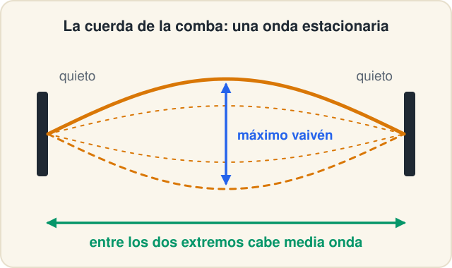
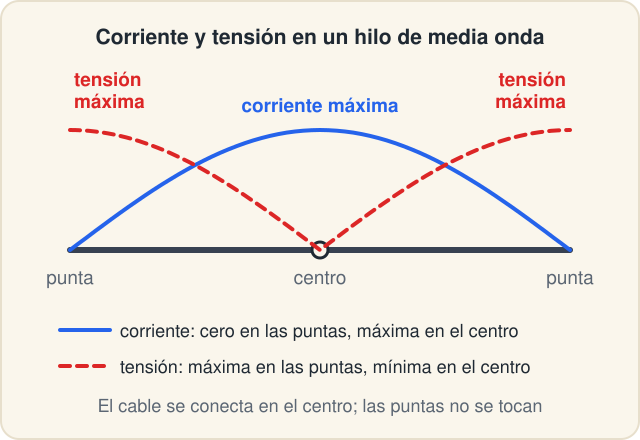

En la azotea, Vicente dictó una medida desde su silla plegable —«diez metros y cinco centímetros cada brazo»— y luego Dani estuvo recortando el hilo de veinte en veinte centímetros hasta que el aparato dijo que estaba bien. A Lucía aquello le pareció una exageración.

—Es un cable colgado —dijo—. ¿Qué más le dará medir diez metros que once?

Esta lección contesta a Lucía. Al terminar sabrás qué ocurre dentro de un hilo cuando hace de antena, por qué su longitud tiene que guardar una proporción exacta con la longitud de onda y de dónde sale la fórmula con la que se corta cualquier antena de hilo: 142,5 entre los megahercios.

## Qué es una antena

Recuerda lo que viste en la sección 6: cuando una corriente alterna de radiofrecuencia recorre un conductor, parte de su energía se desprende de él y se aleja por el espacio en forma de onda de radio.

> **Antena:** un conductor con la forma y el tamaño adecuados para que la corriente de radiofrecuencia que lo recorre se convierta en onda de radio con la mayor eficacia posible. Y al revés: para que las ondas que le llegan produzcan en él la mayor corriente posible.

Ese «y al revés» es importante. **Una antena tiene el mismo diagrama, la misma ganancia y la misma impedancia transmitiendo que recibiendo**. La que lanza bien tu señal hacia una dirección es la misma que mejor oye lo que viene de ella. Por eso la antena que Marina use estos meses solo para escuchar será igual de buena el día que transmita.

Un matiz, para ser exactos. En onda corta hay tanto ruido en el aire que una antena mediocre capta menos señal, pero también menos ruido, y «oye» casi igual de bien. Transmitiendo no existe esa ayuda: la falta de eficacia de una antena solo se nota al transmitir.

## Una cuerda atada por los dos extremos

Para entender por qué importa el tamaño vamos a usar, durante toda la lección, una cuerda.

Ata una cuerda larga a una pared, coge el otro extremo y dale una sacudida. Verás una joroba que viaja por la cuerda hasta la pared, **rebota** y vuelve hacia ti. Una onda que llega al final de su camino no desaparece: se refleja.

Ahora, en vez de una sacudida, mueve la mano arriba y abajo sin parar. Las ondas que van hacia la pared se cruzan continuamente con las que vuelven rebotadas. Si mueves la mano a un ritmo cualquiera, el resultado es un lío: la cuerda se agita sin orden y notas que te cuesta moverla.

Pero si vas cambiando el ritmo poco a poco, llega un momento en que ocurre algo llamativo. La cuerda deja de parecer un lío y dibuja una forma limpia y estable: una gran barriga que sube y baja en el centro, con los dos extremos casi quietos. Has dado con el ritmo al que las ondas de ida y las de vuelta se refuerzan siempre en los mismos sitios y se anulan siempre en los mismos sitios. Y notas otra cosa: a ese ritmo, con un movimiento pequeño de la mano consigues un vaivén enorme de la cuerda.

Es lo que hace quien da comba, y lo sabe sin haberlo estudiado: la comba entra a su ritmo, no a cualquiera, y ese ritmo depende de lo larga que sea la cuerda. (Hay ritmos más rápidos que también dan un dibujo limpio, con dos barrigas o con tres. Aquí nos interesa el más lento, el de una sola.)

Esa figura que parece quieta tiene nombre:

> **Onda estacionaria:** el dibujo fijo que se forma cuando una onda y su propio rebote se cruzan una y otra vez en el mismo sitio. No parece que viaje: unos puntos se mueven siempre mucho y otros no se mueven nunca.

Fíjate en cuánta cuerda ocupa esa barriga única. En la sección 3 viste que una onda completa tiene una cresta y un valle: dos semiciclos, o, dicho con el dibujo de la cuerda, una barriga hacia arriba y otra hacia abajo. La cuerda de la comba solo dibuja una. Entre sus dos extremos cabe, por tanto, **media onda**.

Y ya conoces el nombre de lo que ha ocurrido, porque lo viste en la sección 5 con la bobina y el condensador: cuando algo tiene un ritmo propio y lo empujas justo a ese ritmo, responde con muchísima amplitud. Es la **resonancia**.

## Lo mismo, dentro de un hilo

Un hilo de antena se comporta como esa cuerda, y lo que hace de «vaivén» es la corriente.

Piensa en los electrones de un hilo cuyas puntas no están conectadas a nada, y supón que el transmisor los empuja desde el centro del hilo (enseguida verás por qué desde ahí). Cuando los empuja hacia un lado, corren hacia esa punta. Pero en la punta se acaba el camino: no pueden seguir. Se amontonan un instante, se repelen entre sí y vuelven hacia atrás. La onda de corriente ha rebotado en la punta del hilo, igual que la joroba rebotaba en la pared.

—Un momento —dijo Marina—. Lo primero que aprendí en enero es que sin circuito cerrado no hay corriente. Y este hilo acaba en el aire.

—La regla sigue valiendo para la corriente continua —contestó Vicente—. En un hilo suelto, con continua, los electrones se amontonarían en la punta y ahí se quedarían. Pero en radiofrecuencia nadie les pide dar la vuelta entera: solo ir y volver un poco, millones de veces por segundo. Antes de que el amontonamiento los frene del todo, el empuje ya ha cambiado de sentido.

Es lo mismo que viste con el condensador en corriente alterna: la corriente «pasa» sin que ningún electrón cruce de un lado al otro. **Un hilo abierto no conduce la corriente continua, pero sí la radiofrecuencia.**

De ahí sale lo que se cumple siempre en la punta de una antena: **en la punta no puede haber corriente**, porque no hay adónde ir. Las puntas del hilo son los extremos quietos de la cuerda.

Si el hilo mide justo media longitud de onda, el vaivén de los electrones encaja en él igual que la barriga encajaba en la cuerda:

- **La corriente** es nula en las dos puntas y máxima en el centro. En el centro es donde los electrones van y vienen con más amplitud.
- **La tensión** va al revés: es máxima en las puntas y mínima en el centro. (La tensión se mide, como siempre, entre dos puntos: aquí, entre una punta y la otra.) Tiene lógica. En las puntas es donde los electrones se amontonan (y, medio ciclo después, donde faltan), y ya sabes desde la sección 2 que un amontonamiento de carga es justamente lo que produce tensión.

Este dibujo tiene dos consecuencias prácticas que usarás siempre:

- El cable que viene del transmisor se conecta en el **centro** del hilo, que es donde la corriente es grande y la tensión pequeña. En la lección siguiente verás que eso es lo que hace cómoda a esta antena.
- Las **puntas** de una antena que está transmitiendo tienen tensiones muy altas, de cientos o miles de voltios. El transmisor solo aplica unas decenas de voltios en el centro; es la resonancia la que los multiplica en las puntas, igual que tu mano se movía poco y la barriga de la cuerda mucho. Las puntas no se tocan, y se sujetan siempre con aisladores.

La comparación con la cuerda cojea en dos puntos, y conviene saberlos. La cuerda se agita desde un extremo, mientras que al hilo se le empuja desde el centro; el dibujo que se forma es el mismo. Y la cuerda agitada no pierde nada, mientras que el hilo va soltando energía al espacio en cada vaivén. Esa energía que se va es precisamente la onda de radio.

## Por qué importa tanto la medida

—Vale, a media onda entra en resonancia —dijo Lucía—. ¿Y si mide otra cosa? ¿No radia?

—Radia —contestó Vicente—. Cualquier trozo de hilo radia la energía que consigas meterle. El problema es meterla.

Vuelve a la cuerda. Al ritmo bueno, la cuerda «se deja»: toda la fuerza de tu mano se convierte en movimiento. A un ritmo cualquiera, la cuerda te lleva la contraria: tiras cuando ella empuja, empujas cuando ella tira, y buena parte de tu esfuerzo te vuelve a la mano.

Al transmisor le pasa lo mismo. Con un hilo de la medida justa, la energía entra sin que la antena le lleve la contraria, y se va al aire. Con un hilo de medida cualquiera, la antena le devuelve parte de lo que le manda, y el transmisor trabaja incómodo, se calienta y entrega menos. Se puede forzar a funcionar una antena de medida equivocada con un aparato que conocerás en la lección 8, el acoplador, pero siempre se paga algo.

Por eso este oficio vive pendiente del metro: **la longitud de una antena decide en qué frecuencia trabaja a gusto.** A esa frecuencia se le llama **frecuencia de resonancia** de la antena. Es la misma resonancia que conociste con la bobina y el condensador: a esa frecuencia, lo que el hilo tiene de bobina y lo que tiene de condensador se cancelan, y el transmisor solo encuentra una resistencia.

Y la relación va en el sentido que ya conoces: más frecuencia es menos longitud de onda, así que **una antena más corta resuena en una frecuencia más alta, y una más larga, en una más baja.** Es lo que pasó en la azotea: el analizador (un aparato que mide en qué frecuencia resuena una antena; lo conocerás en la lección 8) dijo que la antena resonaba demasiado bajo. Estaba larga, y por eso la recortaron.

## De dónde sale el 142,5

Ya puedes calcular cuánto mide una antena de media onda. Recuerda la fórmula de la sección 3: la longitud de onda, en metros, es 300 dividido entre la frecuencia en megahercios.

Media onda es la mitad:

**media onda = 150 / f**

Para 14,2 MHz serían 150 / 14,2 = 10,56 metros.

Pero si cortas el hilo a esa medida, resonará algo más abajo de lo que querías. En la práctica, un hilo real resuena como si fuera un poco más largo de lo que mide. Hay dos razones:

- En las puntas, la carga amontonada «asoma» un poco más allá del final del hilo, como si el hilo siguiera unos centímetros más.
- El grosor del hilo, y su funda de plástico si la tiene, retrasan ligeramente la onda que lo recorre.

El resultado es que hay que cortar el hilo aproximadamente un **5 % más corto** que la media onda teórica. Quitar un 5 % es quedarse con el 95 %, es decir, multiplicar por 0,95:

150 × 0,95 = 142,5

Y de ahí la fórmula que se usa en todas las azoteas:

**Longitud de un hilo de media onda (en metros) = 142,5 / f (en MHz)**

A ese 0,95 se le llama **factor de acortamiento**. En la azotea, Vicente lo llamó «factor de velocidad del hilo»: es otro nombre que se usa para lo mismo. No lo confundas con el factor de velocidad del cable coaxial, que aparecerá en la lección 9 y es otra cifra distinta.

**Ejemplo 1.** *¿Cuánto mide un hilo de media onda para 14,2 MHz?*

142,5 / 14,2 = **10,04 m** (frente a los 10,56 m de la media onda teórica: algo más de medio metro de diferencia).

**Ejemplo 2.** *¿Y para la banda de 2 metros, en 145 MHz?*

142,5 / 145 = 0,98 m: **98 centímetros**.

Para 14 MHz hacen falta diez metros de hilo; para 145 MHz, menos de uno. Las antenas de las bandas bajas son grandes porque sus ondas son grandes.

## La teoría dimensiona y la medida manda

El 5 % es un valor aproximado. El acortamiento real depende del grosor del hilo, de su funda, de la altura y de lo que tenga cerca: ninguna fórmula conoce tu azotea. Por eso el hilo se corta siempre **un poco más largo** de lo calculado, se cuelga en su sitio, se mide en qué frecuencia resuena y se va recortando de las dos puntas por igual. Acortar es fácil; alargar, no.

## Donde la gente se lía

- **«La resonancia baja si corto.»** Al revés: cortar hace la antena más corta, y más corta es más frecuencia. Recortar **sube** la frecuencia de resonancia.
- **«Las puntas de la antena no tienen peligro porque allí no hay corriente.»** No hay corriente, pero hay la tensión más alta de toda la antena.

## Compruébalo tú

1. ¿Cuánto mide un hilo de media onda para 21,2 MHz?
2. ¿Y para 3,65 MHz? ¿Cabría estirado en una azotea de 25 metros de largo?
3. Has cortado un hilo para 14,2 MHz y el analizador dice que resuena en 13,8 MHz. ¿Está largo o corto? ¿Qué haces?
4. Con el transmisor en marcha, ¿qué parte de un hilo de media onda es más peligroso tocar, el centro o una punta? ¿Y en cuál de los dos sitios se conecta el cable?

**Soluciones**

1. 142,5 / 21,2 = **6,72 m**.
2. 142,5 / 3,65 = **39,0 m**. No cabe estirado en 25 metros. Es el problema clásico de las bandas bajas: sus antenas son enormes.
3. Resuena por debajo de lo deseado, así que está **larga**. Se recorta un poco de cada punta, la misma cantidad en las dos, y se vuelve a medir. Poco a poco: lo cortado no se recupera.
4. Lo más peligroso es una **punta**: ahí la tensión es máxima, de cientos o miles de voltios. El cable se conecta en el **centro**, donde la corriente es máxima y la tensión mínima.

## En una frase

En un hilo de media onda, la corriente del transmisor y su rebote en las puntas forman una onda estacionaria, el hilo entra en resonancia y la energía pasa al aire con facilidad; por eso la longitud decide la frecuencia, y se calcula con **142,5 / f**.

Ese hilo de media onda alimentado por el centro es la antena más importante de la radio, y tiene nombre propio. En la lección siguiente le hacemos el carné completo al dipolo.
