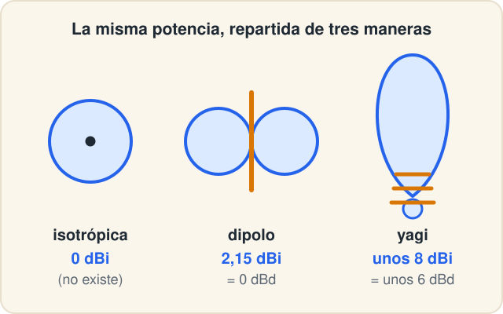

En el mástil del radioclub, por encima de todos los hilos, hay una antena que parece la de la televisión pero en grande: una barra horizontal con varias varillas atravesadas, montada sobre un motor que la hace girar. Lucía preguntó qué tenía de especial.

—Esa tiene ganancia —dijo Dani—. Con los mismos cien vatios, llega como si pusieras cuatrocientos.

—¿Y de dónde saca los otros trescientos?

—De ningún sitio. Ese es el truco.

Esta lección explica el truco. Al terminar sabrás qué significa de verdad la palabra «ganancia» en una antena, por qué se mide con dos unidades distintas y cómo se calcula con cuánta fuerza llega de verdad tu señal. La antena del mástil se llama *yagi*, y la desmontaremos en la lección siguiente; aquí nos basta con saber que concentra.

## Una antena no fabrica energía

Empecemos por lo que una antena **no** puede hacer: no puede sacar más energía de la que le llega. No tiene enchufe ni pilas. Si el transmisor le entrega 100 vatios, la antena radiará, como mucho, 100 vatios.

Lo que sí puede hacer es **decidir hacia dónde los manda**.

Piensa en una bombilla desnuda colgada en mitad de una habitación. Alumbra un poco en todas direcciones. Mete esa misma bombilla en una linterna, con su espejo curvo detrás. La bombilla no ha cambiado y gasta lo mismo, pero ahora toda su luz sale en un haz, y en la pared de enfrente aparece un círculo muchísimo más brillante que antes. A cambio, el resto de la habitación se ha quedado a oscuras.

> **Ganancia de una antena:** lo que aumenta la señal en la dirección preferida de la antena, comparada con la que daría una antena de referencia con la misma potencia. La ganancia no crea energía: la concentra en unas direcciones a costa de quitarla de otras.

Como la ganancia es una comparación entre dos potencias —cuántas veces más fuerte—, se expresa en **decibelios**, que ya conoces de la sección 3. Recuerda los tres valores que más vas a usar: 3 dB es el doble, 6 dB es cuatro veces y 10 dB es diez veces.

Y recuerda también que una antena se comporta igual recibiendo que transmitiendo. Una antena con ganancia lanza más señal en su dirección preferida y, además, oye mejor lo que viene de allí y peor lo que viene de los lados. Para quien busca estaciones lejanas y débiles, esa mitad del regalo vale tanto como la otra. (Al recibir, se habla a veces del *área de captura* de una antena: es como el tamaño de la red con la que recoge la onda que le llega. A más ganancia, más área de captura.)

## ¿Comparada con qué? dBi y dBd

Una comparación necesita un punto de partida. Para las antenas se usan dos, y de ahí salen dos unidades. El examen pregunta la diferencia.

**La antena isotrópica.** Es una antena imaginaria que radiaría exactamente igual en todas las direcciones del espacio: hacia los lados, hacia arriba y hacia abajo. Su diagrama sería una esfera perfecta. («Isotrópico» significa precisamente eso: igual en todas las direcciones.) No existe ni puede construirse. Es una referencia para hacer cuentas, la bombilla desnuda ideal.

- La ganancia medida respecto a la isotrópica se expresa en **dBi** (la *i* es de *isotrópica*).

**El dipolo de media onda.** Este sí existe. Y como viste en la lección 2, no radia igual en todas las direcciones: casi nada por las puntas y más de frente. Es decir, ya concentra un poco. Comparado con la isotrópica, el dipolo tiene una ganancia de **2,15 dBi** en su mejor dirección (2,15 dB es multiplicar por 1,64).

- La ganancia medida respecto al dipolo se expresa en **dBd** (la *d* es de *dipolo*).

Como el dipolo ya lleva 2,15 dB de ventaja sobre la isotrópica, pasar de una unidad a otra es sumar o restar esa cantidad:

**dBd = dBi − 2,15**   y, al revés,   **dBi = dBd + 2,15**

**Ejemplo.** *Una antena tiene 9 dBd de ganancia. ¿Cuánto es en dBi?* 9 + 2,15 = **11,15 dBi**.

**Ejemplo.** *Un catálogo anuncia una antena de 5,15 dBi. ¿Cuánto gana respecto a un dipolo?* 5,15 − 2,15 = **3 dBd**: el doble que un dipolo en su mejor dirección.

Fíjate en el segundo ejemplo. La misma antena puede anunciarse como «5,15» o como «3», según la unidad. Los fabricantes suelen preferir los dBi, porque el número queda más grande. No es mentira, pero si comparas dos antenas tienes que mirar que estén en la misma unidad. Y una ganancia escrita en «dB» a secas, sin decir respecto a qué, no significa nada.

## Cuánto llega de verdad: la potencia radiada aparente

Volvamos a la frase de Dani: «con cien vatios llega como si pusieras cuatrocientos». Eso tiene nombre, y aparece en la normativa.

> **Potencia radiada aparente (PRA):** la potencia que habría que entregar a un dipolo para producir, en la dirección preferida, la misma señal que produce nuestra antena. Se calcula con la potencia que llega a la antena y su ganancia en dBd.

Si la ganancia se toma en dBi, es decir, respecto a la isotrópica, se habla de **PIRE** (potencia isotrópica radiada equivalente).

La cuenta se hace sumando y restando decibelios, como en la sección 3.

**Ejemplo 1: el de Dani.** *A una yagi de 6 dBd le llegan 100 W. ¿Cuál es la PRA?*

6 dB es multiplicar por cuatro: 100 × 4 = **400 W de PRA**. Ahí están los cuatrocientos vatios de Dani. La antena sigue radiando en total 100 W, pero en la dirección a la que apunta, quien la escucha la recibe igual de fuerte que si un dipolo estuviera radiando 400 W.

**Ejemplo 2: contando el cable.** *Un transmisor entrega 100 W. El cable hasta la antena pierde 3 dB. La antena es la misma yagi de 6 dBd. ¿Cuál es la PRA?*

- Balance: −3 dB del cable, +6 dB de la antena. En total, +3 dB.
- +3 dB es el doble: 100 × 2 = **200 W de PRA**.

El cable se ha quedado con la mitad de lo que la antena iba a concentrar.

**Ejemplo 3: la PIRE.** *¿Cuál es la PIRE del ejemplo 1?*

La misma yagi tiene 6 + 2,15 = 8,15 dBi. Esa cifra no está en tu tabla de memoria; equivale a multiplicar por unas 6,5. PIRE ≈ 100 × 6,5 = **unos 650 W**.

Misma antena, misma señal y dos números distintos. No hay contradicción: se está comparando con dos antenas de referencia diferentes. La PIRE es siempre 1,64 veces la PRA (esos 2,15 dB de ventaja del dipolo). Compruébalo: 400 × 1,64 = 656; la pequeña diferencia con 650 es el redondeo. Cuando una norma fije un límite de potencia radiada, mira en cuál de las dos está escrito.

## Donde la gente se lía

- **«Una antena con ganancia amplifica la señal.»** No amplifica nada: no tiene de dónde sacar energía. Reparte la que le llega de forma desigual.
- **«dBi y dBd son lo mismo.»** Se diferencian en 2,15 dB. La misma antena tiene un número mayor en dBi.
- **«Cuanta más ganancia, mejor antena para todo.»** Más ganancia es un haz más estrecho. Para hablar con una estación concreta y lejana es una ventaja; para atender una red de emergencia con estaciones repartidas en todas direcciones, una vertical omnidireccional puede ser mejor elección.
- **«La PRA es la potencia que radia la antena.»** La antena radia lo que le llega. La PRA es la potencia que necesitaría un dipolo para dar la misma señal en la dirección preferida.

## Compruébalo tú

1. Una antena tiene una ganancia de 7 dBd. ¿Cuánto es en dBi?
2. Dos antenas se anuncian así: la A, «10 dBi»; la B, «8,5 dBd». ¿Cuál tiene más ganancia?
3. A una antena de 10 dBd le llegan 20 W. ¿Cuál es su potencia radiada aparente?
4. Un transmisor da 50 W; el cable pierde 3 dB; la antena tiene 3 dBd. ¿Cuál es la PRA?
5. Un vendedor te dice que una antena «de 6 dB» te hará radiar cuatro veces más energía. ¿Qué dos cosas están mal en esa frase?
6. A una antena de 3 dBd le llegan 50 W. Calcula su PRA y, sabiendo que la PIRE es 1,64 veces la PRA, su PIRE.

**Soluciones**

1. 7 + 2,15 = **9,15 dBi**.
2. Hay que ponerlas en la misma unidad. La B: 8,5 + 2,15 = 10,65 dBi. Gana la **B**, aunque su número parecía menor.
3. 10 dB es multiplicar por 10: 20 × 10 = **200 W de PRA**.
4. −3 dB + 3 dB = 0 dB: lo que pierde el cable lo recupera la antena. **50 W de PRA**.
5. Primera: «6 dB» sin decir si son dBi o dBd no está bien definido. Segunda: la antena no radia más energía; radia la misma, concentrada. En su dirección preferida la señal será más fuerte (cuatro veces más que la de la antena de referencia), a costa de las demás direcciones.
6. 3 dB es el doble: PRA = 50 × 2 = **100 W**. PIRE = 100 × 1,64 = **164 W**.

## En una frase

La ganancia de una antena no añade energía: la concentra en una dirección quitándola de otras; se mide en dBi (respecto a la isotrópica) o en dBd (respecto al dipolo, 2,15 dB menos), y con ella se calculan la PRA y la PIRE, que dicen con cuánta fuerza llega la señal en la dirección preferida.

Falta ver cómo se consigue esa concentración con unas simples varillas. En la lección siguiente desmontamos la antena del mástil del club.
