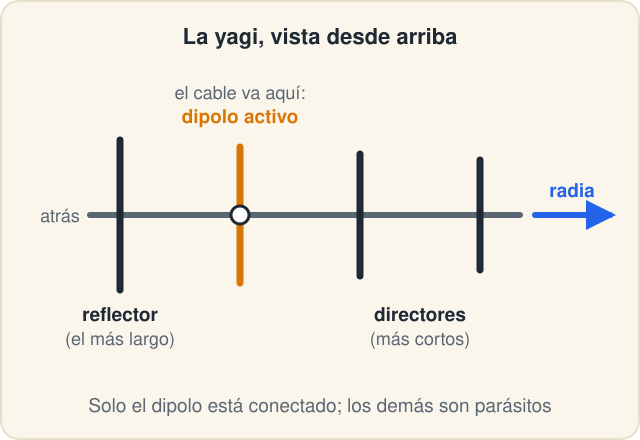

La antena del mástil del radioclub, la que en la lección anterior daba cuatrocientos vatios aparentes con cien de verdad, es una **yagi**. A Marina le llamó la atención una cosa al verla de cerca: de todas aquellas varillas, solo a una le llegaba un cable.

Esta lección la desmonta varilla a varilla y repasa después las demás antenas con nombre propio. Al terminar sabrás cómo consigue una yagi su ganancia, cómo se llama y dónde va cada uno de sus elementos, y reconocerás por su nombre las antenas que más vas a oír nombrar en un radioclub.

## La yagi: un dipolo con ayudantes

La yagi la inventaron en 1926 dos ingenieros japoneses, Shintaro Uda y Hidetsugu Yagi, y es la antena directiva más usada del mundo: la de televisión de los tejados es una yagi.

Tiene una barra central, que solo hace de soporte, y varias varillas atravesadas a ella, que se llaman **elementos**. Lo curioso es que solo uno de ellos está conectado al cable:

- **El elemento activo** (también llamado *radiante* o *excitado*). Es un dipolo de media onda normal. Es el único al que llega el cable.
- **El reflector.** Una varilla situada **detrás** del dipolo y **algo más larga** que él (alrededor de un 5 %). Devuelve hacia delante la energía que iba a salir por detrás.
- **Los directores.** Una o varias varillas situadas **delante** del dipolo y **algo más cortas** que él. Conducen la energía hacia delante y estrechan el haz. Cuantos más directores, más ganancia y más larga la antena.

(Por qué la varilla larga refleja y la corta dirige depende de un detalle de fases que no hace falta conocer. Lo que el examen pide es saber cuál es cuál y dónde va.)

Al reflector y a los directores se les llama **elementos parásitos**. El nombre viene de que no están conectados a nada: viven de la energía que les llega por el aire desde el dipolo.

—¿Y cómo va a hacer algo una varilla que no está conectada a nada? —preguntó Marina.

—¿Tu antena está conectada a la emisora de Italia que oíste el sábado? —contestó Dani—. La onda le llega por el aire y hace circular corriente en tu hilo. Pues a esas varillas les llega la onda del dipolo que tienen al lado, les hace circular corriente, y una varilla con corriente radia. Cada una vuelve a emitir por su cuenta.

Ahí está el mecanismo. Cada elemento parásito es una pequeña antena que vuelve a radiar lo que recibe. Y recuerda lo que viste en la sección 3: dos ondas pueden sumarse o cancelarse según lleguen a la par o a contrapié. Las longitudes y las distancias de una yagi están calculadas para que, **hacia delante**, las ondas de todos los elementos lleguen a la par y se sumen, y **hacia atrás**, lleguen a contrapié y se cancelen. La yagi no tiene nada mágico: es un reparto de sumas y cancelaciones puesto a propósito.

Lo que se consigue, con números:

| Yagi | Ganancia típica |
|---|---|
| De 3 elementos (reflector, activo y un director) | unos 5 o 6 dBd (7 u 8 dBi) |
| De 5 o 6 elementos | unos 7 u 8 dBd |
| Largas, de más de 10 elementos (en VHF y UHF) | 12 dBd o más |

Y lo que cuesta:

- **Hay que apuntarla.** Una antena que concentra en una dirección deja a oscuras las demás. Por eso va sobre un motor que la gira, el **rotor**.
- **Es grande.** Cada elemento mide en torno a media onda. Una yagi para la banda de 20 metros tiene varillas de diez metros de punta a punta; para la de 2 metros, de un metro. Por eso las yagis abundan en VHF y UHF, y en las bandas bajas solo las tienen los muy decididos.

Dos datos de las hojas de características que conviene saber leer. La **relación delante-atrás** dice cuántos decibelios más radia la antena hacia delante que hacia atrás: cuanto mayor, mejor ignora lo que tiene a la espalda. Y el **ancho del haz** dice cuántos grados abarca el lóbulo principal: a más ganancia, haz más estrecho y más puntería hace falta.

## Otras antenas que te vas a encontrar

No hace falta saber calcularlas, pero sí reconocer sus nombres:

- **Antena de hilo largo.** Un hilo de la mayor longitud que quepa, alimentado por una punta. Sencilla y válida para muchas bandas, pero necesita un acoplador (lección 8), porque su impedancia cambia mucho de una frecuencia a otra.
- **Dipolos multibanda.** Varios dipolos de distintas longitudes unidos al mismo cable, o diseños ingeniosos como la **G5RV**, bautizada con el indicativo del inglés que la ideó. Un solo hilo para varias bandas.
- **Antenas con trampas.** Una **trampa** es un pequeño circuito resonante —la bobina y el condensador de la sección 5— intercalado en el hilo o en la varilla. A su frecuencia de resonancia bloquea el paso de la corriente y «corta» eléctricamente la antena en ese punto; a otras frecuencias la deja pasar. Así, un mismo conductor se comporta como una antena corta en una banda y como una larga en otra. Las verticales multibanda de tubo que se ven en muchas terrazas funcionan así.
- **Antena de cuadro** o ***loop***. Un hilo cerrado sobre sí mismo en forma de cuadrado, triángulo o círculo. Los cuadros pequeños son poco eficaces, y por eso apenas se usan para transmitir, pero recogen muy poco ruido y se aprecian para escuchar.
- **Antena parabólica.** Es la linterna del principio hecha antena: un reflector curvo, el plato, que concentra en un haz muy estrecho lo que emite una antena pequeña colocada en su foco. Solo es práctica cuando el plato mide muchas longitudes de onda, es decir, en las frecuencias más altas (por encima de 1 GHz, las llamadas microondas), y allí da ganancias de 20 a 40 dBi.
- **La antena de goma de los walkies.** Es un hilo enrollado en espiral dentro de una funda, para que una antena que debería medir medio metro quepa en quince centímetros. Es cómoda y resistente, y rinde bastante menos que una varilla de tamaño completo. Toda antena acortada paga su comodidad con rendimiento.

Esa palabra tiene un sentido preciso. El **rendimiento** (o *eficiencia*) de una antena es la parte de la potencia que recibe del transmisor que de verdad convierte en onda de radio; el resto se pierde en calor, en la resistencia de sus conductores, de sus bobinas o del terreno. Un dipolo de tamaño completo radia casi todo lo que le llega. Una antena muy acortada puede radiar la décima parte. Ojo: la ganancia habla de *hacia dónde* va la energía radiada; el rendimiento, de *cuánta* llega a radiarse.

## Donde la gente se lía

- **«El reflector es la varilla corta.»** El reflector es la **larga** y va **detrás**. Los directores son los cortos y van delante. La yagi apunta hacia sus elementos cortos.
- **«Los elementos parásitos son piezas de adorno, porque no están conectados.»** Tienen corriente, inducida por el aire, y radian. Sin ellos la yagi sería un dipolo.
- **«Ganancia y rendimiento son lo mismo.»** La ganancia dice hacia dónde va la energía radiada; el rendimiento, cuánta llega a radiarse. Una antena puede concentrar muy bien lo poco que radia.
- **«Una antena pequeña con muchos dBi anunciados rinde como una grande.»** Desconfía. La ganancia sale de concentrar, y para concentrar hace falta tamaño.

## Compruébalo tú

1. En una yagi, ¿qué elemento es el más largo y dónde está? ¿A cuál se conecta el cable?
2. Tienes que colocar una yagi apuntando a una estación situada al norte. ¿Hacia dónde deben quedar los directores?
3. ¿Por qué se llama «parásitos» al reflector y a los directores?
4. ¿Qué es una trampa y qué consigue en una antena multibanda?
5. ¿Por qué no se ven antenas parabólicas para la banda de 40 metros?
6. A una antena muy acortada le llegan 50 W y solo radia 5 W. ¿Cuál es su rendimiento?
7. Una hoja de características dice «relación delante-atrás: 20 dB». ¿Qué significa?

**Soluciones**

1. El más largo es el **reflector**, y está detrás. El cable se conecta al **elemento activo** (el dipolo), que es el único conectado.
2. Hacia el **norte**. La yagi radia hacia el lado de los directores.
3. Porque no están conectados al cable: viven de la energía que les llega por el aire desde el dipolo activo, y la vuelven a radiar.
4. Un circuito resonante de bobina y condensador intercalado en el conductor. A su frecuencia de resonancia bloquea la corriente y «corta» la antena en ese punto, de modo que el mismo conductor sirve para varias bandas.
5. Porque el plato tiene que medir muchas longitudes de onda, y en 40 metros eso serían cientos de metros. Solo son prácticas en microondas, donde las ondas miden centímetros.
6. 5 / 50 = 0,1: un **10 %**. El otro 90 % se convierte en calor.
7. Que la antena radia hacia delante 20 dB más que hacia atrás, es decir, cien veces más potencia.

## En una frase

La yagi consigue su ganancia con elementos parásitos que vuelven a radiar lo que reciben del dipolo activo: un reflector más largo detrás y directores más cortos delante; y cada antena del catálogo —hilo largo, multibanda con trampas, cuadro, parabólica, antena de goma— es un compromiso distinto entre tamaño, bandas y rendimiento.

Ya conoces las antenas. Queda el asunto que une la antena, el cable y el equipo, y que explica el número que hizo silbar a Dani en la azotea. Empieza por una pregunta: ¿por qué todo en radio es «de 50 ohmios»?
