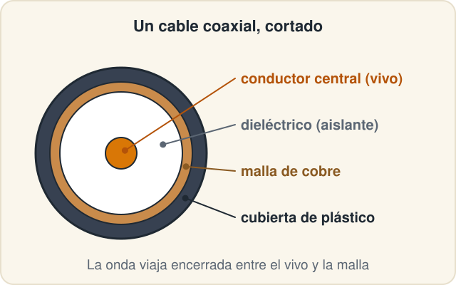
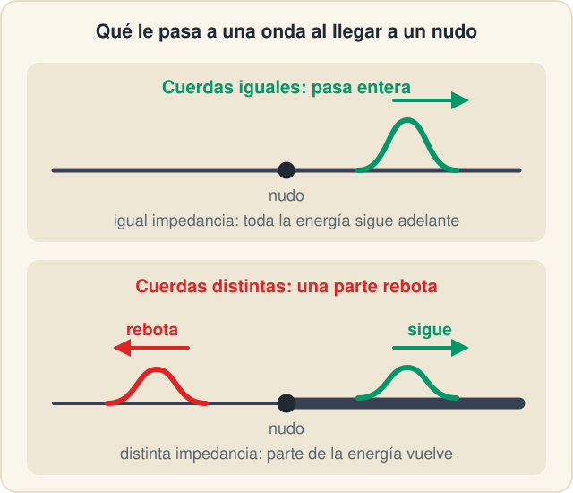

Cuando Marina preguntó en la azotea qué significaba la cifra del analizador, Dani le contestó con una palabra que no esperaba: «acuerdo». Dijo que aquel número medía el acuerdo entre su equipo, su cable y su antena, y que ya entendería los divorcios.

Antes de entender el número hay que entender el acuerdo. Esta lección explica qué tiene que coincidir entre las tres piezas de una estación, qué ocurre cuando no coincide y por qué casi todo lo que compres para radio llevará escrito «50 Ω».

## El cable por dentro

El cable que se usa para unir un equipo de radio con su antena se llama **cable coaxial**. Si cortas uno y lo miras de frente, ves cuatro capas, una dentro de otra:

1. **El conductor central**, un hilo de cobre. Los técnicos lo llaman *el vivo*.
2. **El dieléctrico**, un aislante de plástico que rodea al vivo y lo mantiene exactamente en el centro. («Dieléctrico» es la palabra que ya conociste en los condensadores: un aislante colocado entre dos conductores.)
3. **La malla**, un tubo de hilos de cobre trenzados que envuelve al dieléctrico. Es el segundo conductor.
4. **La cubierta**, la funda exterior de plástico que protege el conjunto de la lluvia y del sol.

Los dos conductores del cable son, por tanto, el vivo y la malla. La señal viaja **encerrada** en el espacio que queda entre los dos, y la malla hace de blindaje: ni sale nada hacia fuera ni entra nada desde fuera.

## El cable también es un camino para ondas

En la sección 2 tratamos los cables como tuberías: la corriente entra por un extremo y sale por el otro, y lo único que importa del cable es su resistencia. Con corriente continua, y con la alterna lenta del enchufe, eso es verdad.

Con radiofrecuencia deja de serlo. La señal cambia de sentido millones de veces por segundo, y el cable que baja de la azotea ya no es corto comparado con la longitud de onda: mide una buena parte de ella, o más. Mientras la señal recorre el cable, al transmisor le da tiempo a cambiar de sentido. En esas condiciones, lo que recorre el cable es una **onda que viaja** del transmisor hacia la antena, igual que una sacudida viaja por una cuerda.

Vamos a usar otra vez la cuerda, durante toda la lección. El transmisor es tu mano, que la agita. El cable es la cuerda. La antena es lo que hay atado al otro extremo.

Cuidado, porque en la lección 1 el rebote era el héroe y aquí va a ser el villano. No hay contradicción. *Dentro de la antena* queremos que la onda rebote en las puntas: ese rebote crea la resonancia que hace radiar al hilo. *En el cable* no queremos ningún rebote: el cable no está para resonar, sino para entregar. La cuerda de la lección 1 era la antena. La de esta lección es el cable, y la antena pasa a ser lo que hay atado a su extremo.

A un cable pensado para llevar ondas de radio de un sitio a otro se le llama **línea de transmisión**. El coaxial de la azotea de Marina lo es.

## Qué significa que un cable sea «de 50 ohmios»

Aquí está la confusión más común de esta sección, así que vamos despacio.

—Dani, he medido tu cable «de cincuenta ohmios» con el polímetro —dijo Lucía—. De punta a punta marca cero coma tres. Y entre el vivo y la malla marca infinito. ¿Dónde están los cincuenta?

—En ningún sitio que el polímetro pueda ver —contestó Dani—. No es una resistencia. Es otra cosa, que por desgracia se mide en la misma unidad.

Esa otra cosa es esto. Cuando una onda viaja por un cable, lleva a la vez una tensión entre sus dos conductores y una corriente a lo largo de ellos. La proporción entre esa tensión y esa corriente no la decide el transmisor ni la antena: la impone el propio cable, por cómo está construido. Un cable determinado obliga a toda onda que viaje por él a llevar, por ejemplo, 50 voltios por cada amperio.

> **Impedancia característica de una línea:** la proporción entre la tensión y la corriente de una onda que viaja por ella. La fijan la forma y los materiales del cable (los diámetros de sus conductores y el aislante que los separa). **No depende de la longitud del cable.**

En la cuerda, lo equivalente es su grosor. Una cuerda gruesa y pesada y un cordel fino transmiten las sacudidas de manera distinta, midan lo que midan. El grosor es una propiedad de la cuerda entera, no de su longitud. Un metro de maroma y cien metros de maroma le cuestan lo mismo a la mano *en el instante de la sacudida*: la mano solo nota el primer palmo de cuerda, porque lo que haya más allá todavía no se ha enterado.

Por eso el polímetro de Lucía no encuentra los 50 Ω. El polímetro mide con corriente continua, y con continua no hay onda viajando. Y por eso un cable de 50 Ω sigue siendo de 50 Ω tanto si mide dos metros como si mide cincuenta.

## Qué pasa en una unión: la onda que rebota

Ahora viene la idea central. Ata dos cuerdas distintas una a continuación de la otra y observa qué hace una sacudida cuando llega al nudo.

- **Si las dos cuerdas son iguales**, la sacudida pasa por el nudo como si no existiera. Toda la energía sigue adelante.
- **Si la segunda cuerda es distinta** —mucho más gruesa o mucho más fina—, al llegar al nudo la sacudida se divide. Una parte sigue por la segunda cuerda y otra parte **rebota** y vuelve hacia tu mano.

Y cuanto más distintas son las dos cuerdas, mayor es la parte que rebota. En el caso extremo, una cuerda atada a una pared, rebota todo.

En una estación de radio, el nudo que nos va a ocupar es el del cable con la antena. En él ocurre exactamente lo mismo que en las cuerdas:

> **Cuando una onda llega a una unión entre dos impedancias iguales, pasa entera. Si las impedancias son distintas, una parte de la energía se refleja y vuelve por donde vino.** Cuanto más distintas, más se refleja.

Tres palabras que oirás constantemente para decir esto:

- Cuando las impedancias coinciden se dice que hay **adaptación**, o que la antena está *adaptada*.
- Cuando no coinciden, hay **desadaptación**.
- A la onda que va del transmisor a la antena se le llama **onda directa** o *incidente*; a la que rebota, **onda reflejada**.

La regla general vale para toda la electrónica, y el examen la pregunta así:

> **La máxima transferencia de potencia entre dos elementos se produce cuando sus impedancias son iguales.**

—Eso no me cuadra —dijo Marina—. Según la ley de Ohm, con menos resistencia pasa más corriente. Una antena de diez ohmios debería chupar más potencia que una de cincuenta.

—Haz la cuenta entera y verás dónde se queda esa potencia —contestó Dani.

Un transmisor se comporta como una fuente que tiene dentro su propia resistencia de 50 Ω, la misma idea que la resistencia interna de la batería que viste en la sección 2. Supón, para hacer números sencillos, una fuente de 12 V con 50 Ω dentro, y conéctale tres cargas distintas. La corriente es la tensión dividida entre *toda* la resistencia del circuito, la de dentro más la de fuera, y la potencia que recibe la carga es I² × R:

| Carga | Corriente | Potencia en la carga |
|---|---|---|
| 10 Ω | 12 / (50 + 10) = 0,2 A | 0,2² × 10 = **0,4 W** |
| 50 Ω | 12 / (50 + 50) = 0,12 A | 0,12² × 50 = **0,72 W** |
| 250 Ω | 12 / (50 + 250) = 0,04 A | 0,04² × 250 = **0,4 W** |

Con poca resistencia pasa mucha corriente, pero casi toda la tensión se queda dentro de la fuente. Con mucha resistencia hay tensión de sobra, pero apenas pasa corriente. El máximo está justo cuando la carga iguala a la fuente.

## Por qué 50 ohmios

Si lo que importa es que las impedancias coincidan, bastaría con que todo el mundo se pusiera de acuerdo en un valor. Eso es justo lo que se hizo. En radiocomunicaciones, el valor acordado es **50 Ω**.

- Los transmisores y los transceptores están diseñados para entregar su potencia a una carga de 50 Ω.
- Los cables de radio se fabrican con una impedancia característica de 50 Ω.

(«Carga» es el nombre que se da a aquello que recibe la potencia: aquí, la antena.)

La cadena ideal es, por tanto:

**transmisor de 50 Ω → cable de 50 Ω → antena de 50 Ω**

Con las tres piezas iguales no hay ningún nudo que haga rebotar nada, y toda la potencia que sale del equipo llega a la antena, salvo la que el cable se quede en forma de calor, que es otro asunto y veremos en la lección 9.

Las antenas son la pieza rebelde de la cadena, porque su impedancia la decide la física y no un fabricante. Repasa las dos que conoces:

- El dipolo presenta unos 73 Ω: algo por encima de 50.
- La vertical de cuarto de onda, unos 36 Ω: algo por debajo.

Ninguna da 50 exactos, pero las dos quedan cerca, y ahora entiendes por qué decíamos que eran cifras afortunadas. Con desacuerdos tan pequeños, lo que rebota es muy poco.

Un dato para no meter la pata en una tienda: el cable de la antena de televisión es de **75 Ω**, no de 50.

## Cuando la antena no está en resonancia

Hay una segunda manera de estropear el acuerdo, además de tener una cifra distinta de 50.

En la lección 1 viste que, a su frecuencia de resonancia, la antena «se deja»: recibe la energía sin llevar la contraria. Recuerda cómo lo explicaba la sección 5 para la bobina y el condensador: en resonancia, sus dos reactancias se cancelan y solo queda la resistencia. En la antena pasa igual. A su frecuencia de resonancia se comporta como una resistencia sola, sin nada más; se suele decir que es una carga *resistiva* o una *resistencia pura*.

Fuera de su resonancia, una de las dos reactancias gana a la otra y ya no se cancelan. Recuerda que la **reactancia** era esa oposición que no gasta energía, sino que la toma y la devuelve en cada ciclo. Cuál de las dos aparece depende de hacia qué lado esté el error, y el examen lo pregunta:

- Si la antena es demasiado **larga** para la frecuencia, se comporta como si llevara una bobina en serie: presenta reactancia **inductiva**.
- Si es demasiado **corta**, se comporta como si llevara un condensador en serie: presenta reactancia **capacitiva**.

En los dos casos, la antena devuelve en cada ciclo una parte de la energía que recibe. Y esa energía devuelta es, vista desde el cable, una onda reflejada.

De ahí sale algo que comprobarás en cuanto tengas una antena: la adaptación es buena en la frecuencia de resonancia y va empeorando conforme te alejas de ella, hacia arriba o hacia abajo. Toda antena tiene un tramo de frecuencias en el que trabaja a gusto, y a ese tramo se le llama su **ancho de banda**.

## Dónde cojea la cuerda

La comparación con la cuerda cojea en un punto: en ella ves la sacudida ir y volver, una detrás de otra. En el cable, el transmisor emite sin parar, y la onda directa y la reflejada están las dos presentes en el cable a la vez, todo el tiempo, cruzándose. De ese cruce nace el número de Dani, y es el tema de la lección siguiente.

## Donde la gente se lía

- **«Los 50 Ω de un cable se pueden medir con el polímetro.»** No. No es una resistencia, y con corriente continua no aparece. El polímetro solo sirve para comprobar que el cable no está cortado ni en cortocircuito.
- **«Con menos ohmios en la antena entra más potencia.»** Pasa más corriente, pero la tensión se queda dentro del transmisor. La potencia máxima pasa cuando las impedancias son iguales.
- **«El cable de la tele sirve igual.»** Es de 75 Ω. En radio se usa el de 50 Ω.

## Compruébalo tú

1. ¿Qué ocurre cuando una onda que viaja por un cable de 50 Ω llega a una antena que presenta exactamente 50 Ω resistivos?
2. De estas tres antenas, ¿cuál está claramente peor adaptada a un cable de 50 Ω: una de 36 Ω, una de 73 Ω o una de 600 Ω?
3. Tienes una antena cortada para 14,2 MHz y bien adaptada en esa frecuencia. Pruebas a usarla en 14,0 y luego en 18,1 MHz. ¿En cuál de las dos esperas peor adaptación? ¿Por qué?
4. Una antena cortada para 7,1 MHz se usa en 7,0 MHz. Para esa frecuencia, ¿resulta larga o corta? ¿Qué tipo de reactancia presenta?

**Soluciones**

1. No se refleja nada. **Toda la potencia** que llega por el cable pasa a la antena.
2. La de **600 Ω**, muy lejos de 50. Las de 36 Ω y 73 Ω quedan cerca y bien adaptadas. (En la lección siguiente aprenderás a ponerle número a ese «cerca».)
3. En **18,1 MHz**, que está mucho más lejos de su frecuencia de resonancia. Lejos de la resonancia la antena presenta una reactancia grande y refleja buena parte de la energía. En 14,0 MHz está muy cerca de su resonancia y seguirá trabajando razonablemente bien.
4. A menos frecuencia, más longitud de onda: en 7,0 MHz haría falta una antena algo más larga, así que esta resulta **corta** y presenta reactancia **capacitiva**.

## En una frase

Por un cable de radio viajan ondas, y una onda que llega a una unión entre impedancias distintas se refleja en parte; por eso transmisor, cable y antena se hacen todos de 50 Ω, para que la potencia pase entera de uno a otro.

Falta ponerle número al desacuerdo. Ese número es el que marcó el analizador en la azotea, es la medida más usada de toda la práctica de antenas y tiene tres letras: ROE.
