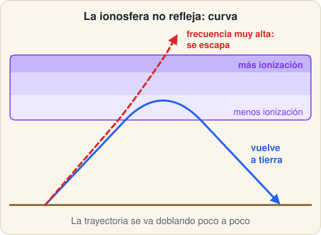

Dani lo contó en «versión bar»: allá arriba, a cientos de kilómetros, el sol pasa el día arrancándole electrones al aire, y ese aire electrificado es «como un espejo borroso» para las ondas. Vicente lleva meses resumiéndolo en una frase: de noche, el cielo es un espejo.

La imagen es buena, pero es una imagen. Esta lección cuenta qué hay de verdad: de qué está hecho ese espejo, quién lo fabrica y, sobre todo, cómo consigue un poco de aire muy tenue darle la vuelta a una onda de radio. Es la idea central de toda la sección, así que vamos a verla despacio.

Al terminar sabrás qué es ionizar, qué es la ionosfera, por qué devuelve unas frecuencias y deja escapar otras, y por qué importa el ángulo con el que la onda llega.

## Qué hay allá arriba

El aire que respiramos se va haciendo menos denso con la altura. A partir de unos 60 kilómetros queda muy poco, y entre los 60 y los 400 kilómetros ese poco aire recibe de lleno la parte más enérgica de la luz del sol: la radiación ultravioleta y los rayos X, que abajo no nos llegan precisamente porque se gastan ahí arriba.

Esa radiación tiene energía suficiente para hacer algo que ya conoces de la sección 2. Recuerda: un átomo es neutro porque tiene tantos electrones como protones. Pues bien, cuando un rayo ultravioleta golpea un átomo de ese aire, puede arrancarle un electrón. Quedan dos cosas sueltas: un **electrón libre** y un átomo al que le falta un electrón, con carga positiva, que se llama **ion**.

> **Ionizar** es arrancar electrones a los átomos. Un gas ionizado contiene electrones libres, y por tanto se parece un poco a un metal: las ondas de radio pueden mover esos electrones. Y unos electrones que se mueven al paso de una onda cambian el camino de esa onda, como verás enseguida.

> **Ionosfera:** la región de la atmósfera, entre unos 60 y 400 km de altura, donde la radiación del sol mantiene el aire ionizado.

El proceso contrario también ocurre sin parar: un electrón libre tropieza con un ion, se une a él y vuelven a formar un átomo neutro. A eso se le llama **recombinarse**.

Así que la ionosfera es un equilibrio entre dos cosas que tiran en sentidos opuestos:

- **El sol ioniza**: fabrica electrones libres mientras brilla sobre esa zona.
- **La recombinación los elimina**, tanto más deprisa cuanto más denso es el aire (porque en aire denso los tropiezos son más frecuentes).

De esa pelea salen todas las reglas de la propagación. De día hay más electrones libres que de noche. Cuando el sol está más activo, más aún. Y abajo, donde el aire es más denso, la ionización desaparece en minutos al ponerse el sol, mientras que arriba, donde casi no hay aire, aguanta toda la noche.

## Por qué devuelve las ondas: no es un espejo, es una curva

Aquí está la parte que más se suele contar mal. La ionosfera no tiene ninguna superficie. No hay nada contra lo que la onda rebote. Lo que hace es **curvar** la trayectoria de la onda poco a poco, hasta darle la vuelta.

Ese fenómeno tiene nombre y lo has visto muchas veces:

> **Refracción:** el cambio de dirección que sufre una onda al pasar de un medio a otro en el que viaja a distinta velocidad.

Es lo que hace que una pajita metida en un vaso de agua parezca quebrada: la luz cambia de dirección al pasar del agua al aire. Y hay un ejemplo todavía más parecido al nuestro: el **espejismo de la carretera**. En verano, a lo lejos, el asfalto parece mojado y refleja el cielo. No hay agua ni espejo. Hay una capa de aire muy caliente pegada al asfalto, y la luz que baja del cielo, al entrar en aire cada vez más caliente, se va curvando poco a poco hasta que vuelve a subir hacia tus ojos. Tú ves cielo donde debería haber carretera, y lo interpretas como un reflejo.

La ionosfera es ese espejismo puesto boca abajo. Veamos qué ocurre, paso a paso.

Cuando la onda atraviesa aire ionizado, pone a oscilar a los electrones libres, a su mismo ritmo. Y recuerda de la sección 6 que una corriente alterna —cargas que van y vienen— radia: emite a su vez una onda. Cada electrón se convierte así en una emisora diminuta, y lo que sigue avanzando es la suma de la onda original y de todas esas ondas reemitidas. El efecto de esa suma es que las crestas de la onda avanzan **algo más deprisa** que en el aire normal, tanto más cuantos más electrones libres haya.

Ahora mira el frente de una onda que sube inclinada. Su borde de arriba ya está en una zona más ionizada y corre más; su borde de abajo, en una zona menos ionizada, va más despacio. Pasa lo mismo que con la fila de personas cogidas del brazo de la lección anterior: si las de un extremo aprietan el paso, la fila entera gira hacia el lado lento. El frente de la onda gira hacia abajo, un poco en cada kilómetro, hasta que la onda viaja horizontal y después desciende. La onda regresa a tierra. Es el mismo giro que hace la luz sobre el asfalto caliente.

Vista desde el suelo, la onda ha subido, «ha rebotado» y ha bajado. Por eso todo el mundo, incluidos este curso y el examen, dice que la ionosfera **refleja** las ondas. Puedes decirlo sin problema, sabiendo que lo que ocurre de verdad es una refracción progresiva.

—¿Y por qué eso importa, si el resultado es el mismo? —preguntó Marina.

—Porque un espejo lo refleja todo, y esto no —contestó Dani—. Que la onda llegue a dar la vuelta o no depende de dos cosas: de cuántos electrones libres haya y de la frecuencia de la onda.

Esa es la regla central de toda la sección:

> **Cuanto más ionizada está una capa, más alta es la frecuencia que es capaz de devolver a tierra.** Las ondas de frecuencia demasiado alta para esa capa se curvan un poco, no llegan a dar la vuelta, la atraviesan y se pierden en el espacio.

¿Por qué importa la frecuencia? Porque a un electrón le cuesta seguir un vaivén muy rápido. Con una onda de frecuencia baja, cada empujón dura más: el electrón oscila con amplitud, reemite mucho y la onda se curva mucho. Con una onda de frecuencia muy alta, el electrón apenas llega a moverse antes de que el empujón cambie de sentido: reemite poco, y la onda casi no nota que el aire está ionizado.

Y hay un tercer factor: el ángulo. Vuelve al espejismo de la carretera: solo lo ves a lo lejos, donde tu mirada roza el asfalto. Si miras el asfalto que tienes a los pies, casi a plomo, no hay espejismo: esa luz tendría que girar demasiado. Con las ondas ocurre igual. La que llega a la capa muy tumbada necesita girar poco y vuelve con facilidad. La que se lanza casi en vertical tiene que dar la vuelta entera, y solo lo consigue si hay muchísima ionización.

Con esto ya se entiende por qué VHF y UHF no vuelven: sus frecuencias son tan altas que casi nunca hay ionización suficiente para darles la vuelta.

## Donde la gente se lía

- **«La ionosfera refleja como un espejo de cristal.»** No hay ninguna superficie. La onda se va curvando poco a poco (refracción) al atravesar aire cada vez más ionizado. Por eso no devuelve todas las frecuencias, y por eso el ángulo importa.
- **«Cuanto más alta la frecuencia, mejor rebota.»** Al revés: cuanto más alta, menos la siguen los electrones y más ionización hace falta para devolverla. Las frecuencias altas se escapan antes.
- **«La ionosfera está siempre igual.»** Es un equilibrio entre el sol, que ioniza, y la recombinación, que deshace. Cambia con la hora, con la estación y con la actividad del sol.
- **«Ionizado quiere decir radiactivo o peligroso.»** Quiere decir que a algunos átomos les falta un electrón. Ocurre a más de 60 km sobre tu cabeza y no tiene ningún efecto aquí abajo.

## Compruébalo tú

1. Durante un eclipse total de sol, a mediodía, ¿qué esperarías que le pasara a la ionización de la parte baja de la ionosfera durante esos minutos? ¿Por qué?
2. ¿Qué les hace una onda de radio a los electrones libres al pasar, y qué hacen ellos a cambio?
3. Dos ondas llegan a la misma capa con el mismo ángulo: una de 7 MHz y otra de 50 MHz. ¿Cuál tiene más probabilidades de volver a tierra, y por qué?
4. Una misma onda de 14 MHz se lanza una vez casi vertical y otra vez muy tumbada. ¿Cuál vuelve con más facilidad?
5. ¿Por qué la ionosfera desaparece antes, al ponerse el sol, en su parte baja que en su parte alta?
6. Un satélite emite en 145 MHz hacia la Tierra. ¿Le impide la ionosfera llegar al suelo? ¿Y si emitiera en 5 MHz?

**Soluciones**

1. Que **baje deprisa**. La ionización la fabrica la radiación del sol; sin ella solo queda la recombinación, que en la parte baja, donde el aire es más denso, deshace la ionización en minutos.
2. Los pone a **oscilar** a su mismo ritmo. Ellos, al oscilar, **emiten** a su vez; la suma de la onda original y de lo que reemiten avanza algo más deprisa donde hay más electrones, y eso hace girar el frente de la onda.
3. La de **7 MHz**. A los electrones les cuesta seguir un vaivén muy rápido: a 50 MHz casi no se mueven, la onda apenas se curva y atraviesa la capa.
4. La **tumbada**. Necesita girar poco para regresar. La vertical tiene que darse la vuelta completa.
5. Porque abajo el aire es más denso: los electrones tropiezan con iones mucho más a menudo y se recombinan en minutos. Arriba, con el aire muy enrarecido, tardan horas.
6. A 145 MHz **no**: la frecuencia es tan alta que los electrones apenas la siguen, la onda casi no se curva y atraviesa la ionosfera (igual hacia abajo que hacia arriba). A 5 MHz la ionosfera la curvaría de vuelta hacia el espacio: por eso los satélites usan VHF y frecuencias superiores.

## En una frase

La ionosfera es aire al que el sol ha arrancado electrones; esos electrones, al oscilar con la onda, hacen que avance más deprisa donde hay más de ellos, y por eso el camino de la onda se curva poco a poco hasta volver a tierra, tanto más fácilmente cuanto más ionización haya, cuanto más baja sea la frecuencia y cuanto más tumbada llegue.

Falta la otra mitad de lo que dijo Dani: la capa baja que de día es «puro secante». En la lección siguiente, las capas de la ionosfera, una por una.
