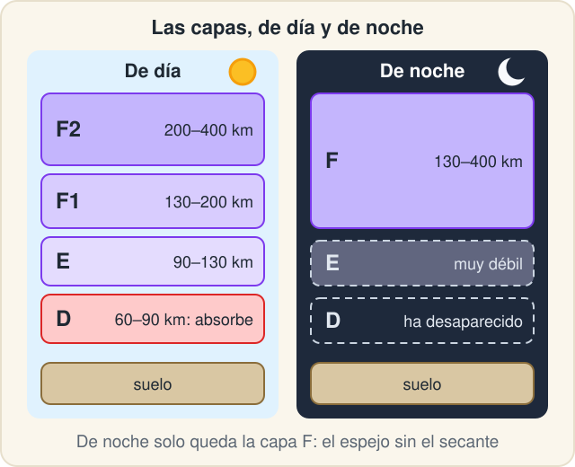

Dani dijo dos cosas de la ionosfera. Que arriba hay un espejo borroso, y ya sabes cómo funciona. Y que de día el sol crea además «una capa baja que es puro secante: se traga las ondas de las bandas bajas antes de que lleguen al espejo».

Esta lección trata de eso. La ionosfera no es una sola cosa: tiene varios pisos, cada uno con su carácter, y uno de ellos no devuelve las ondas sino que se las bebe. Al terminar sabrás nombrar las capas, decir qué hace cada una de día y de noche, y explicar con tus palabras por qué la banda de 40 metros es «de andar por casa» a media tarde y una avenida mundial a medianoche.

## Tres letras: D, E y F

La ionización no es igual a todas las alturas. Se concentra en varias franjas, que se llaman **capas** y se nombran con letras, de abajo arriba. Cada una tiene su carácter, y el examen las pregunta por su nombre.

### La capa D: el secante

Es la más baja, entre **60 y 90 km**. Solo existe **de día**: está en aire relativamente denso, y al ponerse el sol se recombina en cuestión de minutos.

Y es la villana de la historia, porque **la capa D no devuelve las ondas: las absorbe.**

¿Por qué absorbe en vez de curvar? Por dos razones. La primera es que a esta altura hay muchos menos electrones libres que arriba: demasiado pocos para dar la vuelta a una onda de onda corta. La segunda es lo que les ocurre a esos pocos. Cuando la onda pasa, los pone a oscilar, como en cualquier otra capa. Pero aquí abajo el aire es tan denso que cada electrón, mientras oscila, choca una y otra vez con átomos neutros. En cada choque pierde la energía que la onda le había dado, y esa energía ya no vuelve a la onda: se queda en el aire, en forma de calor. La onda sale de la capa D debilitada, o no sale.

La absorción depende muchísimo de la frecuencia:

> **La capa D absorbe tanto más cuanto más baja es la frecuencia.** Aproximadamente, a mitad de frecuencia, cuatro veces más absorción.

La razón es sencilla de imaginar: una onda de frecuencia baja empuja a cada electrón durante más tiempo en cada vaivén, el electrón recorre más distancia y tiene más ocasiones de chocar.

Consecuencias, que son pregunta fija de examen:

- Las **bandas bajas** (160, 80 y 40 metros) quedan muy absorbidas **de día**. Sus ondas tienen que cruzar la capa D para llegar a las capas altas, y otra vez para bajar, y casi nada sobrevive al doble peaje. Por eso el 40 de día es de andar por casa.
- Las frecuencias de 14 MHz hacia arriba la atraviesan casi sin pérdidas.
- **De noche la capa D desaparece**, el peaje se levanta y las bandas bajas se abren a larga distancia.

Ese es el secante de Dani: un papel que de día se bebe la tinta de las bandas bajas y que por la noche, simplemente, ya no está.

### La capa E: la intermedia

Está entre **90 y 130 km**. Es sobre todo **diurna**: de noche queda muy debilitada. Tiene ionización suficiente para devolver las frecuencias más bajas de HF (las bandas de 160 a 40 metros, más o menos), en saltos más bien cortos, porque está baja.

Su fenómeno más famoso es la **esporádica-E**: nubes pequeñas y densísimas de ionización que aparecen sin avisar, sobre todo a finales de primavera y en verano, y que durante minutos u horas devuelven frecuencias altísimas, incluso de VHF. Le dedicaremos un apartado al final de la sección.

### La capa F: la reina de la larga distancia

Es la más alta, entre **130 y 400 km**, y la más ionizada. Es la que hace posibles los contactos intercontinentales.

- **De día** se desdobla en dos: la **F1**, más baja y menos importante, y la **F2**, más alta, que es la que devuelve las frecuencias más altas y produce los saltos más largos.
- **De noche**, F1 y F2 se funden en una sola capa **F**.

Y aquí está la clave de la frase de Vicente. La capa F está a tanta altura, en un aire tan enrarecido, que los electrones libres casi no encuentran iones con los que recombinarse. La ionización que el sol fabricó durante el día **tarda horas en desaparecer**. El sol se pone, pero el espejo de arriba aguanta toda la noche, cada vez un poco más débil, hasta que el amanecer lo recarga.

## La noche del 40, explicada

Junta ahora las piezas con la banda de 40 metros (7 MHz).

**A las siete de la tarde, en agosto**, al sol le quedan casi dos horas en el cielo y la capa D sigue en su sitio. La capa F está fuerte y devolvería sin problema una onda de 7 MHz. Pero entre tu antena y la capa F está la capa D, también en plena forma, y a 7 MHz absorbe mucho. Las ondas que salen muy tumbadas, las que irían lejos, recorren un camino larguísimo dentro de la capa D y no sobreviven. Solo pasan las que suben bastante empinadas, que la cruzan por el camino corto, y esas caen cerca: España y los países vecinos. (Dirás que las empinadas eran las difíciles de devolver. Lo son, pero con el sol arriba la capa F tiene ionización de sobra para dar la vuelta incluso a una onda de 7 MHz muy empinada. En la lección siguiente verás el número que lo decide: la frecuencia crítica.)

**A medianoche**, la capa D se ha recombinado. Ya no hay peaje. La capa F sigue ahí, algo más débil, pero de sobra para 7 MHz. Ahora las ondas tumbadas llegan intactas a la capa F, vuelven a tierra a dos o tres mil kilómetros, rebotan y vuelven a subir. Italianos, alemanes, el este de Europa y, con tres saltos seguidos, La Plata.

El espejo estaba ahí todo el día. Lo que cambia por la noche es que desaparece el secante que había delante.

| Capa | Altura | Cuándo existe | Qué hace |
|---|---|---|---|
| **D** | 60–90 km | Solo de día | **Absorbe**, sobre todo las bandas bajas. No refleja |
| **E** | 90–130 km | De día (de noche, muy débil) | Devuelve frecuencias bajas y medias, saltos cortos. Esporádica-E |
| **F1** | 130–200 km, aprox. | Solo de día | Papel menor |
| **F2** (de noche, **F**) | 200–400 km, aprox. | Día y noche | Devuelve las frecuencias más altas y da los saltos más largos: es la de los contactos a larga distancia (el *DX*) |

## Donde la gente se lía

- **«La capa D refleja las bandas bajas.»** Es la trampa favorita del examen. La capa D **absorbe**. Las que devuelven son la E y, sobre todo, la F.
- **«De noche se forma el espejo.»** El espejo (la capa F) está de día y de noche. De noche lo que ocurre es que desaparece la capa D, que tapaba las bandas bajas.
- **«De noche hay más ionización.»** Hay menos: el sol no está. Lo que pasa es que la poca que queda está arriba, donde hace falta, y la de abajo, la que estorbaba, se ha ido.
- **«F1 y F2 son dos capas distintas siempre.»** Solo de día. De noche se funden en una sola capa F.

## Compruébalo tú

1. Ordena las capas de abajo arriba y di cuáles existen a medianoche.
2. Son las dos de la tarde. Llamas en 80 metros (3,6 MHz) y nadie de fuera de tu región te contesta. ¿Qué capa es la responsable, y qué está haciendo con tu señal?
3. A las once de la noche repites la llamada y te contestan desde Alemania. ¿Qué ha cambiado allá arriba?
4. ¿Por qué la capa F sigue existiendo de madrugada, si el sol hace horas que se puso?
5. De día, ¿a cuál de estas dos señales le afecta más la capa D: a una de 3,6 MHz o a una de 21 MHz?
6. ¿Qué capa es la responsable de los contactos intercontinentales, y por qué produce los saltos más largos?

**Soluciones**

1. D, E, F1 y F2. A medianoche solo queda la **F** (F1 y F2 fundidas); la D ha desaparecido y la E está muy debilitada.
2. La **capa D**. No refleja tu señal: la **absorbe**, y a una frecuencia tan baja como 3,6 MHz la absorbe casi por completo antes de que llegue a las capas altas.
3. La capa D **ha desaparecido** al ponerse el sol: se recombina en minutos. Sin ella, tu onda llega a la capa F, que sigue ionizada, y vuelve a tierra lejos.
4. Porque está en aire muy poco denso: los electrones libres casi no encuentran iones con los que recombinarse, y la ionización del día tarda horas en desaparecer.
5. A la de **3,6 MHz**, y mucho más: la absorción crece al bajar la frecuencia (aproximadamente, a mitad de frecuencia, cuatro veces más). La de 21 MHz cruza la capa D casi sin pérdidas.
6. La **F2** (de noche, la F). Es la más ionizada, así que devuelve las frecuencias más altas, y es la más alta, así que las ondas que vuelven de ella caen más lejos.

## En una frase

La ionosfera tiene tres pisos: la capa D, que solo existe de día y no devuelve nada sino que absorbe las bandas bajas; la E, intermedia y sobre todo diurna; y la F, la más alta, que devuelve las ondas a miles de kilómetros y aguanta toda la noche. Por eso las bandas bajas se abren al anochecer: no porque aparezca el espejo, sino porque desaparece lo que lo tapaba.

En la lección siguiente le ponemos números a todo esto: cuál es la frecuencia más alta que vuelve y cuál la más baja que sobrevive.
