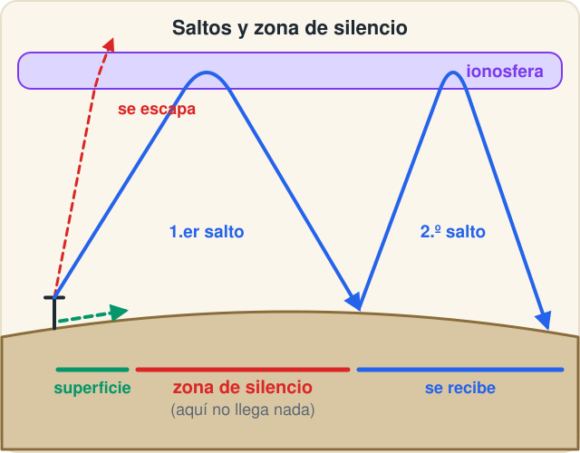

En la vigilia, la señal de La Plata llegaba «con un eco raro, acuoso», y subía y bajaba «como una respiración». Salva dijo que a esa señal se le notaba el viaje en la voz. Y Dani había avisado de que, para llegar tan lejos, la onda tiene que rebotar varias veces seguidas: tierra, cielo, tierra, cielo.

Esta lección sigue a la onda en ese viaje. Al terminar sabrás cuánto mide un salto y de qué depende, cuántos hacen falta para cruzar un océano, qué es la zona de silencio —y por qué es normal oír una estación a 1.500 km y no otra a 200— y por qué las señales lejanas respiran.

## El salto

> **Salto:** el recorrido de una onda desde la antena hasta la ionosfera y de vuelta a tierra.

La longitud de un salto depende de dos cosas: la altura de la capa que devuelve la onda y el ángulo con el que la onda salió de la antena.

- Cuanto **más alta** está la capa, más largo puede ser el salto. Con la capa **F2**, el máximo ronda los **4.000 km**. Con la capa **E**, que está mucho más baja, unos **2.000 km**.
- Cuanto **más tumbada** sale la onda de la antena, más lejos cae. Ese ángulo respecto al suelo se llama **ángulo de radiación** o **ángulo de salida**, y ya te apareció en la sección 8: un dipolo horizontal colocado bien alto radia con ángulos bajos, y por eso es el preferido para la larga distancia.

¿Y por qué hay un máximo? Porque el ángulo más bajo posible es el de la onda que sale rasante al horizonte, y esa onda, por la curvatura de la Tierra, alcanza la capa F2 a unos 2.000 km de distancia y cae a otros 2.000. No se puede salir más tumbado que el horizonte.

### Multisalto

Cuatro mil kilómetros no llegan a Argentina. Para ir más lejos, la onda repite el viaje: al caer a tierra, una parte se refleja en el suelo —o, mucho mejor, en el mar, que es buen conductor— y vuelve a subir. Tierra, cielo, tierra, cielo.

> **Propagación multisalto:** la que alcanza grandes distancias encadenando varios saltos, con reflexiones intermedias en la superficie de la Tierra.

**Ejemplo.** *De Vallverd a La Plata hay unos 11.000 km. ¿Cuántos saltos hacen falta, como mínimo, vía capa F2?*

- Con dos saltos se cubren, como mucho, 2 × 4.000 = 8.000 km. No llega.
- Con tres saltos, hasta 3 × 4.000 = 12.000 km. Llega.
- Hacen falta, como mínimo, **tres saltos**.

Cada paso por la ionosfera y cada reflexión en el suelo se queda con una parte de la señal. Por eso las señales de muy lejos llegan débiles, y por eso las rutas sobre océano funcionan mejor que las que rebotan en desiertos o montañas.

## La zona de silencio

Ahora una consecuencia que desconcierta a todos los principiantes: con una emisora de onda corta es normal oír a una estación a 1.500 km y no oír a otra que está a 200.

La explicación sale de juntar dos cosas que ya sabes:

- Cerca de la emisora, la señal llega por **onda de superficie**, que en HF se agota en unas decenas de kilómetros.
- Lejos, llega por **onda ionosférica**, pero el primer salto no cae en cualquier sitio. Las ondas que suben muy empinadas, que serían las que caerían cerca, atraviesan la capa si la frecuencia supera la crítica. Solo vuelven las que salen por debajo de cierto ángulo, y esas caen a partir de cierta distancia. Esa distancia mínima tiene nombre:

> **Distancia de salto** (en inglés, *skip distance*): la distancia **mínima** a la que la onda ionosférica de una frecuencia vuelve a tierra. Más cerca que eso no cae ninguna.

Entre el final de la onda de superficie y el comienzo de la zona donde aterriza el primer salto queda un anillo adonde no llega nada.

> **Zona de silencio:** la franja de distancias alrededor de una emisora en la que su señal no se recibe, porque queda más allá del alcance de la onda de superficie y más cerca que la distancia de salto.

—O sea —dijo Lucía—, que puedo estar oyendo a un tío de Berlín y no a uno de Teruel, que está aquí al lado.

—Exactamente eso —dijo Salva—. Y no es que el de Teruel tenga mala antena. Es que estás en su zona de silencio y él en la tuya.

La zona de silencio es más ancha cuanto más alta es la frecuencia respecto a la crítica. En las bandas bajas de noche puede no existir: si la frecuencia está por debajo de la crítica, vuelven incluso las ondas casi verticales, y la banda cubre desde tu calle hasta mil kilómetros sin huecos.

## El desvanecimiento: por qué las señales respiran

Queda la respiración de la señal de La Plata. Tiene nombre:

> **Desvanecimiento** (en inglés *fading*; en el código Q de los radioaficionados, que aprenderás en la sección 11, **QSB**): las subidas y bajadas de intensidad de una señal recibida, a veces lentas y a veces rápidas.

La causa principal la conoces desde la sección 3, donde aprendiste qué es la **fase**. Dos ondas iguales que llegan a la par (en fase) se suman. Si una llega medio ciclo retrasada (en oposición de fase), se anulan.

A tu antena casi nunca llega una sola onda desde la emisora lejana. Llegan varias a la vez, por caminos distintos: una que ha dado dos saltos y otra que ha dado tres, una que rebotó en la capa E y otra en la F. Cada camino tiene una longitud diferente, así que cada onda llega con un retraso diferente. A esa llegada por varios caminos se le llama **multitrayecto**.

Y la ionosfera no está quieta: sube, baja y se ondula continuamente. Las longitudes de los caminos cambian unos metros de un segundo a otro, y con ellas los retrasos. En un momento las ondas llegan en fase y la señal crece; segundos después llegan en oposición y casi desaparece. Eso es la respiración. Y el eco «acuoso» es lo mismo oído de otra manera: varias copias de la misma voz llegando con retrasos ligeramente distintos. Como el efecto no es igual para todas las frecuencias, a veces borra una parte de la voz y respeta otra, y el audio se deforma unos instantes: es el *desvanecimiento selectivo*.

## Donde la gente se lía

- **«Si no oigo a una estación cercana es que tiene poca potencia.»** Puede que estés en su zona de silencio.
- **«Un salto mide 4.000 km.»** Cuatro mil es el **máximo** aproximado con la capa F2. Según el ángulo, un salto puede medir mucho menos.
- **Confundir «distancia de salto» con «lo que mide un salto».** En el examen, la distancia de salto es la **mínima** a la que vuelve la onda ionosférica: el borde exterior de la zona de silencio.
- **«La zona de silencio es siempre igual de ancha.»** Crece con la frecuencia, y en las bandas bajas, de noche, puede no existir.
- **«El desvanecimiento es un fallo de mi receptor.»** Es la propia señal, que llega por varios caminos que se suman y se anulan.

## Compruébalo tú

1. ¿Cuántos saltos F2 hacen falta, como mínimo, para un contacto a 7.000 km?
2. Desde Valencia, en 14 MHz, oyes de día a una estación de Hamburgo y no oyes a una de Zaragoza, que tiene la misma potencia y la misma antena. ¿Cuál es la explicación más probable?
3. Una señal de DX sube y baja de intensidad cada pocos segundos. ¿Cómo se llama el fenómeno y cuál es su causa principal?
4. Una antena radia sobre todo con ángulos altos (casi hacia arriba). ¿Será buena para contactos a 4.000 km?
5. ¿Qué capa da saltos más largos, la E o la F2, y por qué?
6. ¿Por qué una ruta que rebota sobre el océano suele dar mejor señal que una que rebota sobre un desierto?

**Soluciones**

1. Un salto cubre como máximo 4.000 km; uno solo no llega. Con dos, hasta 8.000 km: **dos saltos**.
2. Zaragoza está en la **zona de silencio**: demasiado lejos para la onda de superficie y más cerca que la distancia de salto en esa frecuencia. Hamburgo cae donde aterriza el salto.
3. **Desvanecimiento (QSB)**. La señal llega por varios caminos a la vez (multitrayecto), y como la ionosfera se mueve, las ondas llegan unas veces en fase (se suman) y otras en oposición (se anulan).
4. No. Para saltos largos hacen falta **ángulos de radiación bajos**. Con ángulos altos, la onda cae cerca (o atraviesa la capa). Esa antena es buena para contactos de pocos cientos de kilómetros.
5. La **F2**: está mucho más alta (hasta 400 km frente a unos 100), así que una onda que sale rasante la alcanza más lejos y cae más lejos: unos 4.000 km frente a unos 2.000.
6. Porque el agua salada es buena conductora y refleja la onda con pocas pérdidas; la arena seca conduce mal y se queda con más energía en cada rebote.

## En una frase

La onda ionosférica avanza a saltos de hasta 4.000 km, encadenando varios para las grandes distancias; alrededor de cada emisora deja una zona de silencio, entre el final de la onda de superficie y la distancia de salto; y llega por varios caminos a la vez, que se suman y se anulan, y por eso respira.

Falta el personaje que mueve todos esos números arriba y abajo. En el móvil de Dani aparecía con dos cifras: SFI 142, K 1. En la lección siguiente, el sol.
