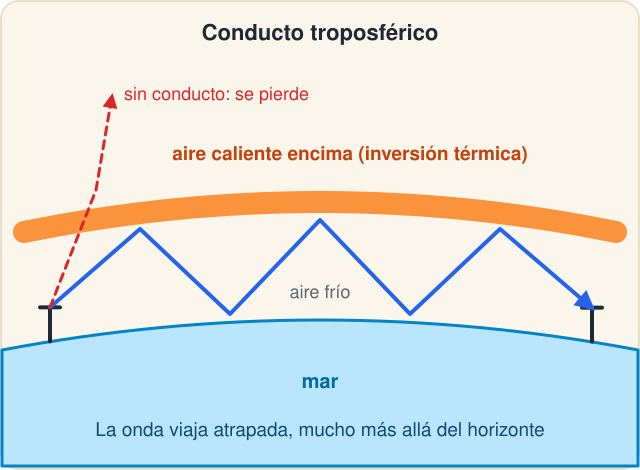

Toda la sección ha girado alrededor de la onda corta, porque es la que usa la ionosfera. Pero el primer equipo de casi todo radioaficionado —probablemente también el tuyo— no es de onda corta: es un walkie de VHF o de UHF. Y de esas bandas dijimos en la primera lección que su onda va recta, que llega hasta el horizonte y que la ionosfera no las devuelve.

Todo eso es cierto casi siempre. Esta lección trata del «casi»: cinco fenómenos que, de vez en cuando, llevan una señal de VHF a cientos o miles de kilómetros. Los cinco están en el temario del examen. Y al final, una idea que sirve para todas las bandas y que cierra la sección: qué tiene que cumplirse, en números, para que un contacto sea posible.

Al terminar sabrás reconocer cada uno de esos fenómenos por sus síntomas y explicar por qué una señal se oye o no se oye.

## Lo normal: el horizonte

En las bandas de **2 metros** (en torno a 145 MHz) y **70 centímetros** (en torno a 435 MHz), lo normal ya lo sabes: onda directa hasta el horizonte radioeléctrico, con alguna ayuda de reflexiones y difracción, y la altura lo es casi todo. La ionosfera no interviene: sus frecuencias son demasiado altas para que los electrones libres las sigan.

Lo excepcional son estos cinco casos.

## 1. Los conductos troposféricos

La **troposfera** es la capa más baja de la atmósfera, la del tiempo meteorológico: los primeros diez o quince kilómetros. Normalmente, cuanto más subes, más frío hace.

Con tiempo anticiclónico muy estable ocurre a veces lo contrario: una capa de aire **caliente** queda encima de una capa de aire más frío. A eso se le llama **inversión térmica**, y es lo que deja la niebla y la contaminación atrapadas sobre las ciudades en invierno.

Para las ondas de VHF y UHF, la frontera entre el aire frío de abajo y el caliente de arriba actúa como la capa del espejismo de la carretera: las curva de vuelta hacia el suelo. La onda queda atrapada entre el suelo (o el mar) y la inversión, y avanza guiada como por un tubo.

> **Conducto troposférico:** canal formado por una inversión térmica en la baja atmósfera, que guía las ondas de VHF y UHF mucho más allá del horizonte, a cientos de kilómetros y a veces a más de mil.

En el Mediterráneo son un clásico del verano: días de calma y bochorno en los que, desde la costa valenciana, entran por 2 metros los repetidores de Baleares y hasta estaciones de Italia como si estuvieran en el pueblo de al lado.

Hay un pariente modesto de los conductos que funciona todos los días: la **dispersión troposférica**. Las pequeñas irregularidades del aire desvían una parte diminuta de la señal hacia más allá del horizonte. Con buenas antenas y algo de potencia permite contactos de unos cientos de kilómetros en VHF y UHF, con señales débiles.

## 2. La esporádica-E

Cuando viste las capas quedó pendiente. La capa E, a unos 100 km de altura, forma a veces **nubes pequeñas y muy densas de ionización**. Son tan densas que devuelven frecuencias que la ionosfera normal jamás devolvería: 28 MHz, 50 MHz y, en las mejores ocasiones, 144 MHz.

> **Esporádica-E** (abreviado **Es**): nubes de ionización muy intensa en la capa E, impredecibles y de corta duración, que permiten contactos de entre 1.000 y 2.000 km en las bandas altas de HF y en VHF.

Sus rasgos:

- Es **esporádica** de verdad: aparece sin aviso y dura desde minutos hasta unas horas.
- Tiene temporada: en nuestro hemisferio, sobre todo de **mayo a agosto**, con un repunte menor en pleno invierno.
- **No depende del ciclo solar.** Aparece igual en los mínimos.
- Como la capa E está baja, los saltos son de unos 1.000 a 2.000 km.

Es la razón de que la banda de **6 metros** (50 MHz) se llame «la banda mágica»: casi todo el año está muda a larga distancia y, de pronto, una tarde de junio se abre a toda Europa.

## 3. La aurora

Las auroras boreales aparecen durante las tormentas geomagnéticas, cuando el índice K está alto. Son cortinas de aire muy ionizado, a unos 100 km de altura, sobre las regiones cercanas al polo. Están tan ionizadas que devuelven las ondas de VHF.

> **Propagación por aurora:** reflexión de señales de VHF en las cortinas ionizadas de una aurora. Las dos estaciones apuntan sus antenas hacia el norte, hacia la aurora, y no la una hacia la otra.

Permite contactos de cientos de kilómetros, hasta más de mil, en 6 y 2 metros. La señal llega con un sonido inconfundible, ronco y susurrante, porque la aurora se mueve muy deprisa y la deforma; por eso se usa sobre todo telegrafía. Desde España es poco frecuente, porque estamos lejos del polo, pero en el norte de Europa es habitual.

Fíjate en la paradoja: la misma tormenta geomagnética que estropea la onda corta abre una posibilidad en VHF.

## 4. La dispersión meteórica

Cada día entran en la atmósfera millones de meteoros, casi todos del tamaño de un grano de arena. Al quemarse, a unos 100 km de altura, dejan una estela de aire ionizado que dura desde una fracción de segundo hasta unos pocos segundos. Mientras dura, esa estela devuelve las ondas de VHF.

Se llama **dispersión meteórica** (en inglés, *meteor scatter*). Permite contactos de hasta unos 2.000 km, pero en ráfagas brevísimas, así que se usan modos digitales capaces de aprovechar un segundo de señal. Funciona mejor durante las lluvias de estrellas, como las Perseidas de agosto.

## 5. El rebote lunar

El más extremo de todos: apuntar una antena muy directiva a la Luna, transmitir y recibir el eco que la Luna devuelve. Se llama **EME** (*Earth-Moon-Earth*, Tierra-Luna-Tierra). La señal recorre unos 770.000 km entre ida y vuelta, tarda dos segundos y medio en regresar y llega debilitadísima. Durante décadas fue cosa de estaciones enormes; con los modos digitales actuales está al alcance de una estación de aficionado bien montada.

| Fenómeno | Dónde ocurre | Alcance típico | Cuándo |
|---|---|---|---|
| Conducto troposférico | Troposfera (hasta 1 o 2 km de altura) | De cientos a más de 1.000 km | Anticiclón estable; verano en el Mediterráneo |
| Esporádica-E | Capa E (unos 100 km) | 1.000 a 2.000 km | Mayo a agosto, sin aviso |
| Aurora | Unos 100 km, cerca del polo | De cientos a más de 1.000 km | Tormenta geomagnética (K alto) |
| Dispersión meteórica | Unos 100 km | Hasta 2.000 km, en ráfagas | Siempre; mejor en lluvias de estrellas |
| Rebote lunar (EME) | La Luna | Cualquier punto que vea la Luna | Con la Luna sobre el horizonte |

## El ruido también decide

Llevamos toda la sección hablando de si la señal *llega*. Para que un contacto sea posible hace falta algo más: que llegue **por encima del ruido**.

En cualquier frecuencia, aunque nadie transmita, un receptor recoge un soplido de fondo: el **ruido**. Tiene orígenes distintos según la banda:

- En **HF** manda el **ruido atmosférico**: los rayos de las tormentas de medio planeta, que llegan por la misma ionosfera que las señales. A él se suma el ruido eléctrico de las casas, que verás en la sección siguiente.
- En **VHF y UHF**, el atmosférico casi desaparece. Queda el **ruido galáctico**, que viene del cielo y cuenta sobre todo en la parte baja de VHF, y el **ruido térmico** del propio receptor, generado por la agitación de los electrones en sus componentes, que es el que manda en UHF.

Una señal solo se entiende si es más fuerte que el ruido que la acompaña. A la proporción entre las dos se le llama **relación señal/ruido**, y es lo que de verdad decide si hay contacto.

Con eso se puede hacer una cuenta muy sencilla, que los ingenieros llaman **balance de enlace**. Como todo va en decibelios, son sumas y restas (sección 3):

*potencia del transmisor + ganancia de las antenas − pérdidas de los cables − pérdidas del trayecto = señal que llega*

Si lo que llega queda por encima del ruido, hay contacto. Si no, no. Y la cuenta deja ver dónde se gana: la potencia es solo uno de los sumandos. Un cable mejor, una antena con más ganancia o un lugar con menos ruido valen exactamente lo mismo que más vatios, y casi siempre cuestan menos.

—O sea —dijo Marina—, que aquella noche lo de La Plata no fue solo que el cielo estuviera bien.

—Fue que el cielo dejó pasar la señal —dijo Salva— y que llegó lo bastante fuerte para sobresalir del ruido que había. Hacen falta las dos cosas.

## Donde la gente se lía

- **«La esporádica-E depende de las manchas solares.»** No. Tiene temporada (verano), pero no sigue el ciclo de once años.
- **«Los conductos troposféricos son cosa de la ionosfera.»** No. Ocurren en la troposfera, a menos de un par de kilómetros de altura, y dependen del tiempo meteorológico. La ionosfera está cien veces más arriba.
- **«Para la aurora se apunta la antena hacia la otra estación.»** Se apunta hacia la aurora, al norte.
- **«Si la señal llega, se oye.»** Solo si llega por encima del ruido.
- **«Más potencia es la única forma de mejorar un enlace.»** Es un sumando más del balance, y normalmente el más caro.

## Compruébalo tú

1. Una tarde de junio, la banda de 6 metros, que llevaba semanas en silencio, se llena de estaciones italianas y alemanas durante una hora. ¿Qué fenómeno es el más probable?
2. En agosto, con anticiclón y mar en calma, se recibe desde la costa de Valencia un repetidor de 2 metros situado en Mallorca, a unos 250 km. ¿Qué ha ocurrido?
3. Durante una fuerte tormenta geomagnética, un aficionado de Dinamarca hace contactos en 2 metros con estaciones a 800 km, con señales roncas, apuntando la antena al norte. ¿Qué propagación es?
4. ¿Qué modo de propagación de VHF aprovecha las lluvias de estrellas?
5. ¿Qué tipo de ruido domina en HF, y cuál en UHF?
6. Un transmisor entrega una potencia que llamaremos de referencia. El cable pierde 3 dB, la antena gana 6 dB y el trayecto pierde 120 dB. ¿Cuánto ha variado la señal en total, de un extremo a otro?
7. En el caso anterior, ¿qué mejora más el enlace: duplicar la potencia o cambiar el cable por uno que pierda solo 1 dB?

**Soluciones**

1. **Esporádica-E**: verano, banda de 50 MHz, apertura repentina y corta, a distancias de 1.000 a 2.000 km.
2. Se ha formado un **conducto troposférico** sobre el mar por una inversión térmica: la onda viaja atrapada entre el mar y la capa de aire caliente.
3. **Propagación por aurora**: tormenta geomagnética, VHF, señal ronca y antenas apuntadas al norte.
4. La **dispersión meteórica**: las estelas ionizadas de los meteoros devuelven la señal durante instantes.
5. En HF, el **ruido atmosférico** (más el de origen doméstico). En UHF, el **térmico** del propio receptor (el galáctico cuenta sobre todo en la parte baja de VHF).
6. −3 + 6 − 120 = **−117 dB**.
7. Duplicar la potencia son +3 dB. Cambiar el cable ahorra 3 − 1 = 2 dB. Gana por poco la potencia, pero el cable mejora además la **recepción**, cosa que la potencia no hace.

## En una frase

En VHF y UHF lo normal es el horizonte, salvo cuando un conducto troposférico, una nube de esporádica-E, una aurora, la estela de un meteoro o la propia Luna echan una mano; y en cualquier banda, el contacto existe solo si lo que llega —potencia, más antenas, menos pérdidas— queda por encima del ruido.

Con esto termina la propagación. El material siguiente es el resumen de la sección en formato de chuleta, para repasar antes del examen.
