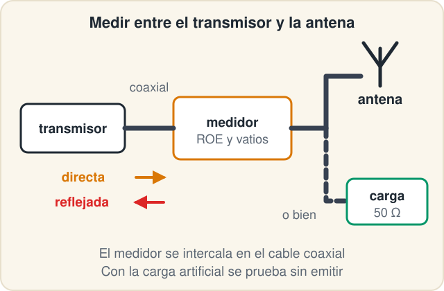

En la prueba del televisor, Vicente transmitió «cinco series cortas en 40 metros, potencia baja primero, luego media». Para que una prueba así sirva de algo hay que saber cuánta potencia está saliendo, si llega a la antena o vuelve rebotada, y si lo que se emite es solo lo que se quiere emitir. Nada de eso lo mide un polímetro.

Esta lección presenta los instrumentos que trabajan con radiofrecuencia. Son ocho, contando dos que no miden, y el examen pregunta de cada uno lo mismo: qué mide y dónde se conecta. Al terminar sabrás responderlo, y sabrás además algo que no viene en los temarios: cuándo un instrumento puede estar diciéndote una verdad a medias.

## El medidor de ROE y el vatímetro

Recuerda de la sección 8 que, cuando la antena no está bien adaptada, una parte de la potencia que le envías rebota y vuelve por el cable, y que eso se resume en un número, la **ROE** (relación de ondas estacionarias): 1 es perfecto, hasta 1,5 es muy bueno y hasta 2 no suele importar; por encima conviene mirar qué pasa.

> El **medidor de ROE** (o *reflectómetro*) se **intercala en el cable coaxial, entre el transmisor y la antena**. Toma una muestra de la potencia que va hacia la antena (potencia *directa*) y otra de la que vuelve (potencia *reflejada*), y de la comparación entre las dos saca la ROE.

El **vatímetro de RF** mide directamente esas potencias, en vatios. Muchos aparatos hacen las dos cosas a la vez.

Con el vatímetro hay un detalle que conviene conocer. En telegrafía o en FM, la potencia es constante mientras se transmite, y cualquier vatímetro la mide bien. En banda lateral única, en cambio, la potencia sube y baja con la voz (sección 7). Un vatímetro sencillo indica la potencia **media**, que al hablar es bastante menor que la de las crestas; quien no lo sabe cree que su equipo de 100 W «solo da 30». Para ver la potencia de cresta, la **PEP**, que es la que usan los límites legales, hace falta un vatímetro que la mida expresamente.

—Entonces, si el medidor marca 1,1, la antena está perfecta —dijo Marina.

—Si el cable es bueno y corto, sí —dijo Vicente—. Si es malo y largo, puede estar engañándote.

El matiz es este. El medidor está junto al transmisor, y solo ve lo que llega hasta él. Si el cable tiene muchas pérdidas, la potencia reflejada por una antena mala se va gastando por el camino de vuelta y llega al medidor muy debilitada. El medidor ve poca potencia reflejada y marca una ROE estupenda. Un cable con muchas pérdidas **disimula** una antena mala, y además se está comiendo tu potencia en el viaje de ida. Para saber cómo está de verdad una antena, se mide lo más cerca posible de ella.

## El frecuencímetro

Mide la **frecuencia** de una señal. Por dentro hace exactamente lo que dice la definición de hercio: cuenta cuántos ciclos llegan en un segundo y muestra el número.

Los equipos modernos no lo necesitan para su dial: la cifra que muestran es la que su sintetizador tiene programada (sección 5), no una medida de lo que sale. Precisamente por eso el frecuencímetro sigue siendo útil: sirve para comprobar, desde fuera, que un transmisor emite donde dice que emite.

## El osciloscopio

Todos los instrumentos anteriores dan un número. El **osciloscopio** da un dibujo: muestra en una pantalla **la forma de la señal**, con la tensión en vertical y el tiempo en horizontal.

Es el instrumento que convierte en imagen lo que este curso ha descrito con palabras. En su pantalla se ve la senoide de la sección 3, y sobre ella se pueden medir el periodo y el valor de pico. Se ve el rizado de una fuente de alimentación mal filtrada (sección 5). Y se ve una señal con las crestas recortadas por un amplificador saturado.

> Si la pregunta es «¿qué instrumento permite ver la forma de onda?», la respuesta es siempre el **osciloscopio**.

## El analizador de espectro

El osciloscopio enseña cómo cambia una señal a lo largo del tiempo. El **analizador de espectro** enseña otra cosa: **cuánta energía hay en cada frecuencia**. En su pantalla, el eje horizontal no es el tiempo sino la frecuencia.

Ya has visto algo muy parecido: la cascada del receptor por Internet de la sección 6 es, en el fondo, un analizador de espectro. Tu emisión aparece en él como un pico en tu frecuencia; y si el transmisor emite armónicos o espurias, se ven como picos más pequeños en otras frecuencias.

Es como la diferencia entre oír una orquesta y leer su partitura: el osciloscopio muestra el sonido completo, tal como llega; el analizador de espectro lo separa nota por nota. Por eso es el instrumento adecuado para responder a la pregunta «¿es limpia mi emisión?».

## El generador de señales

Hasta ahora, todos los instrumentos miden. El **generador de señales** hace lo contrario: **fabrica** una señal de frecuencia y nivel conocidos. Se conecta a la entrada de un receptor, de un filtro o de un amplificador para comprobar cómo responden y ajustarlos. Si inyectas una señal de un nivel exacto y sabes lo que debería salir, cualquier diferencia delata el fallo.

## El analizador de antenas

Es el aparatito que Dani subió a la azotea en la sección 8. Reúne dos de los anteriores: un generador diminuto que va recorriendo las frecuencias de una banda, y un medidor que anota la ROE en cada una. El resultado es una curva completa, en la que se lee de un vistazo **en qué frecuencia resuena la antena**, lo ancha que es la zona aprovechable y si hay algo raro.

Sus ventajas sobre el medidor de ROE: enseña toda la banda de una vez, lo hace emitiendo una potencia tan pequeña que no molesta a nadie, y se puede conectar directamente en la antena, sin el cable de bajada por medio.

## La carga artificial

También la conoces de la sección 8: una resistencia de **50 Ω** capaz de recibir la potencia del transmisor y convertirla en calor **sin radiarla**. Se conecta en lugar de la antena.

No mide nada, pero es compañera inseparable de las medidas: permite probar, ajustar y medir un transmisor sin salir al aire y sin molestar a nadie. Como son 50 Ω exactos, el transmisor la ve como una antena perfecta (ROE 1).

Una precaución: cada carga indica cuántos vatios aguanta y durante cuánto tiempo. Se calienta mucho, y sobrepasar su límite la destruye.

## Una precaución con tres de ellos

El frecuencímetro, el osciloscopio y el analizador de espectro son aparatos delicados, hechos para señales pequeñas. **Ninguno de los tres se conecta directamente a la salida de un transmisor**: decenas de vatios los destruyen. Se les da solo una muestra muy pequeña de la señal, a través de un atenuador (un accesorio que la reduce en una cantidad conocida de decibelios) o de una antenita colocada cerca.

## Todos, en una tabla

| Instrumento | Qué mide o hace | Dónde va |
|---|---|---|
| Medidor de ROE | La adaptación entre transmisor, cable y antena | Intercalado en el coaxial |
| Vatímetro de RF | Potencia directa y reflejada (media o de cresta) | Intercalado en el coaxial |
| Frecuencímetro | La frecuencia, contando ciclos | A una muestra de la señal |
| Osciloscopio | La **forma** de la señal en el tiempo | En paralelo, como un voltímetro; de un transmisor, solo una muestra |
| Analizador de espectro | La energía en cada **frecuencia**: armónicos, espurias | A una muestra de la señal |
| Generador de señales | No mide: produce una señal conocida | A la entrada de lo que se prueba |
| Analizador de antenas | La ROE a lo largo de toda una banda; la resonancia | En lugar del transmisor |
| Carga artificial | No mide: absorbe la potencia sin radiar | En lugar de la antena |

Y vale para todos lo dicho del polímetro: ninguno deja intacto lo que mide (el medidor de ROE también se queda con una pizca de potencia) y todos tienen su margen de error.

## Donde la gente se lía

- **«ROE baja en el medidor quiere decir antena buena.»** Quiere decir que al medidor llega poca potencia reflejada. Con un cable de muchas pérdidas, eso puede ocurrir con una antena mala.
- **«Mi vatímetro marca 30 W en banda lateral: el equipo está averiado.»** Probablemente marca potencia media. La de cresta es bastante mayor.
- **«El osciloscopio enseña los armónicos.»** Enseña la forma de la onda, donde una deformación puede hacer sospechar. Quien enseña los armónicos uno por uno es el analizador de espectro.
- **«La carga artificial es una antena pequeña.»** Es justo lo contrario de una antena: está hecha para no radiar.
- **«El dial de mi equipo es un frecuencímetro.»** Muestra la frecuencia programada, no la medida.

## Compruébalo tú

1. Un vatímetro intercalado en el coaxial marca 100 W de potencia directa y 4 W de reflejada. ¿Hacia dónde va cada una, y es preocupante esa reflejada?
2. Tu transmisor emite con las crestas de la señal recortadas. ¿Qué instrumento te mostraría ese recorte?
3. Quieres comprobar si tu transmisor emite algún armónico. ¿Qué instrumento usarías?
4. Quieres ajustar la potencia de tu transmisor sin emitir al aire. ¿Qué conectas en lugar de la antena, y qué ROE marcará el medidor?
5. Has cortado un dipolo y quieres saber en qué frecuencia resuena antes de transmitir. ¿Qué aparato te lo dice?
6. En una instalación de VHF con 30 metros de un cable coaxial muy viejo, el medidor de ROE del cuarto de radio marca 1,2. Al cambiarlo por un cable nuevo de baja pérdida marca 2,5. ¿Se ha estropeado la antena?
7. Un compañero quiere ver en su osciloscopio la señal de su transmisor de 100 W y se dispone a unir los dos aparatos con un cable. ¿Qué le dices?

**Soluciones**

1. La **directa** va del transmisor hacia la antena; la **reflejada** vuelve de la antena hacia el transmisor. Cuatro vatios de cien es un 4 %: corresponde a una ROE de alrededor de 1,5 (sección 8), que es muy buena.
2. El **osciloscopio**: es el que muestra la forma de onda.
3. El **analizador de espectro**: muestra qué hay en cada frecuencia, y un armónico aparece como un pico en un múltiplo de la tuya.
4. Una **carga artificial** de 50 Ω. El medidor marcará una ROE de **1** (o muy cerca), porque la carga es la impedancia exacta que el transmisor espera.
5. El **analizador de antenas**: dibuja la ROE a lo largo de la banda, y su punto más bajo señala la frecuencia de resonancia.
6. No. La antena tenía mala adaptación desde el principio. El cable viejo, con muchísimas pérdidas, debilitaba la potencia reflejada antes de que llegara al medidor y **disimulaba** el problema; de paso se quedaba con la mayor parte de la potencia. El cable nuevo deja ver la ROE real.
7. Que **no lo haga**: cien vatios destruyen la entrada del osciloscopio. Hay que darle solo una muestra pequeña de la señal, con un atenuador adecuado o una antenita cercana, y con el transmisor conectado a su carga artificial.

## En una frase

El medidor de ROE y el vatímetro se intercalan en el coaxial, el frecuencímetro cuenta ciclos, el osciloscopio dibuja la forma de la señal, el analizador de espectro muestra qué hay en cada frecuencia, el generador fabrica una señal de prueba, el analizador de antenas busca la resonancia y la carga artificial permite probarlo todo sin emitir.

En la lección siguiente, la parte de la sección que no admite errores: la electricidad que puede hacer daño.
